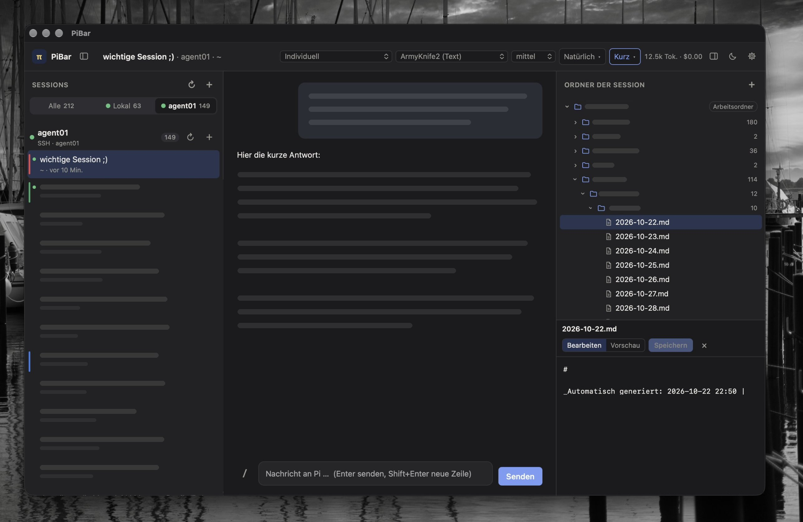
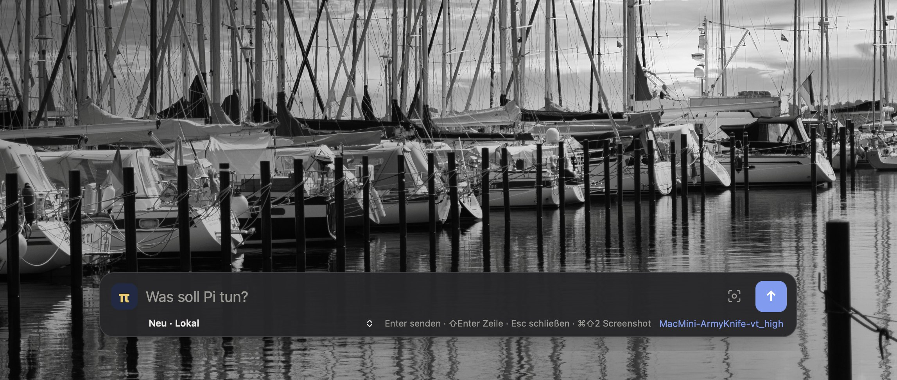

# PiBar

Desktop-Oberfläche für den [Pi Coding Agent](https://pi.dev): Sessions links, Chat in der Mitte, Markdown-Dateien
rechts, dazu eine Quick-Leiste, die man von überall per Doppeltipp öffnet.
Gebaut mit Tauri 2 (Rust-Kern + Web-Oberfläche), läuft auf macOS, Linux und Windows.

**Version 1.6.0** · [English](README.md) · [Mitarbeiten (englisch)](CONTRIBUTING.md) · [Codemap](docs/CODEMAP.md) ·
MIT-Lizenz

> Stand: Prototyp. Hauptziel ist macOS; Linux und Windows bauen, Doppeltipp, Bereichs-Screenshot und OCR gibt es bisher
> nur auf macOS.

## Screenshots





## Funktionen

### Chat

- Chat mit Pi, live gestreamt, Markdown und Code-Hervorhebung; ein runder Knopf sendet, stoppt Pi während der Arbeit
  oder reiht deine Nachricht ein, sobald du tippst
- Die Eingabe wächst mit dem Text bis sechs Zeilen, danach scrollt sie
- **Uhrzeit der Nachrichten**: Zeigst du auf eine Nachricht, erscheint, wann sie gesendet wurde („14:32“, „Gestern
  09:15“, ältere mit Datum; das volle Datum als Tooltip). Immer sichtbar: Ansicht-Menü → „Uhrzeiten immer anzeigen“
  (oder Einstellungen → Chat)
- Modell und Denkaufwand je Session oder ein gespeichertes Preset für beides; eine Nachricht direkt nach dem Wechsel
  wartet, bis Pi umgestellt hat; jede Antwort zeigt das Modell, das sie erzeugt hat (beim Überfahren). Die Wahl gehört
  zur Session: Sie kommt zurück, wenn du die Session wieder öffnest oder PiBar neu startest – bis du ein anderes
  Modell oder Preset wählst. Presets werden in den Einstellungen mit den Pfeilen ↑/↓ sortiert; die Reihenfolge gilt
  für Kopfzeile und Quick-Bar (erstes Preset = deren Vorgabe)
- **Ansicht** (Kopfzeile): _Natürlich_ (nur Pis Antworten – eine Antwort, die nur aus Toolaufrufen besteht oder ohne
  sichtbaren Text ist, verschwindet ganz), _Technisch_ (Denken und Toolaufrufe als kleine, zugeklappte Karten,
  Standard) oder _Debug_ (Karten offen, Tool-Ausgabe live). Die Ansicht gehört zur Session: Beim Wechsel zu
  einer anderen Session kommt deren Ansicht zurück, und Einstellungen → Chat legt fest, mit welcher neue Sessions
  starten
- **Antwortstil** (Kopfzeile): kurz, normal oder möglichst kurz mit technischen Details
- **Temperatur** (Kopfzeile): ein Schieberegler von 0 bis 1 mit kurzer Erklärung – niedrige Werte halten Pi präzise und
  nah an den Regeln, hohe machen es freier und kreativer. Der Wert gehört zur Session und übersteht einen Neustart;
  PiBar installiert dafür eine kleine Extension auf dem Host (ein Klick im Menü). Modelle, die Temperatur ablehnen
  (extended Thinking, manche Reasoning-Modelle), behalten ihren Standard
- **Plan / Build** (Kopfzeile): Der Planmodus beschränkt Pi auf nur lesende Tools (read, grep, find, ls) und bittet um
  einen nummerierten Plan statt Änderungen; Build gibt die eigenen Tools der Session zurück. Die Wahl gehört zur
  Session und übersteht einen Neustart; beim Wechsel startet Pi in derselben Session neu, der Verlauf bleibt
- **Schnellwahl**: kleine Buttons unten rechts im Chat – ein Befehl/eine Nachricht geht an die Session (Slash-Befehle
  gehen auch), ein Shell-Skript läuft in einem neuen Terminal-Tab im Ordner der Session. Verwaltet unter Einstellungen
  → Schnellwahl (hinzufügen, bearbeiten, entfernen, verschieben); die Buttons ändern sich sofort
- **Subagents**: unter einer Session in der linken Spalte, eingerückt und einklappbar – die Runs der Pi-Subagent-
  Extension live (Klick zeigt die Tool-Karte), und „Neuer Subagent …“ im Session-Menü startet eine eigene Kind-Session
  mit einer Agenten-Definition des Hosts (`~/.pi/agent/agents/*.md` oder `.pi/agents`: Tools, Modell, System-Prompt)
- **Werkzeugleiste** an der Eingabe: ein dezentes `+`; kommt die Maus in die Nähe, blenden weitere Knöpfe ein –
  **Dateien anhängen** (Textdateien und Bilder, auch per Drag & Drop oder Einfügen; als Chips über der Eingabe),
  **Screenshot**, **Skills** und **Tools**
- **Skills und Befehle**: `/` in der Eingabe tippen (oder über die Werkzeugleiste) zeigt Skills, Prompt-Vorlagen und
  Erweiterungsbefehle der Session
- **Tools pro Session**: wählen, welche Pi-Tools (read, bash, edit, write, grep, find, ls) eine Session nutzen darf; Pi
  startet dafür in derselben Session neu, der Verlauf bleibt
- **Frühere Nachrichten**: unter jeder eigenen Nachricht – _bearbeiten und neu senden_ (direkt in der Nachricht), _ab
  hier neu ausführen_ oder _bis hierher zurück_ (das Gespräch springt auf den Stand nach dieser Nachricht und ihrer
  Antwort). _Bis hierher zurück_ stellt auch die Dateien wieder her: vor jeder Nachricht hält PiBar den Ordner als
  Git-Commit fest (nur eigene Objekte und Refs, Index und Historie bleiben unangetastet) und setzt die von Pi seither
  geänderten Dateien auf diesen Stand zurück – deine übrigen Änderungen bleiben, die Liste steht vorher im Dialog.
  Alles erst nach Bestätigung (_Abbrechen_ oder Esc lässt alles unverändert) und in einer neuen Verzweigung: die
  ursprüngliche Session bleibt immer erhalten. Direkt danach führt eine Leiste **Rückgängig** zur vorherigen Fassung
  zurück, Dateien inklusive. Außerdem _als neue Nachricht übernehmen_ oder _kopieren_. Das gewählte Modell bleibt beim
  Verzweigen.
- **Fragen mit Optionen**: endet eine Antwort mit einer Auswahlfrage, öffnet sich ein Dialog mit anhakbaren Optionen
  und einem Feld für eine eigene Antwort (auch für Dialoge von Pi-Erweiterungen)
- **Session-Liste geordnet**: Knopf im Kopf – sortieren nach letzter Aktivität, Erstellung, Name oder Ordner;
  Abschnitte nach Datum (heute, gestern, letzte 7 Tage, …), nach Ordner oder keine; ein Klick auf eine Überschrift klappt
  den Abschnitt zu. „Eigene Reihenfolge" macht die Liste zu deiner: eine Session dorthin ziehen, wo sie stehen soll
  (innerhalb ihres Hosts oder Projekts, auch in eine andere Gruppe) – dort bleibt sie
- **Nachrichten, während Pi arbeitet**: Enter reiht ein (Pi bekommt sie, wenn es fertig ist), ⌥Enter schiebt sie
  dazwischen (vor Pis nächstem Schritt); wartende Nachrichten bleiben über dem Eingabefeld sichtbar und lassen sich
  umstellen, zurückholen oder löschen
- **Chat-Farben** (Einstellungen): Farbprofile mit Hintergrund- und Textfarbe für Denken, Toolaufrufe, Antworten und
  eigene Nachrichten – getrennt für dunkel und hell, als Hex-Werte (`#2b3a55`) eingetragen; ein Profil pro Host, so
  kann jeder Server anders aussehen
- **Läufe im Hintergrund**: Rechtsklick auf den Senden-Knopf (oder ⇧⌘↩) schickt die Nachricht als abgekoppelten Lauf
  auf den Host, sie läuft also weiter, wenn du das Notebook zumachst oder PiBar beendest; „Immer im Hintergrund senden"
  (gleiches Menü) oder die Einstellung machen das für jede Nachricht. Der Chat folgt dem Lauf, die Antwort steht in der
  Session, wenn du zurückkommst; der Senden-Knopf stoppt ihn, das Session-Menü hat „Lauf im Hintergrund stoppen". Der
  Lauf nimmt Modell und Denkaufwand der Session mit und antwortet so mit demselben Modell wie auf dem Schirm; die
  kleine Ecke am Senden-Knopf ist der Hinweis auf sein Menü.
  Solange der Modus an ist, steht neben dem Eingabefeld die Plakette „Im Hintergrund" (Klick schaltet ihn aus) und
  der Senden-Knopf hat einen gestrichelten Ring – so siehst du vor dem Senden, was die Nachricht tut
- **Einstellungen** (Zahnrad): links eine Abschnittsliste – Allgemein, Chat, Modelle & Presets, Schnellstart,
  Terminal, Quick-Launcher, Sprache & Audio, Chat-Farben, Session-Farben, Hosts; der Dialog öffnet sich wieder im zuletzt
  gewählten Abschnitt
- **Git-Verlauf**: Klick auf die Git-Zeile unter einem Ordner zeigt die Commits des Repositories (geänderte Dateien
  und Diff pro Commit, nicht gepushte mit ↑); Rechtsklick auf eine Datei → Verlauf zeigt die Commits dieser Datei
- **Auto-Scroll** mit drei Modi (Ansichts-Menü oben oder Einstellungen → Chat): _automatisch_ folgt der
  Antwort bis ans Ende und pausiert beim Hochscrollen, _immer_ erzwingt bei jeder Änderung das Ende, _aus_ scrollt nie
  von selbst (gut für schnelle Modelle); ⌘J springt ans Ende
- **Tastatur**: ⌘/ zeigt alle Kürzel – ⌘⇧N neue Session im selben Ordner, ⌘[ / ⌘] und ⌘1…9 wechseln Sessions, ⌘↑ holt
  die letzte eigene Nachricht zurück, ⌘L in die Eingabe, ⌘. stoppt; ⌘+ / ⌘− / ⌘0 machen die Schrift größer, kleiner
  oder wieder 100 % (Chat-Nachrichten, Listen und Spalten); Dialoge und Ordnerauswahl gehen per Tastatur
- **Versionen einer Nachricht**: wo sich Verzweigungen trennen, wechselt „‹ 2/3 ›“ unter der eigenen Nachricht
  zwischen den Versionen
- **Standardmodell** für neue Sessions: Stern in der Kopfzeile (übernimmt Modell und Denkaufwand bzw. Preset der
  aktuellen Session) oder Einstellungen → Modelle & Presets
- **Statuszeile unter der Eingabe**, wie Pis Fußzeile und mit Pis Zahlen: `↑` Eingabe, `↓` Ausgabe, `R` aus dem Cache
  gelesen (mit Anteil an der Eingabe in %), `W` in den Cache geschrieben, Kosten, belegter Kontext/Kontextfenster (orange
  ab 70 %, rot ab 90 %); rechts Modell und Denkaufwand. Beim Überfahren Tokens pro Sekunde, Zeit bis zum ersten Token und
  mehr

### Sprache

- **Diktieren** mit dem Mikrofon-Knopf im Hauptfenster und in der Quick-Leiste: OpenAI-kompatible API (OpenAI, Groq,
  lokale Whisper-Server) oder ein lokaler Befehl wie whisper.cpp
- **Text verbessern** mit einem zweiten LLM und eigenem Prompt (OpenAI-kompatibel: OpenAI, Ollama, LM Studio …), per
  Knopf oder automatisch nach dem Diktat
- **Vorlesen**: Lautsprecher-Knopf an jeder Antwort, Systemstimme oder API; auf Wunsch automatisch für alle Antworten
  oder nur für Antworten auf Nachrichten aus der Quick-Leiste

### Sessions

- **Aktivität auf einen Blick**: Eine Session, in der Pi arbeitet, zeigt einen Kreisel und „arbeitet · Werkzeug“; eine,
  die fertig wurde, während du woanders warst, ist mit „Fertig“ (oder „Fehler“) markiert, bis du sie öffnest. Zähler an
  jedem Host und Host-Reiter, die Zahl fertiger Sessions am App-Symbol und eine Mitteilung, wenn PiBar im Hintergrund
  ist (in den Einstellungen abschaltbar)
- Linke Spalte nach Host gruppiert (lokal und SSH), je eine zuklappbare Karte pro Host und pro Projekt; am Griff im
  Kopf lässt sich eine Karte nach oben oder unten ziehen, zugeklappte Karten bleiben nach einem Neustart zu. Starten
  (auf Wunsch gleich mit Namen), öffnen, Verlauf laden, mehrere Sessions parallel
- **Schnellstart** (Einstellungen → Schnellstart): bis zu vier Presets mit Name und festem Ordner stehen als Chips
  oben im Dialog „Neue Session“ – ein Klick startet sofort eine Session in diesem Ordner; ein Chip ohne Ordner
  öffnet die Einstellungen, leere Zeilen bleiben verborgen
- **Ordnerauswahl** für den Arbeitsordner einer neuen Session und für weitere Ordner: durchsucht den Host (lokal und
  SSH), nach oben/Benutzerordner, neuer Ordner, auf Wunsch versteckte Ordner; „Als Standardordner merken“ belegt ihn für die nächste neue Session auf diesem Host vor (auch in der
  Quick-Bar)
- **Suche** (Feld über der Liste, ⌘F): Tippen filtert die Liste sofort nach Name und Ordner, und nach einer kurzen
  Pause wird jeder gezeigte Host nach Sessions gefragt, deren **Nachrichten** den Text enthalten – ein `grep` über
  seine Session-Dateien, lokal oder per SSH. Die Treffer stehen über den Hosts, mit der Rolle der Nachricht (Du, Pi,
  Tool) und einem Ausschnitt um die Fundstelle; ein Klick öffnet die Session. Esc oder × zeigt wieder alles
- **Aufräumen** (Archiv-Kiste neben ↻): verschiebt Sessions in eine zugeklappte Gruppe „Archiv“ am Ende der Liste –
  alle oder nur ältere, auf Wunsch auch gruppierte oder angepinnte; gelöscht wird nichts, die Meldung bietet
  „Rückgängig“
- **Projekte** (unter den Hosts): ein benannter Ordner auf einem Host – Sessions, deren Arbeitsordner darin liegt,
  erscheinen unter der Projektkarte statt in der Host-Liste, und `＋` startet eine neue Session direkt in diesem Ordner;
  ein Projekt kann ein festes **Inferenz-Preset** (Modell und Denkaufwand) tragen, mit dem jede dort gestartete Session
  beginnt – es steht neben dem Projektnamen –, und ein Projekt kann die **Chat-Ansicht** festlegen, mit der seine
  Sessions starten, damit technische Arbeit gleich mit Denken und Toolaufrufen aufgeht und ein Schreibprojekt schlicht
  bleibt; arbeitet eine Session im Projekt, zeigt der Projektkopf den Spinner und die Zähler und die Karte ist eingefärbt
  (auch bei zugeklapptem Projekt und für einen Hintergrund-Lauf, dessen Tab geschlossen ist); per Rechtsklick oder `⋯`
  umbenennen, Ordner, Preset, Ansicht oder das Projekt ändern bzw. löschen (die Sessions bleiben)
- **Ansichten der Liste** (Trichter in ihrer Kopfzeile): „Nur woran ich arbeite" zeigt über alle Hosts die Sessions,
  die gerade aktiv sind – Pi arbeitet darin (auch als Hintergrund-Lauf), eine Antwort ist ungelesen, oder der Tab ist
  geöffnet; dazu je eine Ansicht pro Farbe und „ohne Farbe", kombinierbar mit der Arbeits-Ansicht. Ein Chip über der
  Liste nennt die Ansicht und schaltet sie ab; die Wahl bleibt gespeichert
- **Ungelesen**: Rechtsklick → „Als ungelesen markieren" (oder ⇧⌘U für die Session auf dem Bildschirm) hält eine
  Session im Blick, bis du sie öffnest: Akzentbalken links, kräftigere Tönung, Titel in der Akzentfarbe, Plakette
  „ungelesen". Ein Lauf, der fertig wird, während du woanders hinschaust, bekommt dieselbe Markierung – und sie bleibt
  über einen Neustart von PiBar erhalten: Zeile und ✓-Zähler an Host, Projekt und Gruppe sind nach dem Start wieder da.
  Ein Punkt vor
  Host oder Projekt erscheint nur, wenn es etwas zu melden gibt – nicht erreichbar (rot) oder prüft (gelb);
  „verbunden" braucht keinen Punkt. Überfahre den Namen für den Verbindungszustand. Sessions tragen keinen
  Status-Punkt, sie sagen „arbeitet" in Worten
- **Ordnen** per Rechtsklick oder `⋯`: umbenennen (auch F2), oben anpinnen, farbig markieren, in farbige, zuklappbare
  Gruppen verschieben
- **Session-Farben** (Einstellungen): eine kurze Beschreibung je Farbe (1–3 Worte, z. B. „Dringend“); sie erscheint als
  Tooltip an Farbe, Session, Gruppe und Terminal-Tab und als Legende im Farbmenü – leer bleibt der Farbname
- **Drag & Drop**: Sessions auf eine Gruppe ziehen oder auf die Felder unter der Liste (anpinnen, ohne Gruppe, neue
  Gruppe)
- **Mehrfachauswahl** mit ⌘-Klick und ⇧-Klick: mehrere Sessions auf einmal verschieben, färben, anpinnen, schließen
  oder löschen (Leiste unten oder Rechtsklick)
- **Löschen** (Rechtsklick, Leiste oder ⌫) nach einer Rückfrage mit Liste der Sessions; die Session-Dateien auf dem
  Host werden entfernt
- **Erinnerungen**: in 1 Std., 3 Std., heute Abend, morgen, nächste Woche oder eigene Zeit, mit Notiz; fällige
  Erinnerungen stehen oben links und kommen als Systemmitteilung
- **Schließen** (× beim Überfahren oder ⌘W): der Pi-Prozess endet, die Session-Datei bleibt
- Host-Umschalter „Alle / Lokal / weitere Hosts“: der Chat springt auf die Session zurück, die du auf diesem Host zuletzt offen hattest

### Dateien

- Rechte Spalte: Ordner der Session als Baum mit **allen Dateien** (Filter-Knopf: nur Markdown, HTML und Bilder);
  von Pi in der Session geänderte Dateien sind mit ✎ markiert. Dateien und Ordner anlegen (`+`), Textdateien lesen,
  bearbeiten und speichern (⌘S), Markdown-Vorschau; **HTML**-Dateien öffnen gerendert (abgeschottet: keine Skripte, keine Dateien aus dem
  Netz), **Bilder** (PNG, JPEG, GIF, WebP) werden angezeigt
- **Diff-Ansicht** neben Bearbeiten und Vorschau: Änderungen gegenüber dem letzten Git-Commit oder der gespeicherten
  Datei, inklusive ungespeicherter Änderungen (+/−-Zeilen, 3 Zeilen Kontext); Rechtsklick auf eine Datei → Änderungen
  anzeigen
- **Kontext**: Ordner oder Datei aus dem Baum in die Eingabe ziehen oder Rechtsklick → Zum Kontext hinzufügen; Pi
  bekommt den Pfad und liest mit seinen Werkzeugen, was es braucht
- **Upload**: Dateien beliebigen Typs (z. B. PDF) vom eigenen Rechner in einen Ordner des Baums – „+“ oder
  Rechtsklick → „Dateien hochladen …“, oder auf einen Ordner ziehen (auch über SSH, max. 50 MB pro Datei);
  vorhandene Dateien werden erst nach Rückfrage überschrieben, und der „Nur Markdown“-Filter schaltet sich ab,
  damit die Uploads sichtbar sind
- **Löschen**: Rechtsklick auf eine Datei oder einen Ordner → „Löschen …“ – zwei Rückfragen, die zweite mit einer
  Checkbox („Ich weiß, dass das nicht rückgängig gemacht werden kann“); Ordner samt Inhalt, ein Symlink verliert nur
  den Link. Die Wurzelordner der Session werden nie gelöscht (nur aus der Session entfernt), lokal und über SSH
- Verschiebbarer Trenner zwischen Baum und Editor; Ordner, die es auf dem Host nicht gibt, lassen sich mit einem Klick
  anlegen
- Optional **Git-Status** (Einstellungen → Chat): für den Session-Ordner und für Repositories in seinen
  Unterordnern Branch, nicht gepushte (↑) oder zu holende Commits (↓) und Änderungen; ein kleiner Buchstabe an
  geänderten Dateien (M, A, U, D)
- **Neu laden** (↻ im Kopf der Spalte oder ⌘⇧R): Baum, Git-Status und die offene Datei (wenn unverändert); auch
  automatisch nach jeder Antwort und wenn man zu PiBar zurückkehrt

### Layout

- Helles, dunkles oder automatisches Farbschema
- **Textgröße** für das ganze Fenster (Einstellungen → Allgemein, oder ⌘+ / ⌘− / ⌘0): Chat-Nachrichten, Listen und
  Spalten wachsen und schrumpfen zusammen; die Größe bleibt gemerkt
- Seitenleisten: am Rand in der Breite ziehen (Doppelklick: Standardbreite), mit ⌘B / ⌥⌘B ausblenden
- Funktioniert auf halbem Bildschirm: in schmalen Fenstern schweben die Seitenleisten über dem Chat
- **Terminal** ganz unten, unter der Eingabe (Knopf in der Kopfzeile der Dateispalte oder ⌘⌥J): eine echte Shell in
  einem Pty, ein Tab pro Shell, lokal oder im Ordner der Session auf dem SSH-Host; Höhe per Ziehen, wird gemerkt.
  Ein Tab kann zu seiner Session gehören und trägt dann deren Namen und Farbe; beides optional (Einstellungen →
  Terminal): eine Shell pro Session und das Mitwechseln beim Session-Wechsel
- Menüleisten-Symbol: PiBar öffnen, Quick-Leiste, Beenden; Fenster schließen = ausblenden, der Hotkey bleibt aktiv
- Englisch und Deutsch, automatisch nach Systemsprache oder fest in den Einstellungen

### Quick-Leiste

- Doppeltipp ⌥⌥ (macOS, Taste wählbar) oder ⌥⇧Leertaste (änderbar in den Einstellungen)
- Breite Eingabezeile; Ziel darunter: aktuelle Session, neue Session auf einem Host, angepinnte oder letzte Sessions
- Preset oder Modell und Denkaufwand, minimalistisch; bei einer bestehenden Session bleibt deren Modell, außer man wählt
  eins
- Mikrofon- und Verbessern-Knopf (wenn in den Einstellungen eingerichtet)
- Dateien anhängen: Büroklammer (Bilder und Textdateien, auch per Einfügen)
- Screenshot: Kamera-Symbol oder ⌘⇧2 = Bereich ziehen, ⇧-Klick = ganzer Bildschirm; senden als **Bild**, **Text (OCR)**
  oder **beides**
- Verschiebbar; die Position wird gemerkt

Noch nicht drin: Kurzantwort direkt in der Leiste, J-Tracker, herdr.

## KI und Datenschutz

PiBar selbst schickt keine Daten irgendwohin: Es spricht nur mit Pi auf deinen eigenen Rechnern, lokal oder per SSH.
Welches Modell deine Prompts, Dateiinhalte und Tool-Ausgaben sieht, legt Pis Konfiguration auf dem jeweiligen Host
fest. Ein lokales Modell (z. B. auf einem LLM-Server im eigenen Netz) hält alles im Haus; ein Cloud-Modell bekommt,
was die Session ihm schickt.

Was in PiBar zu sehen ist, kommt bereinigt an: Markdown von einem Modell wird saniert (keine Stile, keine Formulare,
keine eingebetteten Frames, keine Bilder aus dem Netz), und beide Fenster laufen unter einer Content Security
Policy – die App selbst lädt nichts aus dem Netz; HTML-Vorschauen eigener Dateien sind ebenso abgeschottet.

**Gemeinsame Skills mit Syncthing.** Lege `~/.pi/agent/skills/`, `prompts/` und, falls genutzt, `extensions/` in
einen [Syncthing](https://syncthing.net)-Ordner. Er synchronisiert direkt zwischen deinen Rechnern, ohne Cloud-Dienst
dazwischen, so hat jeder Host dieselben Skills und Slash-Befehle. Nicht synchronisieren: `auth.json` (API-Keys,
OAuth-Tokens), den Ordner `sessions/` und `trust.json` – Zugangsdaten und Gespräche bleiben auf dem Rechner, zu dem
sie gehören. Erweiterungen vor dem Teilen prüfen, sie laufen im Pi-Prozess.

**Arbeit auf dedizierte VMs verteilen.** Ein Agent erreicht nur, was sein Rechner erreicht. Statt eines Pi mit
Zugriff auf alles bekommt jeder Zweck eine eigene VM (oder einen eigenen Host) mit genau den Rechten, die er braucht,
und jede wird in PiBar als Host eingetragen:

- eine Coding-VM mit den Projekt-Repositories, aber ohne private Dokumente oder Mails
- eine VM für Notizen und Dokumente, ohne SSH-Schlüssel zu Servern und ohne Push-Rechte auf Repositories
- ein lokaler LLM-Server ohne Internetzugang für alles, was das Haus nicht verlassen darf
- der eigene Rechner nur für Arbeit, die wirklich dort passieren soll

Pro VM: eigener Linux-Benutzer und SSH-Schlüssel, eigene, eng begrenzte API-Keys, Snapshots vor größeren Änderungen.
In PiBar lassen sich zusätzlich Pis Tools pro Session einschränken (Tool-Leiste → Tools). Passiert eine
Prompt-Injection oder ein falscher Befehl, bleibt der Schaden in dieser einen VM.

## Spracheinstellungen

Zahnrad → **Sprache & Audio**. Jeder Teil ist optional.

| Teil | Auswahl |
| --- | --- |
| Diktieren | Aus · OpenAI-kompatible API (Basis-URL, Schlüssel, Modell z. B. `whisper-1`, Sprache) · lokaler Befehl mit `{file}` |
| Vorlesen | Systemstimme (optional Stimmenname) · OpenAI-kompatible API (Modell z. B. `gpt-4o-mini-tts`, Stimme) |
| Textverbesserung | Basis-URL, Schlüssel, Modell und Prompt (leer = eingebauter Prompt); „automatisch nach dem Diktat verbessern“ |

API-Schlüssel liegen nur in der lokalen Einstellungsdatei der App, nie im Repository. Anfragen laufen über `curl`; der
Schlüssel wird über stdin übergeben, nicht auf der Kommandozeile.

## Wenn etwas nicht geht

Fehler im Chat wie „Connection error“ haben einen Knopf **Diagnose** (auch pro Host in den Einstellungen). Er läuft auf
dem Host mit denselben Rechten und derselben Umgebung wie Pi und zeigt Pis eigene Fehlerausgabe, die Pi- und
Node-Version, relevante Umgebungsvariablen (Geheimnisse verborgen), Pis Modell-Konfiguration, die in Pis
Konfiguration und Erweiterungen gefundenen Serveradressen, ob sie erreichbar sind (per curl und Node wie Pi) und das
Ergebnis einer kurzen Test-Anfrage über Pi – dazu Hinweise auf typische Ursachen in Klartext (Freigabe „Lokales Netzwerk“, Server läuft nicht,
API-Schlüssel fehlt, Proxy). „Bericht kopieren“ legt alles in die Zwischenablage.

Wurde Pi auf einem Host aktualisiert oder entfernt, während eine Session lief, sagt der Chat genau das und bietet
**Session neu starten** – Session-Datei und Verlauf bleiben erhalten.

## macOS-Rechte

- **Lokales Netzwerk**: macOS sperrt bei selbst gebauten Apps Adressen im lokalen Netz oft ohne Nachfrage (Chats mit
  Modellservern im LAN scheitern dann mit „Connection error“). PiBar startet Pi, SSH und curl deshalb als eigenständige
  Programme, die wie aus dem Terminal gestartet behandelt werden. Falls es trotzdem auftritt: Systemeinstellungen →
  Datenschutz & Sicherheit → Lokales Netzwerk → PiBar einschalten.
- **Umgebung**: Eine aus dem Finder gestartete App sieht keine Variablen aus `~/.zshrc` (API-Schlüssel, Basis-URLs von
  Modellservern, Proxys). PiBar liest die Umgebung deiner interaktiven Shell einmal beim Start ein und gibt sie an
  lokale Pi-Sessions weiter, damit sie sich wie im Terminal verhalten.
- **Mikrofon** (Diktieren): macOS fragt bei der ersten Aufnahme. Systemeinstellungen → Datenschutz & Sicherheit →
  Mikrofon.
- **Bildschirmaufnahme**: macOS fragt beim ersten Screenshot. Im Entwicklungsmodus gilt die Freigabe für das Terminal,
  aus dem du `npm run dev:app` startest. Systemeinstellungen → Datenschutz & Sicherheit → Bildschirmaufnahme.
- **Eingabeüberwachung** (für den Doppeltipp): macOS fragt beim ersten Start. Im Entwicklungsmodus gilt sie für das
  Terminal. Systemeinstellungen → Datenschutz & Sicherheit → Eingabeüberwachung. Danach PiBar neu starten. Ist der
  Schalter an, der Doppeltipp reagiert aber nicht: PiBar dort entfernen (−), wieder hinzufügen und PiBar neu starten.
- **Berechtigungen und Neubauen**: macOS bindet Berechtigungen an die Code-Signatur, und jede selbst gebaute Version
  bekommt eine neue. `npm run app:install` setzt deshalb standardmäßig die alten Berechtigungen zurück, und macOS fragt
  nach jedem Neubau erneut. Optional, siehe unten: eine gleichbleibende lokale Signatur, damit Berechtigungen ein
  Neubauen überstehen.
- **Quick-Bar öffnet nicht**: PiBar meldet beim Start, wenn das Tastenkürzel belegt ist (von einer anderen App oder
  einem PiBar, das noch im Terminal läuft) oder dem Doppeltipp die Berechtigung fehlt; Menüleisten-Symbol →
  Quick-Launcher geht immer.
- **OCR** nutzt Apples Texterkennung (Vision). Beim ersten Mal baut PiBar dafür ein kleines Hilfsprogramm mit den
  Xcode-Werkzeugen, einmalig 20–40 Sekunden.

## Einmalig einrichten (macOS)

```bash
# 1. Xcode Command Line Tools (vollständiges Xcode ist nicht nötig)
xcode-select --install

# 2. Rust
curl --proto '=https' --tlsv1.2 -sSf https://sh.rustup.rs | sh

# 3. Node.js 20+ (z.B. von nodejs.org oder: brew install node)

# 4. Pi
npm install -g @earendil-works/pi-coding-agent
pi            # einmal starten und Anbieter/API-Key einrichten
```

Für einen Server per SSH (Beispiel-Alias `mein-server` in `~/.ssh/config`): Pi dort genauso installieren und
einrichten. Dann prüfen, dass SSH ohne Passwortabfrage klappt:

```bash
ssh mein-server pi --version
```

## Als App installieren (macOS)

```bash
git clone https://github.com/DJ-Soft-creator/pibar.git
cd pibar
npm install
npm run app:install
```

`app:install` installiert die Abhängigkeiten, baut die Release-Version, beendet ein laufendes PiBar, kopiert `PiBar.app` nach `/Programme` und startet
sie. Zum Aktualisieren nach `git pull` einfach erneut ausführen. Einstellungen, Hosts und Gruppen bleiben erhalten (sie
liegen im Konfigurationsordner der App). macOS fragt Mikrofon, Bildschirmaufnahme und Eingabeüberwachung noch einmal ab,
jetzt für PiBar selbst statt fürs Terminal. Beim Anmelden starten: Systemeinstellungen → Allgemein → Anmeldeobjekte →
PiBar hinzufügen.

### Optional: gleichbleibende Signatur (`PIBAR_SIGN=1`)

```bash
PIBAR_SIGN=1 npm run app:install
```

Legt einmalig ein eigenes Zertifikat „PiBar Local Signing“ im Anmelde-Schlüsselbund an und signiert PiBar damit. Dann
behält macOS die Berechtigungen (Eingabeüberwachung, Mikrofon, Bildschirmaufnahme, lokales Netzwerk) über Neubauten
hinweg. Es ist nicht deine Apple-ID und kein Apple-Entwicklerzertifikat; vertraut wird ihm nur für Code-Signatur und
nur für deinen Benutzer. Entfernen: `security delete-certificate -c "PiBar Local Signing"`.

> **Hinweis zu Passwortabfragen.** PiBar und sein Installationsskript lesen, sammeln oder versenden keine Passwörter und
> keine persönlichen Daten – alles, was sie tun, steht in [`scripts/install-mac.sh`](scripts/install-mac.sh) und lässt
> sich nachprüfen. Ohne `PIBAR_SIGN=1` wird der Schlüsselbund gar nicht angefasst. Mit `PIBAR_SIGN=1` fragt **macOS
> selbst** eventuell nach dem Passwort des Anmelde-Schlüsselbunds (um das Zertifikat abzulegen, ihm für Code-Signatur zu
> vertrauen oder wenn `codesign` es benutzt); PiBar sieht dieses Passwort nie. Das Schlüsselbund-Passwort ist meist dein
> Mac-Anmeldepasswort, kann aber abweichen (z. B. nachdem das Anmeldepasswort zurückgesetzt wurde). Im Zweifel die
> Abfrage abbrechen: Das Skript installiert PiBar dann ohne gleichbleibende Signatur, sonst ändert sich nichts.

Nur bauen, ohne zu installieren: `npm run app:build` (`.app` unter `src-tauri/target/release/bundle/macos/`); zusätzlich
mit `.dmg`: `npm run tauri build`.

## Entwicklungsmodus

```bash
npm run dev:app
```

Läuft aus dem Terminal, Oberfläche mit Live-Reload. Der erste Start kompiliert den Rust-Teil und dauert ein paar
Minuten. Vorher die installierte App beenden, sonst belegen beide denselben Hotkey.

## Hosts einstellen

Zahnrad oben rechts. Vorbelegt ist „Lokal“; weitere mit „+ Host hinzufügen“ (Typ SSH, Alias aus `~/.ssh/config`).

| Feld | Bedeutung |
| --- | --- |
| SSH-Host / Alias | Eintrag aus `~/.ssh/config` oder Hostname |
| Pi-Befehl | Standard `pi`. Falls Pi nicht gefunden wird: vollen Pfad eintragen, z.B. `/opt/homebrew/bin/pi` |
| Standard-Ordner | Vorauswahl für neue Sessions |

„Verbindung testen“ zeigt die Pi-Version des Hosts.

## Ohne API-Key testen

`dev/fake-pi.mjs` simuliert Pi (Streaming, Denken, Toolaufruf, Modellliste). Als Pi-Befehl eines Hosts eintragen:

```
node /voller/pfad/zu/pibar/dev/fake-pi.mjs
```

## Lizenz

[MIT](https://github.com/DJ-Soft-creator/pibar/blob/main/LICENSE)
