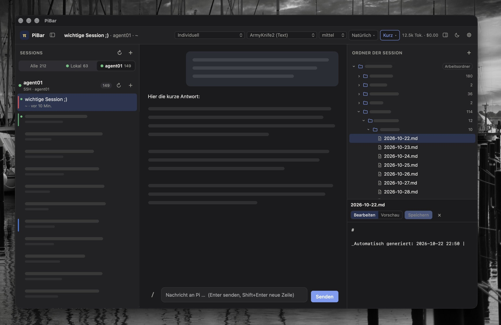
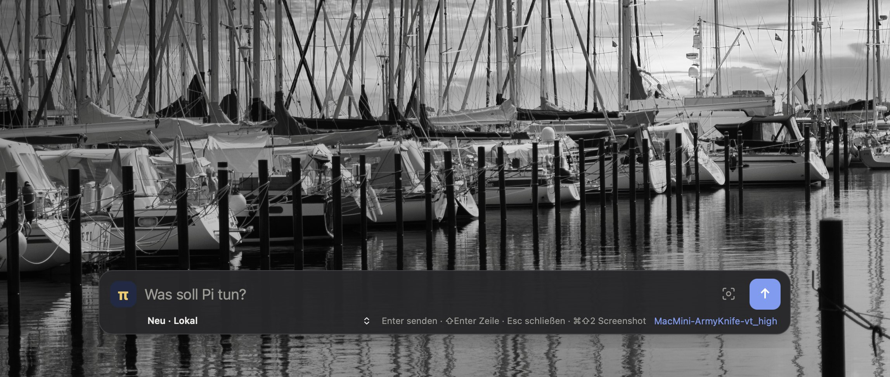

# PiBar

Desktop-Oberfläche für den [Pi Coding Agent](https://pi.dev): Sessions links, Chat in der Mitte, Markdown-Dateien
rechts, dazu eine Quick-Leiste, die man von überall per Doppeltipp öffnet.
Gebaut mit Tauri 2 (Rust-Kern + Web-Oberfläche), läuft auf macOS, Linux und Windows.

[English](README.md) · [Mitarbeiten (englisch)](CONTRIBUTING.md) · [Codemap](docs/CODEMAP.md) · MIT-Lizenz

> Stand: Prototyp. Hauptziel ist macOS; Linux und Windows bauen, Doppeltipp, Bereichs-Screenshot und OCR gibt es bisher
> nur auf macOS.

## Screenshots





## Funktionen

### Chat

- Chat mit Pi, live gestreamt, Markdown und Code-Hervorhebung; stoppen und nachsteuern, während Pi arbeitet
- Modell und Denkaufwand je Session oder ein gespeichertes Preset für beides
- **Ansicht** (Kopfzeile): _Natürlich_ (nur Antworten), _Technisch_ (Denken und Toolaufrufe als kleine, zugeklappte
  Karten, Standard) oder _Debug_ (Karten offen, Tool-Ausgabe live)
- **Antwortstil** (Kopfzeile): kurz, normal oder möglichst kurz mit technischen Details
- **Skills und Befehle**: `/` in der Eingabe tippen (oder auf `/` klicken) zeigt Skills, Prompt-Vorlagen und
  Erweiterungsbefehle der Session
- **Token-Statistik**: Tokens, Kosten und Geschwindigkeit in der Kopfzeile; beim Überfahren Ein-/Ausgabe-/Cache-Tokens,
  Tokens pro Sekunde, Zeit bis zum ersten Token und Kontextbelegung

### Sprache

- **Diktieren** mit dem Mikrofon-Knopf im Hauptfenster und in der Quick-Leiste: OpenAI-kompatible API (OpenAI, Groq,
  lokale Whisper-Server) oder ein lokaler Befehl wie whisper.cpp
- **Text verbessern** mit einem zweiten LLM und eigenem Prompt (OpenAI-kompatibel: OpenAI, Ollama, LM Studio …), per
  Knopf oder automatisch nach dem Diktat
- **Vorlesen**: Lautsprecher-Knopf an jeder Antwort, Systemstimme oder API; auf Wunsch automatisch für alle Antworten
  oder nur für Antworten auf Nachrichten aus der Quick-Leiste

### Sessions

- Linke Spalte nach Host gruppiert (lokal und SSH); starten, öffnen, Verlauf laden, mehrere Sessions parallel
- **Ordnen** per Rechtsklick oder `⋯`: umbenennen (auch F2), oben anpinnen, farbig markieren, in farbige, zuklappbare
  Gruppen verschieben
- **Drag & Drop**: Sessions auf eine Gruppe ziehen oder auf die Felder unter der Liste (anpinnen, ohne Gruppe, neue
  Gruppe)
- **Mehrfachauswahl** mit ⌘-Klick und ⇧-Klick: mehrere Sessions auf einmal verschieben, färben, anpinnen, schließen
  oder löschen (Leiste unten oder Rechtsklick)
- **Löschen** (Rechtsklick, Leiste oder ⌫) nach einer Rückfrage mit Liste der Sessions; die Session-Dateien auf dem
  Host werden entfernt
- **Erinnerungen**: in 1 Std., 3 Std., heute Abend, morgen, nächste Woche oder eigene Zeit, mit Notiz; fällige
  Erinnerungen stehen oben links und kommen als Systemmitteilung
- **Schließen** (× beim Überfahren oder ⌘W): der Pi-Prozess endet, die Session-Datei bleibt
- Host-Umschalter „Alle / Lokal / weitere Hosts“

### Dateien

- Rechte Spalte: Ordner der Session als Baum; Dateien und Ordner anlegen (`+`), `.md`-Dateien lesen, bearbeiten,
  Vorschau, speichern (⌘S)
- Verschiebbarer Trenner zwischen Baum und Editor; Ordner, die es auf dem Host nicht gibt, lassen sich mit einem Klick
  anlegen
- Optional **Git-Status** (Einstellungen → Allgemein): für den Session-Ordner und für Repositories in seinen
  Unterordnern Branch, nicht gepushte (↑) oder zu holende Commits (↓) und Änderungen; ein kleiner Buchstabe an
  geänderten Dateien (M, A, U, D)

### Layout

- Helles, dunkles oder automatisches Farbschema
- Seitenleisten: am Rand in der Breite ziehen (Doppelklick: Standardbreite), mit ⌘B / ⌥⌘B ausblenden
- Funktioniert auf halbem Bildschirm: in schmalen Fenstern schweben die Seitenleisten über dem Chat
- Menüleisten-Symbol: PiBar öffnen, Quick-Leiste, Beenden; Fenster schließen = ausblenden, der Hotkey bleibt aktiv
- Englisch und Deutsch, automatisch nach Systemsprache oder fest in den Einstellungen

### Quick-Leiste

- Doppeltipp ⌥⌥ (macOS, Taste wählbar) oder ⌥⇧Leertaste (änderbar in den Einstellungen)
- Breite Eingabezeile; Ziel darunter: aktuelle Session, neue Session auf einem Host, angepinnte oder letzte Sessions
- Preset oder Modell und Denkaufwand, minimalistisch
- Mikrofon- und Verbessern-Knopf (wenn in den Einstellungen eingerichtet)
- Screenshot: Kamera-Symbol oder ⌘⇧2 = Bereich ziehen, ⇧-Klick = ganzer Bildschirm; senden als **Bild**, **Text (OCR)**
  oder **beides**
- Verschiebbar; die Position wird gemerkt

Noch nicht drin: Kurzantwort direkt in der Leiste, J-Tracker, herdr.

## Spracheinstellungen

Zahnrad → **Sprache & Audio**. Jeder Teil ist optional.

| Teil | Auswahl |
| --- | --- |
| Diktieren | Aus · OpenAI-kompatible API (Basis-URL, Schlüssel, Modell z. B. `whisper-1`, Sprache) · lokaler Befehl mit `{file}` |
| Vorlesen | Systemstimme (optional Stimmenname) · OpenAI-kompatible API (Modell z. B. `gpt-4o-mini-tts`, Stimme) |
| Textverbesserung | Basis-URL, Schlüssel, Modell und Prompt (leer = eingebauter Prompt); „automatisch nach dem Diktat verbessern“ |

API-Schlüssel liegen nur in der lokalen Einstellungsdatei der App, nie im Repository. Anfragen laufen über `curl`; der
Schlüssel wird über stdin übergeben, nicht auf der Kommandozeile.

## macOS-Rechte

- **Mikrofon** (Diktieren): macOS fragt bei der ersten Aufnahme. Systemeinstellungen → Datenschutz & Sicherheit →
  Mikrofon.
- **Bildschirmaufnahme**: macOS fragt beim ersten Screenshot. Im Entwicklungsmodus gilt die Freigabe für das Terminal,
  aus dem du `npm run dev:app` startest. Systemeinstellungen → Datenschutz & Sicherheit → Bildschirmaufnahme.
- **Eingabeüberwachung** (für den Doppeltipp): macOS fragt beim ersten Start. Im Entwicklungsmodus gilt sie für das
  Terminal. Systemeinstellungen → Datenschutz & Sicherheit → Eingabeüberwachung. Danach PiBar neu starten.
- **OCR** nutzt Apples Texterkennung (Vision). Beim ersten Mal baut PiBar dafür ein kleines Hilfsprogramm mit den
  Xcode-Werkzeugen, einmalig 20–40 Sekunden.

## Einmalig einrichten (macOS)

```bash
# 1. Xcode Command Line Tools (vollständiges Xcode ist nicht nötig)
xcode-select --install

# 2. Rust
curl --proto '=https' --tlsv1.2 -sSf https://sh.rustup.rs | sh

# 3. Node.js 20+ (z.B. von nodejs.org oder: brew install node)

# 4. Pi
npm install -g @earendil-works/pi-coding-agent
pi            # einmal starten und Anbieter/API-Key einrichten
```

Für einen Server per SSH (Beispiel-Alias `mein-server` in `~/.ssh/config`): Pi dort genauso installieren und
einrichten. Dann prüfen, dass SSH ohne Passwortabfrage klappt:

```bash
ssh mein-server pi --version
```

## Als App installieren (macOS)

```bash
git clone https://github.com/DJ-Soft-creator/pibar.git
cd pibar
npm install
npm run app:install
```

`app:install` installiert die Abhängigkeiten, baut die Release-Version, beendet ein laufendes PiBar, kopiert `PiBar.app` nach `/Programme` und startet
sie. Zum Aktualisieren nach `git pull` einfach erneut ausführen. Einstellungen, Hosts und Gruppen bleiben erhalten (sie
liegen im Konfigurationsordner der App). macOS fragt Mikrofon, Bildschirmaufnahme und Eingabeüberwachung noch einmal ab,
jetzt für PiBar selbst statt fürs Terminal. Beim Anmelden starten: Systemeinstellungen → Allgemein → Anmeldeobjekte →
PiBar hinzufügen.

Nur bauen, ohne zu installieren: `npm run app:build` (`.app` unter `src-tauri/target/release/bundle/macos/`); zusätzlich
mit `.dmg`: `npm run tauri build`.

## Entwicklungsmodus

```bash
npm run dev:app
```

Läuft aus dem Terminal, Oberfläche mit Live-Reload. Der erste Start kompiliert den Rust-Teil und dauert ein paar
Minuten. Vorher die installierte App beenden, sonst belegen beide denselben Hotkey.

## Hosts einstellen

Zahnrad oben rechts. Vorbelegt ist „Lokal“; weitere mit „+ Host hinzufügen“ (Typ SSH, Alias aus `~/.ssh/config`).

| Feld | Bedeutung |
| --- | --- |
| SSH-Host / Alias | Eintrag aus `~/.ssh/config` oder Hostname |
| Pi-Befehl | Standard `pi`. Falls Pi nicht gefunden wird: vollen Pfad eintragen, z.B. `/opt/homebrew/bin/pi` |
| Standard-Ordner | Vorauswahl für neue Sessions |

„Verbindung testen“ zeigt die Pi-Version des Hosts.

## Ohne API-Key testen

`dev/fake-pi.mjs` simuliert Pi (Streaming, Denken, Toolaufruf, Modellliste). Als Pi-Befehl eines Hosts eintragen:

```
node /voller/pfad/zu/pibar/dev/fake-pi.mjs
```

## Lizenz

[MIT](https://github.com/DJ-Soft-creator/pibar/blob/main/LICENSE)
