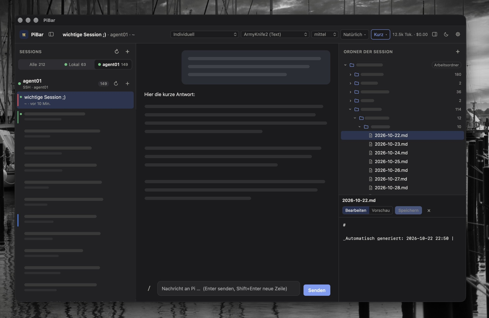
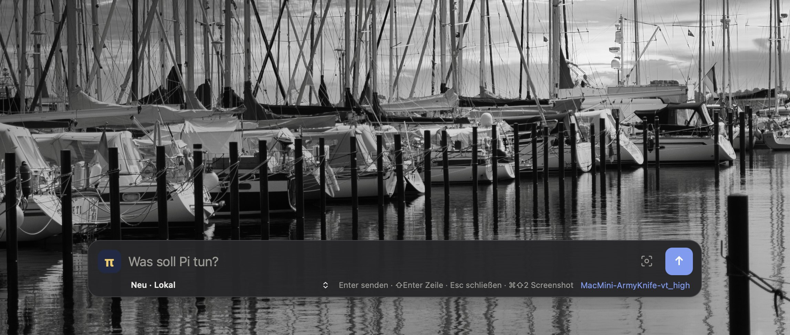

# PiBar

Desktop GUI for the [Pi coding agent](https://pi.dev): sessions on the left, chat in the middle, Markdown files on the
right, plus a quick bar you open from anywhere with a double tap.
Built with Tauri 2 (Rust core + web UI); runs on macOS, Linux and Windows.

**Version 1.4.0** · [Deutsch](README.de.md) · [Contributing](CONTRIBUTING.md) · [Codemap](docs/CODEMAP.md) · MIT
License

> Status: prototype. macOS is the main target; Linux and Windows build, but double tap, area screenshots and OCR are
> macOS only so far.

## Screenshots





## Features

### Chat

- Chat with Pi, streamed live, Markdown and code highlighting; one round button sends, stops Pi while it works, or
  steers it as soon as you type
- The input grows with the text up to six lines, then it scrolls
- **Message times**: pointing at a message shows when it was sent ("14:32", "Yesterday 09:15", older with date; the
  full date as tooltip). To see them always: View menu → "Always show message times" (or Settings → General → Chat)
- Model and thinking level per session, or a saved preset for both; a message sent right after a change waits until
  Pi has switched; each answer shows the model that produced it (on hover)
- **View** (header): _Natural_ (answers only), _Technical_ (thinking and tool calls as small collapsed cards, default)
  or _Debug_ (cards open, tool output live)
- **Answer style** (header): short, normal, or as short as possible with technical details
- **Tool dock** at the input: a quiet `+`; when the mouse comes near, more buttons fade in – **attach files** (text files
  and images, also by drag & drop or paste; shown as chips above the input), **screenshot**, **skills** and **tools**
- **Skills and commands**: type `/` in the input (or use the dock) for the session's skills, prompt templates and
  extension commands
- **Tools per session**: choose which of Pi's tools (read, bash, edit, write, grep, find, ls) a session may use; Pi
  restarts in the same session, the history stays
- **Earlier messages**: under each own message – _edit and resend_ (edit right in the message), _run again from here_
  or _go back to here_ (the conversation returns to the state after that message and its answer). Each of these only
  happens after you confirm (_Cancel_ or Esc leaves everything as it is) and works in a new branch: the original
  session always stays. Right after it an **Undo** bar takes you back to the previous version. Also _use as new
  message_ or _copy_
- **Default model** for new sessions: star in the header (takes the current session's model and thinking level or
  preset) or Settings → General
- **Status line under the input**, as in Pi's footer and with Pi's numbers: `↑` input, `↓` output, `R` cache read
  (with its share of the input in %), `W` cache write, cost, context used/window (orange above 70 %, red above 90 %);
  model and thinking level on the right. Hover for tokens per second, time to first token and more

### Voice

- **Dictate** with the microphone button in the main window and the quick bar: OpenAI-compatible API (OpenAI, Groq,
  local whisper servers) or a local command such as whisper.cpp
- **Improve text** with a second LLM and your own prompt (OpenAI-compatible: OpenAI, Ollama, LM Studio …), by button
  or automatically after dictation
- **Read aloud**: speaker button on every answer, system voice or API; optionally automatic for all answers or only
  for answers to quick bar messages

### Sessions

- **Activity at a glance**: a session where Pi is working shows a spinner and "working · tool"; one that finished while
  you looked elsewhere is marked "Done" (or "Error") until you open it. Counters at each host and host tab, the
  number of finished sessions on the app icon, and a system notification when PiBar is in the background (can be
  turned off in the settings)
- Left column grouped by host (local and SSH); start (optionally with a name right away), open, load history, several
  sessions in parallel
- **Folder picker** for the working folder of a new session and for extra folders: browses the host (local and SSH),
  up/home, new folder, hidden folders on request; "Remember as default folder" pre-fills it for the next new session
  on that host (also in the quick bar)
- **Tidy up** (archive box next to ↻): moves sessions into a collapsed "Archive" group at the end of the list – all or
  only older ones, optionally also grouped or pinned ones; nothing is deleted, and the message offers "Undo"
- **Organise** by right click or `⋯`: rename (also F2), pin to the top, colour, move into coloured, collapsible groups
- **Drag & drop** sessions onto a group, or onto the zones under the list (pin, no group, new group)
- **Multi-select** with ⌘-click and ⇧-click: move, colour, pin, close or delete several sessions at once (bar at the
  bottom or right click)
- **Delete** sessions (right click, bar or ⌫) after a confirmation listing them; the session files on the host are
  removed
- **Reminders**: in 1 h, 3 h, this evening, tomorrow, next week or a custom time, with a note; due reminders show at
  the top left and as a system notification
- **Close** (× on hover or ⌘W): the Pi process ends, the session file stays
- Host switcher "All / Local / other hosts"

### Files

- Right column: the session's folders as a tree; create files and folders (`+`), read, edit, preview and save `.md`
  files (⌘S)
- **Diff view** next to edit and preview: the changes against the last Git commit or against the saved file, including
  unsaved edits (+/− lines, 3 lines of context); right click on a file → Show changes
- **Context**: drag a folder or file from the tree into the input, or right click → Add to context; Pi gets the path
  and reads what it needs with its tools
- Draggable divider between tree and editor; folders that do not exist on the host can be created with one click
- Optional **Git status** (Settings → General): for the session folder and for repositories in its subfolders the
  branch, commits not pushed (↑) or to pull (↓) and changes; a small letter at changed files (M, A, U, D)

### Layout

- Light, dark or automatic colour scheme
- Side panels: resize by dragging the edge (double click: default width), hide with ⌘B / ⌥⌘B
- Works in half a screen: in narrow windows the side panels float over the chat
- Menu bar icon: open PiBar, quick bar, quit; closing the window hides it, the hotkey stays active
- English and German, automatic from the system language or set in the settings

### Quick bar

- Double tap ⌥⌥ (macOS, key selectable) or shortcut ⌥⇧Space (changeable in the settings)
- Wide input line; target below: current session, new session on a host, pinned or recent sessions
- Preset or model and thinking level, minimal
- Microphone and "improve" buttons (when set up in the settings)
- Screenshot: camera icon or ⌘⇧2 = drag an area, ⇧-click = whole screen; send as **image**, **text (OCR)** or **both**
- Movable; the position is remembered

Not yet: short answers directly in the bar, J-Tracker, herdr.

## Voice settings

Gear icon → **Voice**. Every part is optional.

| Part | Choices |
| --- | --- |
| Dictation | Off · OpenAI-compatible API (base URL, key, model e.g. `whisper-1`, language) · local command with `{file}` |
| Read aloud | System voice (optional voice name) · OpenAI-compatible API (model e.g. `gpt-4o-mini-tts`, voice) |
| Text improvement | Base URL, key, model and prompt (empty = built-in prompt); "improve automatically after dictation" |

API keys are stored only in the local settings file of the app, never in the repository. Requests go through `curl`;
the key is passed on stdin, not on the command line.

## When something fails

Chat errors such as "Connection error" have a **Diagnose** button (also per host in the settings). It runs on the host
with the same rights and environment as Pi and shows Pi's own error output, the Pi and Node versions, relevant
environment variables (secrets hidden), Pi's model configuration, server addresses found in Pi's configuration and
extensions, whether they can be reached (curl and Node, like Pi), and the result of a short test request through Pi – plus
plain hints for typical causes (local network permission, server not running, missing API key, proxy). "Copy report"
puts everything on the clipboard.

## macOS permissions

- **Local Network**: macOS often blocks addresses in the local network for self-built apps without asking (chats
  then fail with "Connection error" for model servers in the LAN). PiBar therefore starts Pi, SSH and curl as their own
  processes, so they are treated like programs started from the terminal. If it still happens: System Settings →
  Privacy & Security → Local Network → enable PiBar.
- **Environment**: an app started from the Finder does not see variables from `~/.zshrc` (API keys, base URLs of
  model servers, proxies). PiBar reads the environment of your interactive shell once at start and passes it to local
  Pi sessions, so they behave like in the terminal.
- **Microphone** (dictation): macOS asks on the first recording. System Settings → Privacy & Security → Microphone.
- **Screen Recording**: macOS asks on the first screenshot. In development mode the permission belongs to the terminal
  you start `npm run dev:app` from. System Settings → Privacy & Security → Screen Recording.
- **Input Monitoring** (for the double tap): macOS asks on first start. In development mode it belongs to the terminal.
  System Settings → Privacy & Security → Input Monitoring. Restart PiBar afterwards. If the switch is on but the double
  tap does not react: remove PiBar there (−), add it again and restart PiBar.
- **Permissions and rebuilds**: macOS ties permissions to the code signature, and every self-built version gets a new
  one. By default `npm run app:install` therefore resets the old permissions and macOS asks again after each rebuild.
  Optional, see below: a stable local signature, so permissions survive rebuilds.
- **Quick bar does not open**: PiBar shows a message at start if the shortcut is taken (by another app or by a PiBar
  still running from the terminal) or the double tap lacks the permission; the tray menu → Quick-Launcher always
  works.
- **OCR** uses Apple's text recognition (Vision). The first time, PiBar builds a small helper with the Xcode tools; this
  takes 20–40 seconds once.

## One-time setup (macOS)

```bash
# 1. Xcode Command Line Tools (full Xcode is not needed)
xcode-select --install

# 2. Rust
curl --proto '=https' --tlsv1.2 -sSf https://sh.rustup.rs | sh

# 3. Node.js 20+ (e.g. from nodejs.org or: brew install node)

# 4. Pi
npm install -g @earendil-works/pi-coding-agent
pi            # start once and set up a provider / API key
```

For a server over SSH (example alias `my-server` in `~/.ssh/config`): install and set up Pi there the same way. Then
check that SSH works without a password prompt:

```bash
ssh my-server pi --version
```

## Install as an app (macOS)

```bash
git clone https://github.com/DJ-Soft-creator/pibar.git
cd pibar
npm install
npm run app:install
```

`app:install` installs the dependencies, builds the release version, quits a running PiBar, copies `PiBar.app` to `/Applications` and starts it.
Run it again after `git pull` to update. Settings, hosts and groups stay (they live in the app's config folder).
macOS asks once more for microphone, screen recording and input monitoring, now for PiBar itself instead of the
terminal. To start PiBar at login: System Settings → General → Login Items → add PiBar.

### Optional: stable signature (`PIBAR_SIGN=1`)

```bash
PIBAR_SIGN=1 npm run app:install
```

Creates once a certificate of its own, "PiBar Local Signing", in your login keychain and signs PiBar with it. Then
macOS keeps the permissions (input monitoring, microphone, screen recording, local network) across rebuilds. It is
not your Apple ID and not an Apple developer certificate; it is trusted for code signing only, for your user only. To
remove it: `security delete-certificate -c "PiBar Local Signing"`.

> **Note on password prompts.** PiBar and its install script do not read, collect or send any passwords or personal
> data – everything they do is in [`scripts/install-mac.sh`](scripts/install-mac.sh) and can be checked. Without
> `PIBAR_SIGN=1` the keychain is not touched at all. With it, **macOS itself** may ask for the password of the login
> keychain (to store the certificate, to trust it for code signing, or when `codesign` uses it); PiBar never sees that
> password. The keychain password is usually your Mac login password, but it can differ (e.g. after the login
> password was reset). If you are unsure, cancel the prompt: the script then installs PiBar without the stable
> signature, nothing else changes.

Only build without installing: `npm run app:build` (`.app` in `src-tauri/target/release/bundle/macos/`); with a
`.dmg` as well: `npm run tauri build`.

## Development mode

```bash
npm run dev:app
```

Runs from the terminal with live reload of the UI. The first start compiles the Rust part and takes a few minutes.
Quit the installed app first, otherwise both register the same hotkey.

## Hosts

Gear icon at the top right. "Local" is preset; add more with "+ Add host" (type SSH, alias from `~/.ssh/config`).

| Field | Meaning |
| --- | --- |
| SSH host / alias | Entry from `~/.ssh/config` or a host name |
| Pi command | Default `pi`. If Pi is not found: enter the full path, e.g. `/opt/homebrew/bin/pi` |
| Default folder | Preselected folder for new sessions |

"Test connection" shows the host's Pi version.

## Testing without an API key

`dev/fake-pi.mjs` simulates Pi (streaming, thinking, tool call, model list). Enter it as the Pi command of a host:

```
node /full/path/to/pibar/dev/fake-pi.mjs
```

## Architecture and contributing

- [Codemap](docs/CODEMAP.md): structure, flows, "where do I change what?", with checked code references
- [Architecture decisions](docs/adr/README.md)
- [Contributing](CONTRIBUTING.md): setup, `npm run check`, workflow, rules

In short: for each open session the app starts `pi --mode rpc` in the working folder, locally or via `ssh <host>`.
Commands and events flow as JSON lines over stdin/stdout. Nothing but Pi needs to be installed on the server.

## License

[MIT](https://github.com/DJ-Soft-creator/pibar/blob/main/LICENSE)
