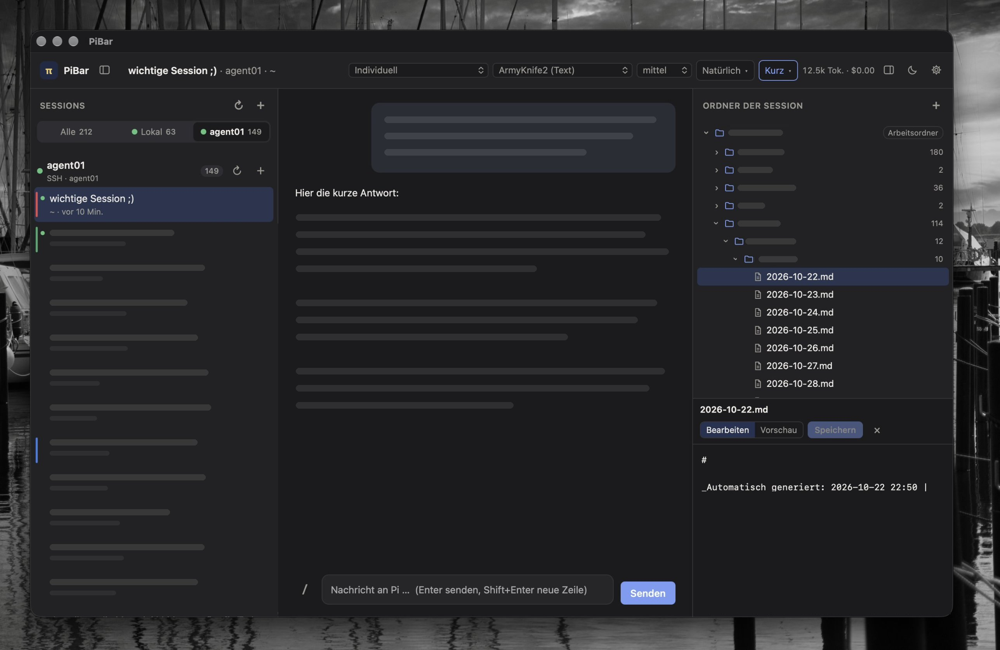
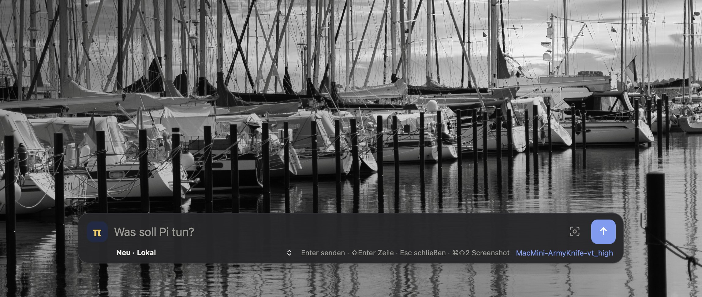

# PiBar

Desktop GUI for the [Pi coding agent](https://pi.dev): sessions on the left, chat in the middle, Markdown files on the
right, plus a quick bar you open from anywhere with a double tap.
Built with Tauri 2 (Rust core + web UI); runs on macOS, Linux and Windows.

**Version 1.6.0** · [Deutsch](README.de.md) · [Contributing](CONTRIBUTING.md) · [Codemap](docs/CODEMAP.md) · MIT
License

> Status: prototype. macOS is the main target; Linux and Windows build, but double tap, area screenshots and OCR are
> macOS only so far.

## Screenshots





## Features

### Chat

- Chat with Pi, streamed live, Markdown and code highlighting; one round button sends, stops Pi while it works, or
  queues your message as soon as you type
- The input grows with the text up to six lines, then it scrolls
- **Message times**: pointing at a message shows when it was sent ("14:32", "Yesterday 09:15", older with date; the
  full date as tooltip). To see them always: View menu → "Always show message times" (or Settings → Chat)
- Model and thinking level per session, or a saved preset for both; a message sent right after a change waits until
  Pi has switched; each answer shows the model that produced it (on hover). The choice belongs to the session: it
  comes back when you open the session again or restart PiBar, until you pick another model or preset. Presets are
  ordered with the up/down arrows in the settings; the order applies to the toolbar and the quick bar (first preset =
  its default)
- **View** (header): _Natural_ (only Pi's answers – an answer made purely of tool calls, or one without visible text,
  disappears completely), _Technical_ (thinking and tool calls as small collapsed cards, default) or _Debug_ (cards
  open, tool output live). The view belongs to the session: switching to another session brings back that session's
  view, and Settings → Chat sets the view new sessions start with
- **Answer style** (header): short, normal, or as short as possible with technical details
- **Temperature** (header): a slider from 0 to 1 with a short explanation – low keeps Pi precise and close to the
  rules, high makes it freer and more creative. The value belongs to the session and survives a restart; PiBar installs
  a small extension on the host for it (one click in the menu). Models that reject temperature (extended thinking,
  some reasoning models) keep their default
- **Plan / Build** (header): Plan mode restricts Pi to read-only tools (read, grep, find, ls) and asks for a numbered
  plan instead of changes; Build restores the session's own tools. The choice belongs to the session and survives a
  restart; Pi restarts in the same session when switching, the history stays
- **Quick actions**: small buttons at the bottom right of the chat – a command/message goes to the session (slash
  commands work too), a shell script runs in a new terminal tab in the session's folder. Managed in Settings → Quick
  actions (add, edit, remove, move); the buttons change right away
- **Subagents**: under a session in the left column, indented and collapsible – the runs of Pi's subagent extension
  live (a click shows the tool card), and "New subagent …" in the session menu starts a child session of its own with
  an agent definition of the host (`~/.pi/agent/agents/*.md` or `.pi/agents`: tools, model, system prompt)
- **Tool dock** at the input: a quiet `+`; when the mouse comes near, more buttons fade in – **attach files** (text files
  and images, also by drag & drop or paste; shown as chips above the input), **screenshot**, **skills** and **tools**
- **Skills and commands**: type `/` in the input (or use the dock) for the session's skills, prompt templates and
  extension commands
- **Tools per session**: choose which of Pi's tools (read, bash, edit, write, grep, find, ls) a session may use; Pi
  restarts in the same session, the history stays
- **Earlier messages**: under each own message – _edit and resend_ (edit right in the message), _run again from here_
  or _go back to here_ (the conversation returns to the state after that message and its answer). _Go back_ also puts
  the files back: before each message PiBar records the folder as a Git commit (only objects and refs of its own, your
  index and history stay untouched) and restores the files Pi changed since then to that state – your other changes
  stay, and the list is shown before anything happens. Each of these only happens after you confirm (_Cancel_ or Esc
  leaves everything as it is) and works in a new branch: the original session always stays. Right after it an **Undo**
  bar takes you back to the previous version, files included. Also _use as new message_ or _copy_. The model you chose
  stays when branching.
- **Questions with options**: when Pi ends an answer with a choice question, a dialog opens with the options to
  tick and a field for your own answer (also for dialogs of Pi extensions)
- **Session list in order**: button in the header – sort by last activity, creation, name or folder; sections by
  date (today, yesterday, last 7 days, …), by folder or none; a click on a section heading collapses it. "Own order"
  turns the list into your own: drag a session where you want it (within its host or project, into another group too)
  and it stays there
- **Messages while Pi works**: Enter queues the message (Pi gets it when done), ⌥Enter puts it in between (before
  Pi's next step); waiting messages stay visible above the input and can be switched, taken back or removed
- **Chat colours** (settings): colour profiles with background and text colour for thinking, tool calls, answers and
  your own messages – separately for dark and light, entered as hex values (`#2b3a55`); a profile per host, so each
  server can look different
- **Runs in the background**: right click the send button (or ⇧⌘↩) sends the message as a detached run on the host,
  so it keeps going when you close the laptop or PiBar quits; "Always send in the background" (same menu) or the
  setting does it for every message. The chat follows the run, and the answer is in the session when you come back;
  the send button stops it, the session menu has "Stop the run in the background". The run takes the model and
  thinking level of the session with it, so it answers with the same model as on screen. The small corner mark on the
  send button is the hint for its menu. While the mode is on, a pill
  "In the background" sits next to the input (click it to switch off) and the send button has a dashed ring, so you
  see before sending what the message will do
- **Settings** (gear icon): a section list on the left – general, chat, models & presets, quick start, terminal,
  quick launcher, voice, chat colours, session colours, hosts; the dialog opens again in the section you used last
- **Git history**: click the Git line under a folder for the commits of the repository (changed files and diff per
  commit, not pushed ones marked ↑); right click on a file → History for the commits of that file
- **Auto scroll** with three modes (view menu in the header or Settings → Chat): _automatic_ follows the
  answer to the end and pauses when you scroll up, _always_ forces every change to the end, _off_ never scrolls by
  itself (good for fast models); ⌘J jumps to the end
- **Keyboard**: ⌘/ shows all shortcuts – ⌘⇧N new session in the same folder, ⌘[ / ⌘] and ⌘1…9 switch sessions,
  ⌘↑ takes your last message back, ⌘L into the input, ⌘. stop; ⌘+ / ⌘− / ⌘0 make the text bigger, smaller or 100 %
  again (chat messages, lists and panels alike); dialogs and the folder picker work with the keyboard
- **Versions of a message**: where branches part, "‹ 2/3 ›" under your message switches between the versions
- **Default model** for new sessions: star in the header (takes the current session's model and thinking level or
  preset) or Settings → Models & presets
- **Status line under the input**, as in Pi's footer and with Pi's numbers: `↑` input, `↓` output, `R` cache read
  (with its share of the input in %), `W` cache write, cost, context used/window (orange above 70 %, red above 90 %);
  model and thinking level on the right. Hover for tokens per second, time to first token and more

### Voice

- **Dictate** with the microphone button in the main window and the quick bar: OpenAI-compatible API (OpenAI, Groq,
  local whisper servers) or a local command such as whisper.cpp
- **Improve text** with a second LLM and your own prompt (OpenAI-compatible: OpenAI, Ollama, LM Studio …), by button
  or automatically after dictation
- **Read aloud**: speaker button on every answer, system voice or API; optionally automatic for all answers or only
  for answers to quick bar messages

### Sessions

- **Activity at a glance**: a session where Pi is working shows a spinner and "working · tool"; one that finished while
  you looked elsewhere is marked "Done" (or "Error") until you open it. Counters at each host and host tab, the
  number of finished sessions on the app icon, and a system notification when PiBar is in the background (can be
  turned off in the settings)
- Left column grouped by host (local and SSH), one collapsible card per host and per project; the grip in a header
  moves a card up or down, and collapsed cards stay collapsed after a restart. Start (optionally with a name right
  away), open, load history, several sessions in parallel
- **Quick start** (Settings → Quick start): up to four presets with a name and a fixed folder each sit as chips at the
  top of the "New session" dialog – one click starts a session right away in that folder; a chip with no folder opens
  the settings, empty rows stay hidden
- **Folder picker** for the working folder of a new session and for extra folders: browses the host (local and SSH),
  up/home, new folder, hidden folders on request; "Remember as default folder" pre-fills it for the next new session
  on that host (also in the quick bar)
- **Search** (field above the list, ⌘F): typing filters the list by name and folder at once, and after a short pause
  each shown host is asked for sessions whose **messages** contain the text – one `grep` over its session files, local
  or over SSH. The hits appear above the hosts with the role of the message (You, Pi, Tool) and a snippet around the
  match; a click opens the session. Esc or × shows everything again
- **Tidy up** (archive box next to ↻): moves sessions into a collapsed "Archive" group at the end of the list – all or
  only older ones, optionally also grouped or pinned ones; nothing is deleted, and the message offers "Undo"
- **Projects** (below the hosts): a named folder on a host – sessions whose working folder lies there appear under
  the project card instead of in the host's list, and `＋` starts a new session right in that folder; a project can
  fix an **inference preset** (model and thinking level), so every session started there begins with it – the preset
  sits next to the project name, and a project can fix the **chat view** its sessions start with, so technical work
  opens with thinking and tool calls while a writing project stays plain; while a session inside the project works,
  its heading shows the spinner and the counters and the card is tinted (also with the project collapsed, and for a
  run in the background whose tab is closed); rename, change the folder, the preset, the view or delete via right
  click or `⋯`
  (the sessions stay)
- **Views of the list** (funnel in its header): "Only what I am working on" shows, across all hosts, the sessions that
  are active right now – Pi is working there (also as a run in the background), an answer is unread, or the tab is
  open; plus one view per colour and "without colour", combinable with the working view. A chip above the list names
  the view and switches it off; the choice is remembered
- **Unread**: right click → "Mark as unread" (or ⇧⌘U for the session on screen) keeps a session in sight until you
  open it: the row gets an accent bar, a stronger tint, the title in the accent colour and the pill says "unread".
  A run that finishes while you look elsewhere gets the same mark, and it is kept when PiBar is closed: the row and
  the ✓ counters at host, project and group are there again after the start. A dot in front of a host or a project only
  appears when there is something to report – not reachable (red) or checking (yellow); "connected" needs no dot.
  Hover the name to see the connection state. Sessions never carry a status dot, they say "working" in words
- **Organise** by right click or `⋯`: rename (also F2), pin to the top, colour, move into coloured, collapsible groups
- **Session colours** (settings): a short description per colour (1–3 words, e.g. "Urgent"); it shows as a tooltip on
  the colour, session, group and terminal tab, and as a legend in the colour menu – empty keeps the colour name
- **Drag & drop** sessions onto a group, or onto the zones under the list (pin, no group, new group)
- **Multi-select** with ⌘-click and ⇧-click: move, colour, pin, close or delete several sessions at once (bar at the
  bottom or right click)
- **Delete** sessions (right click, bar or ⌫) after a confirmation listing them; the session files on the host are
  removed
- **Reminders**: in 1 h, 3 h, this evening, tomorrow, next week or a custom time, with a note; due reminders show at
  the top left and as a system notification
- **Close** (× on hover or ⌘W): the Pi process ends, the session file stays
- Host switcher "All / Local / other hosts": the chat jumps back to the session you last had open on that host

### Files

- Right column: the session's folders as a tree with **all files** (filter button: only Markdown, HTML and images);
  files Pi changed in the session are marked ✎. Create files and folders (`+`), read, edit and save text files (⌘S),
  preview Markdown; **HTML** files open rendered (sandboxed: no scripts, no files from the web), **images** (PNG, JPEG, GIF,
  WebP) are shown
- **Diff view** next to edit and preview: the changes against the last Git commit or against the saved file, including
  unsaved edits (+/− lines, 3 lines of context); right click on a file → Show changes
- **Context**: drag a folder or file from the tree into the input, or right click → Add to context; Pi gets the path
  and reads what it needs with its tools
- **Upload**: files of any type (e.g. PDF) from your computer into a folder of the tree – "+" or right click →
  "Upload files …", or drop them onto a folder (also over SSH, max. 50 MB per file); existing files are only
  overwritten after confirmation, and the "docs only" filter turns off so the uploads show up
- **Delete**: right click on a file or folder → "Delete …" – two confirmations, the second one with a checkbox
  ("I know this cannot be undone"); folders go with their content, a symlink loses only the link. The session's root
  folders are never deleted (only removed from the session), locally and over SSH
- Draggable divider between tree and editor; folders that do not exist on the host can be created with one click
- Optional **Git status** (Settings → Chat): for the session folder and for repositories in its subfolders the
  branch, commits not pushed (↑) or to pull (↓) and changes; a small letter at changed files (M, A, U, D)
- **Reload** (↻ in the panel header or ⌘⇧R): tree, Git status and the open file (if unchanged); also automatically
  after each answer and when you come back to PiBar

### Layout

- Light, dark or automatic colour scheme
- **Text size** for the whole window (Settings → General, or ⌘+ / ⌘− / ⌘0): chat messages, lists and panels grow and
  shrink together; the size is remembered
- Side panels: resize by dragging the edge (double click: default width), hide with ⌘B / ⌥⌘B
- Works in half a screen: in narrow windows the side panels float over the chat
- **Terminal** at the very bottom, under the input (button in the file panel's header or ⌘⌥J): a real shell in a pty,
  one tab each, locally or in the session's folder on the SSH host; height by dragging, rememberable. A tab can belong
  to its session and carries its name and colour; optional (Settings → Terminal): a shell per session and the terminal
  following the switch to another session
- Menu bar icon: open PiBar, quick bar, quit; closing the window hides it, the hotkey stays active
- English and German, automatic from the system language or set in the settings

### Quick bar

- Double tap ⌥⌥ (macOS, key selectable) or shortcut ⌥⇧Space (changeable in the settings)
- Wide input line; target below: current session, new session on a host, pinned or recent sessions
- Preset or model and thinking level, minimal; for an existing session it keeps the session's model unless you pick
  one
- Microphone and "improve" buttons (when set up in the settings)
- Attach files: paperclip (images and text files, also by pasting)
- Screenshot: camera icon or ⌘⇧2 = drag an area, ⇧-click = whole screen; send as **image**, **text (OCR)** or **both**
- Movable; the position is remembered

Not yet: short answers directly in the bar, J-Tracker, herdr.

## AI and privacy

PiBar itself sends no data anywhere: it only talks to Pi on your own machines, locally or over SSH. Which model sees
your prompts, file contents and tool output is decided by Pi's configuration on each host. A local model (e.g. on an
LLM server in your network) keeps everything in-house; a cloud model receives what the session sends it.

What PiBar shows is cleaned on the way in: Markdown from a model is sanitized (no styles, no forms, no embedded
frames, no remote images) and both windows run under a Content Security Policy, so the app itself loads nothing from
the web; HTML previews of your own files are sandboxed the same way.

**Shared skills with Syncthing.** Keep `~/.pi/agent/skills/`, `prompts/` and, if you use them, `extensions/` in a
[Syncthing](https://syncthing.net) folder. It syncs directly between your machines, without a cloud service in
between, so every host has the same skills and slash commands. Do not sync `auth.json` (API keys, OAuth tokens), the
`sessions/` folder or `trust.json`: credentials and conversations stay on the machine they belong to. Review
extensions before sharing them, they run inside the Pi process.

**Spread the work over dedicated VMs.** An agent can only reach what its machine can reach. Instead of one Pi with
access to everything, give each purpose its own VM (or host) with only the rights it needs, and add each one as a
host in PiBar:

- a coding VM with the project repositories, but none of your private documents or mail
- a VM for notes and documents, without SSH keys to servers and without push rights to repositories
- a local LLM server without access to the internet, for anything that must not leave the house
- your own computer only for work you actually want done there

Per VM: its own Linux user and SSH key, its own narrowly scoped API keys, snapshots before larger changes. In PiBar
you can also limit Pi's tools per session (tool dock → tools). If a prompt injection or a wrong command happens, the
damage stays inside that one VM.

## Voice settings

Gear icon → **Voice**. Every part is optional.

| Part | Choices |
| --- | --- |
| Dictation | Off · OpenAI-compatible API (base URL, key, model e.g. `whisper-1`, language) · local command with `{file}` |
| Read aloud | System voice (optional voice name) · OpenAI-compatible API (model e.g. `gpt-4o-mini-tts`, voice) |
| Text improvement | Base URL, key, model and prompt (empty = built-in prompt); "improve automatically after dictation" |

API keys are stored only in the local settings file of the app, never in the repository. Requests go through `curl`;
the key is passed on stdin, not on the command line.

## When something fails

Chat errors such as "Connection error" have a **Diagnose** button (also per host in the settings). It runs on the host
with the same rights and environment as Pi and shows Pi's own error output, the Pi and Node versions, relevant
environment variables (secrets hidden), Pi's model configuration, server addresses found in Pi's configuration and
extensions, whether they can be reached (curl and Node, like Pi), and the result of a short test request through Pi – plus
plain hints for typical causes (local network permission, server not running, missing API key, proxy). "Copy report"
puts everything on the clipboard.

Was Pi on a host updated or removed while a session was running, the chat says exactly that and offers **Restart
session** – the session file and its history stay.

## macOS permissions

- **Local Network**: macOS often blocks addresses in the local network for self-built apps without asking (chats
  then fail with "Connection error" for model servers in the LAN). PiBar therefore starts Pi, SSH and curl as their own
  processes, so they are treated like programs started from the terminal. If it still happens: System Settings →
  Privacy & Security → Local Network → enable PiBar.
- **Environment**: an app started from the Finder does not see variables from `~/.zshrc` (API keys, base URLs of
  model servers, proxies). PiBar reads the environment of your interactive shell once at start and passes it to local
  Pi sessions, so they behave like in the terminal.
- **Microphone** (dictation): macOS asks on the first recording. System Settings → Privacy & Security → Microphone.
- **Screen Recording**: macOS asks on the first screenshot. In development mode the permission belongs to the terminal
  you start `npm run dev:app` from. System Settings → Privacy & Security → Screen Recording.
- **Input Monitoring** (for the double tap): macOS asks on first start. In development mode it belongs to the terminal.
  System Settings → Privacy & Security → Input Monitoring. Restart PiBar afterwards. If the switch is on but the double
  tap does not react: remove PiBar there (−), add it again and restart PiBar.
- **Permissions and rebuilds**: macOS ties permissions to the code signature, and every self-built version gets a new
  one. By default `npm run app:install` therefore resets the old permissions and macOS asks again after each rebuild.
  Optional, see below: a stable local signature, so permissions survive rebuilds.
- **Quick bar does not open**: PiBar shows a message at start if the shortcut is taken (by another app or by a PiBar
  still running from the terminal) or the double tap lacks the permission; the tray menu → Quick-Launcher always
  works.
- **OCR** uses Apple's text recognition (Vision). The first time, PiBar builds a small helper with the Xcode tools; this
  takes 20–40 seconds once.

## One-time setup (macOS)

```bash
# 1. Xcode Command Line Tools (full Xcode is not needed)
xcode-select --install

# 2. Rust
curl --proto '=https' --tlsv1.2 -sSf https://sh.rustup.rs | sh

# 3. Node.js 20+ (e.g. from nodejs.org or: brew install node)

# 4. Pi
npm install -g @earendil-works/pi-coding-agent
pi            # start once and set up a provider / API key
```

For a server over SSH (example alias `my-server` in `~/.ssh/config`): install and set up Pi there the same way. Then
check that SSH works without a password prompt:

```bash
ssh my-server pi --version
```

## Install as an app (macOS)

```bash
git clone https://github.com/DJ-Soft-creator/pibar.git
cd pibar
npm install
npm run app:install
```

`app:install` installs the dependencies, builds the release version, quits a running PiBar, copies `PiBar.app` to `/Applications` and starts it.
Run it again after `git pull` to update. Settings, hosts and groups stay (they live in the app's config folder).
macOS asks once more for microphone, screen recording and input monitoring, now for PiBar itself instead of the
terminal. To start PiBar at login: System Settings → General → Login Items → add PiBar.

### Optional: stable signature (`PIBAR_SIGN=1`)

```bash
PIBAR_SIGN=1 npm run app:install
```

Creates once a certificate of its own, "PiBar Local Signing", in your login keychain and signs PiBar with it. Then
macOS keeps the permissions (input monitoring, microphone, screen recording, local network) across rebuilds. It is
not your Apple ID and not an Apple developer certificate; it is trusted for code signing only, for your user only. To
remove it: `security delete-certificate -c "PiBar Local Signing"`.

> **Note on password prompts.** PiBar and its install script do not read, collect or send any passwords or personal
> data – everything they do is in [`scripts/install-mac.sh`](scripts/install-mac.sh) and can be checked. Without
> `PIBAR_SIGN=1` the keychain is not touched at all. With it, **macOS itself** may ask for the password of the login
> keychain (to store the certificate, to trust it for code signing, or when `codesign` uses it); PiBar never sees that
> password. The keychain password is usually your Mac login password, but it can differ (e.g. after the login
> password was reset). If you are unsure, cancel the prompt: the script then installs PiBar without the stable
> signature, nothing else changes.

Only build without installing: `npm run app:build` (`.app` in `src-tauri/target/release/bundle/macos/`); with a
`.dmg` as well: `npm run tauri build`.

## Development mode

```bash
npm run dev:app
```

Runs from the terminal with live reload of the UI. The first start compiles the Rust part and takes a few minutes.
Quit the installed app first, otherwise both register the same hotkey.

## Hosts

Gear icon at the top right. "Local" is preset; add more with "+ Add host" (type SSH, alias from `~/.ssh/config`).

| Field | Meaning |
| --- | --- |
| SSH host / alias | Entry from `~/.ssh/config` or a host name |
| Pi command | Default `pi`. If Pi is not found: enter the full path, e.g. `/opt/homebrew/bin/pi` |
| Default folder | Preselected folder for new sessions |

"Test connection" shows the host's Pi version.

## Testing without an API key

`dev/fake-pi.mjs` simulates Pi (streaming, thinking, tool call, model list). Enter it as the Pi command of a host:

```
node /full/path/to/pibar/dev/fake-pi.mjs
```

## Architecture and contributing

- [Codemap](docs/CODEMAP.md): structure, flows, "where do I change what?", with checked code references
- [Architecture decisions](docs/adr/README.md)
- [Contributing](CONTRIBUTING.md): setup, `npm run check`, workflow, rules

In short: for each open session the app starts `pi --mode rpc` in the working folder, locally or via `ssh <host>`.
Commands and events flow as JSON lines over stdin/stdout. Nothing but Pi needs to be installed on the server.

## License

[MIT](https://github.com/DJ-Soft-creator/pibar/blob/main/LICENSE)
