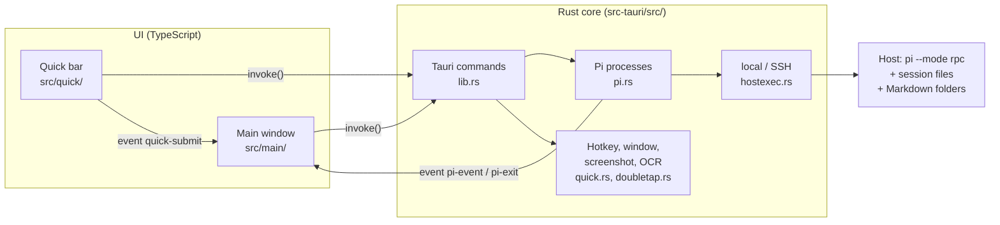

# Codemap

Map of the code: where things live, how the parts work together and where to start for a change.
Written for humans and AI assistants alike.

All code references have the form `` [`Symbol`](path/file) ``, e.g. [`PiManager::open`](../src-tauri/src/pi.rs), and are
checked in CI by [`check-codemap.mjs`](../scripts/check-codemap.mjs) (file exists, symbol is defined, every source file
is mentioned). `npm run check:codemap -- --print` lists all references with line numbers.

## Overview

PiBar is a [Tauri 2](https://v2.tauri.app) app: a **Rust core** (processes, SSH, files, hotkeys, screenshots) and a
**web UI** in TypeScript without a framework. Pi itself runs unchanged in RPC mode (`pi --mode rpc`, JSON lines over
stdin/stdout), locally or over SSH on a server.

## Directories

| Path | Contents |
| --- | --- |
| `index.html`, `quick.html` | The two windows: main window and quick bar |
| `src/main/` | Main window: sessions left, chat middle, files right, settings, reminders |
| `src/quick/` | Quick bar (hotkey window) |
| `src/shared/` | Shared: Rust interface, DOM helpers, translations, pure formatters (with tests) |
| `src-tauri/src/` | Rust core, one module per responsibility |
| `src-tauri/capabilities/` | Tauri permissions of the windows |
| `dev/` | Development helpers, e.g. a fake Pi without an API key |
| `scripts/` | Check scripts for CI |
| `docs/` | This codemap and architecture decisions ([`adr/`](adr/)) |

## Modules

### Rust core (`src-tauri/src/`)

| File | Responsibility | Key symbols |
| --- | --- | --- |
| [`main.rs`](../src-tauri/src/main.rs) | Program start | [`main`](../src-tauri/src/main.rs) |
| [`lib.rs`](../src-tauri/src/lib.rs) | All Tauri commands, tray, window events, startup | [`run`](../src-tauri/src/lib.rs), [`setup_tray`](../src-tauri/src/lib.rs), [`tray_menu`](../src-tauri/src/lib.rs), [`set_language`](../src-tauri/src/lib.rs), [`pi_close_all`](../src-tauri/src/lib.rs) |
| [`i18n.rs`](../src-tauri/src/i18n.rs) | Language of messages from Rust (errors, tray menu) | [`tr`](../src-tauri/src/i18n.rs), [`i18n::set`](../src-tauri/src/i18n.rs) |
| [`config.rs`](../src-tauri/src/config.rs) | Settings as JSON in the app config folder | [`AppConfig`](../src-tauri/src/config.rs), [`HostCfg`](../src-tauri/src/config.rs), [`UiPrefs`](../src-tauri/src/config.rs), [`VoiceCfg`](../src-tauri/src/config.rs), [`SessionMeta`](../src-tauri/src/config.rs), [`SessionGroup`](../src-tauri/src/config.rs), [`Reminder`](../src-tauri/src/config.rs), [`ModelPreset`](../src-tauri/src/config.rs), [`load`](../src-tauri/src/config.rs), [`find_host`](../src-tauri/src/config.rs) |
| [`hostexec.rs`](../src-tauri/src/hostexec.rs) | Shell commands locally or over SSH; quoting | [`run_shell`](../src-tauri/src/hostexec.rs), [`spawn_pi`](../src-tauri/src/hostexec.rs), [`shell_command`](../src-tauri/src/hostexec.rs), [`sq`](../src-tauri/src/hostexec.rs), [`shell_path`](../src-tauri/src/hostexec.rs) |
| [`pi.rs`](../src-tauri/src/pi.rs) | One Pi process per open session, match RPC responses, forward events | [`PiManager`](../src-tauri/src/pi.rs), [`PiManager::open`](../src-tauri/src/pi.rs), [`PiManager::send`](../src-tauri/src/pi.rs), [`PiManager::close`](../src-tauri/src/pi.rs) |
| [`sessions.rs`](../src-tauri/src/sessions.rs) | Read the session list from `~/.pi/agent/sessions` | [`list`](../src-tauri/src/sessions.rs), [`SessionInfo`](../src-tauri/src/sessions.rs), [`first_text`](../src-tauri/src/sessions.rs) |
| [`models.rs`](../src-tauri/src/models.rs) | Model list via `pi --list-models` (no session needed) | [`models::list`](../src-tauri/src/models.rs), [`models::parse`](../src-tauri/src/models.rs) |
| [`files.rs`](../src-tauri/src/files.rs) | List, read, write and create Markdown files; flag and create missing folders | [`files::list`](../src-tauri/src/files.rs), [`parse_listing`](../src-tauri/src/files.rs), [`files::write`](../src-tauri/src/files.rs), [`create_dir`](../src-tauri/src/files.rs), [`FolderListing`](../src-tauri/src/files.rs) |
| [`quick.rs`](../src-tauri/src/quick.rs) | Quick bar: show/hide window, size, position, hotkey, screenshot, OCR | [`toggle_quick`](../src-tauri/src/quick.rs), [`hide_quick`](../src-tauri/src/quick.rs), [`resize_quick`](../src-tauri/src/quick.rs), [`register_hotkey`](../src-tauri/src/quick.rs), [`capture`](../src-tauri/src/quick.rs), [`ocr`](../src-tauri/src/quick.rs), [`mac_ocr_helper`](../src-tauri/src/quick.rs) |
| [`voice.rs`](../src-tauri/src/voice.rs) | Speech to text, text to speech, text improvement via OpenAI-compatible APIs (`curl`) or a local command | [`transcribe`](../src-tauri/src/voice.rs), [`speak`](../src-tauri/src/voice.rs), [`improve`](../src-tauri/src/voice.rs), [`api_url`](../src-tauri/src/voice.rs), [`strip_think`](../src-tauri/src/voice.rs) |
| [`doubletap.rs`](../src-tauri/src/doubletap.rs) | Double tap on a modifier key (macOS, CGEventTap) | [`Detector`](../src-tauri/src/doubletap.rs), [`Detector::on_flags`](../src-tauri/src/doubletap.rs), [`TapKey`](../src-tauri/src/doubletap.rs), [`start`](../src-tauri/src/doubletap.rs) |

### Main window (`src/main/`)

| File | Responsibility | Key symbols |
| --- | --- | --- |
| [`index.ts`](../src/main/index.ts) | Entry: load settings and language, wire modules, dispatch Rust events | [`init`](../src/main/index.ts) |
| [`state.ts`](../src/main/state.ts) | Shared state (settings, sessions, active session) | [`state`](../src/main/state.ts), [`saveConfig`](../src/main/state.ts) |
| [`sessions.ts`](../src/main/sessions.ts) | Left column; open, activate and close sessions; "New session" | [`renderHosts`](../src/main/sessions.ts), [`openSession`](../src/main/sessions.ts), [`activate`](../src/main/sessions.ts), [`closeSession`](../src/main/sessions.ts), [`loadSessions`](../src/main/sessions.ts), [`newSessionDialog`](../src/main/sessions.ts) |
| [`reminders.ts`](../src/main/reminders.ts) | Reminders on sessions: dialog, list at the top left, notifications | [`reminderDialog`](../src/main/reminders.ts), [`presetTimes`](../src/main/reminders.ts), [`renderReminders`](../src/main/reminders.ts), [`openReminder`](../src/main/reminders.ts), [`startReminderClock`](../src/main/reminders.ts) |
| [`sessionTab.ts`](../src/main/sessionTab.ts) | One session: send Pi commands, render Pi events as chat, count tokens and speed, load skills/commands | [`SessionTab`](../src/main/sessionTab.ts), [`SessionTab.start`](../src/main/sessionTab.ts), [`SessionTab.send`](../src/main/sessionTab.ts), [`SessionTab.onEvent`](../src/main/sessionTab.ts), [`SessionTab.loadHistory`](../src/main/sessionTab.ts), [`SessionTab.refreshModels`](../src/main/sessionTab.ts), [`SessionTab.measure`](../src/main/sessionTab.ts), [`TabStats`](../src/main/sessionTab.ts), [`SessionTab.close`](../src/main/sessionTab.ts) |
| [`chatView.ts`](../src/main/chatView.ts) | Header (preset, model, thinking, chat view, answer style, theme), chat area, input, shortcuts | [`renderToolbar`](../src/main/chatView.ts), [`wireChatView`](../src/main/chatView.ts), [`applyUiPrefs`](../src/main/chatView.ts), [`setTheme`](../src/main/chatView.ts), [`showEmpty`](../src/main/chatView.ts) |
| [`layout.ts`](../src/main/layout.ts) | Side panels: show/hide, drag width, divider between file tree and editor, float over the chat in narrow windows | [`applyLayout`](../src/main/layout.ts), [`togglePanel`](../src/main/layout.ts), [`applySplit`](../src/main/layout.ts), [`wireLayout`](../src/main/layout.ts) |
| [`menu.ts`](../src/main/menu.ts) | Popup menus: header dropdowns with descriptions, "+" menus, context menus (headings, colour swatches) | [`openMenu`](../src/main/menu.ts), [`closeMenu`](../src/main/menu.ts), [`MenuEntry`](../src/main/menu.ts), [`COLORS`](../src/main/menu.ts) |
| [`sessionGroups.ts`](../src/main/sessionGroups.ts) | Own session names, pins, colours, coloured groups; context menus of sessions and groups | [`sessionMenu`](../src/main/sessionGroups.ts), [`groupMenu`](../src/main/sessionGroups.ts), [`renameDialog`](../src/main/sessionGroups.ts), [`setMeta`](../src/main/sessionGroups.ts), [`displayTitle`](../src/main/sessionGroups.ts) |
| [`voiceSettings.ts`](../src/main/voiceSettings.ts) | Settings section "Voice": dictation, read aloud, text improvement | [`voiceEditor`](../src/main/voiceSettings.ts) |
| [`slashMenu.ts`](../src/main/slashMenu.ts) | "/" menu in the input: skills, prompt templates, extension commands | [`wireSlashMenu`](../src/main/slashMenu.ts), [`slashKey`](../src/main/slashMenu.ts), [`commandText`](../src/main/slashMenu.ts) |
| [`usageStats.ts`](../src/main/usageStats.ts) | Token info in the header and its hover panel (counters, speed, context) | [`usageSummary`](../src/main/usageStats.ts), [`wireUsage`](../src/main/usageStats.ts) |
| [`files.ts`](../src/main/files.ts) | Right column: session folders as a tree, missing folders, Markdown editor | [`renderFiles`](../src/main/files.ts), [`renderTree`](../src/main/files.ts), [`treeRows`](../src/main/files.ts), [`saveEditor`](../src/main/files.ts), [`wireFiles`](../src/main/files.ts) |
| [`settings.ts`](../src/main/settings.ts) | Settings dialog: language, hotkeys, bar position, model presets, hosts | [`settingsDialog`](../src/main/settings.ts), [`presetEditor`](../src/main/settings.ts) |
| [`quickBridge.ts`](../src/main/quickBridge.ts) | Accept messages from the quick bar | [`handleQuick`](../src/main/quickBridge.ts), [`broadcastActive`](../src/main/quickBridge.ts) |
| [`styles.css`](../src/main/styles.css) | Main window look; light/dark via CSS variables and `data-theme` on `<html>` | – |

### Quick bar (`src/quick/`) and shared code (`src/shared/`)

| File | Responsibility | Key symbols |
| --- | --- | --- |
| [`quick/index.ts`](../src/quick/index.ts) | Input, target, preset or model/thinking, screenshot/OCR, send | [`submit`](../src/quick/index.ts), [`takeShot`](../src/quick/index.ts), [`runOcr`](../src/quick/index.ts), [`renderTargets`](../src/quick/index.ts), [`renderPresets`](../src/quick/index.ts), [`renderModels`](../src/quick/index.ts), [`fit`](../src/quick/index.ts) |
| [`shared/api.ts`](../src/shared/api.ts) | Types and `invoke` calls into the Rust core | [`api`](../src/shared/api.ts), [`QuickSubmit`](../src/shared/api.ts), [`AppConfig`](../src/shared/api.ts), [`Reminder`](../src/shared/api.ts) |
| [`shared/i18n.ts`](../src/shared/i18n.ts) | Translations: English text is the key, German dictionary; tested in `i18n.test.ts` | [`t`](../src/shared/i18n.ts), [`setLang`](../src/shared/i18n.ts), [`resolveLang`](../src/shared/i18n.ts), [`translateDom`](../src/shared/i18n.ts), [`LANGUAGES`](../src/shared/i18n.ts) |
| [`shared/dom.ts`](../src/shared/dom.ts) | Element builder, Markdown (marked + DOMPurify), toasts, modals | [`h`](../src/shared/dom.ts), [`renderMarkdown`](../src/shared/dom.ts), [`openModal`](../src/shared/dom.ts) |
| [`shared/presets.ts`](../src/shared/presets.ts) | Pure preset logic, tested in `presets.test.ts` | [`matchPreset`](../src/shared/presets.ts), [`cleanPresets`](../src/shared/presets.ts), [`splitModelKey`](../src/shared/presets.ts) |
| [`shared/format.ts`](../src/shared/format.ts) | Pure formatters, tested in `format.test.ts` | [`shortModel`](../src/shared/format.ts), [`cleanTitle`](../src/shared/format.ts), [`withScreenText`](../src/shared/format.ts), [`withAnswerStyle`](../src/shared/format.ts), [`stripAnswerStyle`](../src/shared/format.ts), [`tokensPerSecond`](../src/shared/format.ts), [`relTime`](../src/shared/format.ts) |
| [`shared/tree.ts`](../src/shared/tree.ts) | Relative paths → folder tree, tested in `tree.test.ts` | [`buildTree`](../src/shared/tree.ts), [`countFiles`](../src/shared/tree.ts) |
| [`shared/voice.ts`](../src/shared/voice.ts) | Microphone recording, mic and improve buttons for both windows, read aloud; tested in `voice.test.ts` | [`wireVoice`](../src/shared/voice.ts), [`startRecording`](../src/shared/voice.ts), [`stopRecording`](../src/shared/voice.ts), [`speak`](../src/shared/voice.ts), [`improve`](../src/shared/voice.ts), [`DEFAULT_IMPROVE_PROMPT`](../src/shared/voice.ts) |
| [`shared/icons.ts`](../src/shared/icons.ts) | Line icons (SVG) instead of emoji: reminder, gear, check, more, close | [`icon`](../src/shared/icons.ts), [`iconSvg`](../src/shared/icons.ts) |
| [`shared/theme.ts`](../src/shared/theme.ts) | Colour scheme for both windows (auto / light / dark) | [`applyTheme`](../src/shared/theme.ts), [`nextTheme`](../src/shared/theme.ts) |

### Tools

| File | Purpose |
| --- | --- |
| [`dev/fake-pi.mjs`](../dev/fake-pi.mjs) | Fake Pi: simulates streaming, thinking, a tool call, `--list-models` |
| [`scripts/check-codemap.mjs`](../scripts/check-codemap.mjs) | Checks all code references in the docs |

## Flows

### Open a session and send a message

1. Click in the left column → [`openSession`](../src/main/sessions.ts) creates a [`SessionTab`](../src/main/sessionTab.ts).
2. [`SessionTab.start`](../src/main/sessionTab.ts) calls `pi_open` → [`PiManager::open`](../src-tauri/src/pi.rs) →
   [`spawn_pi`](../src-tauri/src/hostexec.rs) starts `pi --mode rpc [--session <file>]` locally or over `ssh`.
3. A reader thread in [`PiManager::open`](../src-tauri/src/pi.rs) matches `response` lines to the waiting call
   ([`PiManager::send`](../src-tauri/src/pi.rs)) and sends everything else as event `pi-event` to the main window.
4. [`init`](../src/main/index.ts) routes `pi-event` by process handle to [`SessionTab.onEvent`](../src/main/sessionTab.ts),
   which renders text, thinking and tool calls live.
5. On `agent_settled`, [`loadSessions`](../src/main/sessions.ts) reloads the list; new sessions get their file path as
   key.

### Close a session

× on a running session or ⌘W → [`closeSession`](../src/main/sessions.ts) → [`SessionTab.close`](../src/main/sessionTab.ts)
→ `pi_close` → [`PiManager::close`](../src-tauri/src/pi.rs). The session file stays and can be reopened. On reload the
main window calls [`pi_close_all`](../src-tauri/src/lib.rs) so no orphaned processes remain.

### Reminders

[`reminderDialog`](../src/main/reminders.ts) stores a [`Reminder`](../src/shared/api.ts) in `AppConfig.reminders`
(Rust side: [`Reminder`](../src-tauri/src/config.rs)). [`startReminderClock`](../src/main/reminders.ts) checks every
30 seconds, marks due ones, shows a system notification and re-renders the list
([`renderReminders`](../src/main/reminders.ts)). A click runs [`openReminder`](../src/main/reminders.ts): remove and
open the session.

### Quick bar

1. Hotkey: [`register_hotkey`](../src-tauri/src/quick.rs) (key combination) or [`Detector::on_flags`](../src-tauri/src/doubletap.rs)
   (double tap) → [`toggle_quick`](../src-tauri/src/quick.rs) positions and shows the window.
2. The bar loads targets ([`renderTargets`](../src/quick/index.ts)) and the target host's models
   ([`models::list`](../src-tauri/src/models.rs)).
3. While typing, [`fit`](../src/quick/index.ts) grows the text field and asks [`resize_quick`](../src-tauri/src/quick.rs)
   for a new window height only when it really changes (resizing on every keystroke made typing stutter on macOS).
4. Screenshot: [`takeShot`](../src/quick/index.ts) → [`capture`](../src-tauri/src/quick.rs) (`screencapture` on macOS);
   OCR: [`runOcr`](../src/quick/index.ts) → [`ocr`](../src-tauri/src/quick.rs) (Apple Vision via
   [`mac_ocr_helper`](../src-tauri/src/quick.rs), otherwise `tesseract`).
5. [`submit`](../src/quick/index.ts) emits `quick-submit`; [`handleQuick`](../src/main/quickBridge.ts) opens the target
   session, sets model/thinking and sends the message with image and OCR text ([`withScreenText`](../src/shared/format.ts)).

### Model presets

Presets ([`ModelPreset`](../src/shared/api.ts), Rust: [`ModelPreset`](../src-tauri/src/config.rs)) live in
`AppConfig.presets` and are edited in [`presetEditor`](../src/main/settings.ts). In the header,
[`renderToolbar`](../src/main/chatView.ts) shows the preset dropdown and hides model and thinking while a preset is
chosen; "Custom" shows them again. Which preset a session shows: `SessionTab.presetId` if set, otherwise
[`matchPreset`](../src/shared/presets.ts) against the session's model and thinking level. In the quick bar,
[`renderPresets`](../src/quick/index.ts) does the same; [`submit`](../src/quick/index.ts) sends the preset's model and
thinking level plus its id, and [`handleQuick`](../src/main/quickBridge.ts) applies them.

### Files on the right

[`renderFiles`](../src/main/files.ts) asks [`files::list`](../src-tauri/src/files.rs) for the working folder and the
session's extra folders (stored in `AppConfig.sessionFolders`). [`buildTree`](../src/shared/tree.ts) turns each listing
into folders; [`renderTree`](../src/main/files.ts) draws them (open folders live in memory, so toggling does not reload).
A folder that does not exist on the host comes back with `missing: true` ([`parse_listing`](../src-tauri/src/files.rs))
and can be created ([`create_dir`](../src-tauri/src/files.rs)) or removed from the session. Reading and writing use `cat` through
[`run_shell`](../src-tauri/src/hostexec.rs), locally and over SSH; [`files::write`](../src-tauri/src/files.rs) writes to a
temp file first and then renames.

### Chat view and answer style

The header dropdowns set `ui.chatMode` and `ui.answerMode` ([`applyUiPrefs`](../src/main/chatView.ts)).
`natural` hides thinking and tool cards via CSS (`.mode-natural`) and shows an activity line while Pi works;
`technical` shows them collapsed; `debug` opens them as they appear and streams tool output (`tool_execution_update`)
into the card. The answer style is a short hint that [`SessionTab.send`](../src/main/sessionTab.ts) appends with
[`withAnswerStyle`](../src/shared/format.ts) (not for `/` commands); [`stripAnswerStyle`](../src/shared/format.ts) and
[`cleanTitle`](../src/shared/format.ts) remove it again for display.

### Skills ("/" menu)

[`SessionTab.refreshModels`](../src/main/sessionTab.ts) also loads Pi's `get_commands`. Typing `/` in the input opens
[`wireSlashMenu`](../src/main/slashMenu.ts); picking an entry inserts `/skill:name ` (skills) or `/name `, which Pi
expands itself when the prompt is sent.

### Token statistics

[`SessionTab.measure`](../src/main/sessionTab.ts) times each live answer (first token → `message_end`) and adds usage to
[`TabStats`](../src/main/sessionTab.ts). [`usageSummary`](../src/main/usageStats.ts) is the header text; on hover
[`wireUsage`](../src/main/usageStats.ts) shows the panel and refreshes it with Pi's `get_session_stats`.

### Layout and colour scheme

[`wireLayout`](../src/main/layout.ts) wires the panel buttons and the drag handles (widths in `ui.leftWidth` /
`ui.rightWidth`). Below 1120 px (right) or 820 px (left) window width, [`togglePanel`](../src/main/layout.ts) opens the
panel floating over the chat instead of as a column. [`applyTheme`](../src/shared/theme.ts) sets `data-theme` and the
native window theme; [`setTheme`](../src/main/chatView.ts) saves it and emits `theme-changed` for the quick bar.

### Sessions: names, pins, colours, groups

[`sessionItem`](../src/main/sessions.ts) rows open [`sessionMenu`](../src/main/sessionGroups.ts) on right click or "⋯":
rename ([`renameDialog`](../src/main/sessionGroups.ts): own name in `AppConfig.sessionMeta`, plus `set_session_name`
for an open session), pin, colour, move to group, reminder, close. [`sessionSections`](../src/main/sessions.ts) renders
pinned sessions first, then each group of `AppConfig.groups` (coloured, collapsible, [`groupMenu`](../src/main/sessionGroups.ts)),
then the rest. The quick bar uses the same names and lists pinned sessions first.

### Voice: dictation, read aloud, text improvement

Settings in `AppConfig.voice` ([`VoiceCfg`](../src-tauri/src/config.rs), edited in [`voiceEditor`](../src/main/voiceSettings.ts)).
[`wireVoice`](../src/shared/voice.ts) wires the mic and improve buttons in both windows: the recording
([`startRecording`](../src/shared/voice.ts), MediaRecorder; macOS asks for the microphone, see `src-tauri/Info.plist`) goes
as base64 to `transcribe_audio` → [`transcribe`](../src-tauri/src/voice.rs) (OpenAI-compatible `/audio/transcriptions`
or a local command with `{file}`); optionally [`improve`](../src/shared/voice.ts) → `improve_text` →
[`improve`](../src-tauri/src/voice.rs) (`/chat/completions` with the prompt). Answers get a speaker button
(`readAloud` in [`sessionTab.ts`](../src/main/sessionTab.ts)); [`speak`](../src/shared/voice.ts) uses the system voice or
`speak_text` → [`speak`](../src-tauri/src/voice.rs). Auto read: `agent_settled` in [`SessionTab.onEvent`](../src/main/sessionTab.ts).
HTTP goes through `curl`; the API key is passed on stdin.

### Language

[`init`](../src/main/index.ts) calls [`setLang`](../src/shared/i18n.ts) with `ui.language` ("auto", "en", "de"),
[`translateDom`](../src/shared/i18n.ts) fills static HTML via `data-i18n*` attributes, and
[`set_language`](../src-tauri/src/lib.rs) tells Rust so errors and the tray menu ([`tray_menu`](../src-tauri/src/lib.rs))
match. Changing the language in the settings reloads both windows (event `language-changed`).

## UI ↔ Rust interface

Tauri commands are registered in [`run`](../src-tauri/src/lib.rs) and typed in [`api`](../src/shared/api.ts).
A new command needs both.

| Command | Purpose |
| --- | --- |
| `get_config`, `save_config` | Settings (the quick bar position is managed by Rust only) |
| `set_language` | Language for messages from Rust and the tray menu |
| `test_host`, `list_sessions`, `list_models` | Check a host, list sessions and models |
| `pi_open`, `pi_send`, `pi_close`, `pi_close_all` | Pi process per session |
| `list_files`, `read_file`, `write_file`, `create_file`, `create_dir` | Markdown files and folders |
| `quick_hide`, `quick_resize`, `quick_reset_pos`, `show_main` | Windows |
| `set_hotkey`, `set_double_tap`, `double_tap_status` | Hotkeys |
| `capture_screen`, `ocr_image` | Screenshot and text recognition |
| `transcribe_audio`, `improve_text`, `speak_text` | Dictation, text improvement, read aloud |

| Event | From → to | Contents |
| --- | --- | --- |
| `pi-event` | Rust → main window | `{ handle, event }`, one Pi event (see [Pi docs](https://pi.dev/docs/latest/json)) |
| `pi-exit` | Rust → main window | `{ handle, stderr }` when a Pi process ends |
| `quick-show` | Rust → quick bar | The bar was opened |
| `quick-submit` | quick bar → main window | [`QuickSubmit`](../src/shared/api.ts) |
| `main-active`, `quick-request-active` | both directions | current session for the "Current" target |
| `language-changed` | main window → both | reload with the new language |
| `theme-changed` | main window → quick bar | new colour scheme (`auto`, `light`, `dark`) |

## Where do I change what?

| Goal | Starting point |
| --- | --- |
| Render a new Pi event | [`SessionTab.onEvent`](../src/main/sessionTab.ts) |
| Chat views, answer style hints | [`applyUiPrefs`](../src/main/chatView.ts), [`withAnswerStyle`](../src/shared/format.ts) |
| Token statistics panel | [`wireUsage`](../src/main/usageStats.ts), [`SessionTab.measure`](../src/main/sessionTab.ts) |
| Panel widths, narrow windows | [`applyLayout`](../src/main/layout.ts) |
| Session context menu, groups, colours | [`sessionMenu`](../src/main/sessionGroups.ts), [`COLORS`](../src/main/menu.ts) |
| Another speech or LLM provider | [`voice.rs`](../src-tauri/src/voice.rs), [`voiceEditor`](../src/main/voiceSettings.ts) |
| New Pi RPC command in the UI | method in [`SessionTab`](../src/main/sessionTab.ts) via [`api`](../src/shared/api.ts) (`api.pi`) |
| New Rust command | function in [`lib.rs`](../src-tauri/src/lib.rs) + register in [`run`](../src-tauri/src/lib.rs) + [`api`](../src/shared/api.ts) |
| New setting | [`UiPrefs`](../src-tauri/src/config.rs) (with `serde(default)`) + [`AppConfig`](../src/shared/api.ts) + [`settingsDialog`](../src/main/settings.ts) |
| New or changed UI text | [`t`](../src/shared/i18n.ts) + German entry in the dictionary in the same file; Rust: [`tr`](../src-tauri/src/i18n.rs) |
| Another language | add a dictionary and an entry in [`LANGUAGES`](../src/shared/i18n.ts); Rust: [`i18n::set`](../src-tauri/src/i18n.rs) |
| Reminder presets | [`presetTimes`](../src/main/reminders.ts) |
| Model presets (editor, matching) | [`presetEditor`](../src/main/settings.ts), [`matchPreset`](../src/shared/presets.ts) |
| Another way to reach a host | [`shell_command`](../src-tauri/src/hostexec.rs) |
| Quick bar look | [`quick.html`](../quick.html), [`quick.css`](../src/quick/quick.css) |
| Main window look | [`index.html`](../index.html), [`styles.css`](../src/main/styles.css) |
| Linux/Windows support for screenshot/OCR/double tap | [`capture`](../src-tauri/src/quick.rs), [`ocr`](../src-tauri/src/quick.rs), [`start`](../src-tauri/src/doubletap.rs) |

## Known gaps

- No Content Security Policy header (`security.csp` is `null`); Markdown is sanitized with DOMPurify.
- Double tap, area screenshot and OCR with Apple Vision are macOS only.
- Reminders are only checked while PiBar is running (missed ones show as due on the next start).
