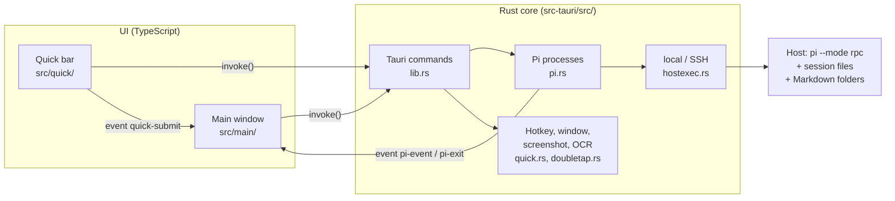

# Codemap

Map of the code: where things live, how the parts work together and where to start for a change.
Written for humans and AI assistants alike.

All code references have the form `` [`Symbol`](path/file) ``, e.g. [`PiManager::open`](../src-tauri/src/pi.rs), and are
checked in CI by [`check-codemap.mjs`](../scripts/check-codemap.mjs) (file exists, symbol is defined, every source file
is mentioned). `npm run check:codemap -- --print` lists all references with line numbers.

## Overview

PiBar is a [Tauri 2](https://v2.tauri.app) app: a **Rust core** (processes, SSH, files, hotkeys, screenshots) and a
**web UI** in TypeScript without a framework. Pi itself runs unchanged in RPC mode (`pi --mode rpc`, JSON lines over
stdin/stdout), locally or over SSH on a server.

## Directories

| Path | Contents |
| --- | --- |
| `index.html`, `quick.html` | The two windows: main window and quick bar |
| `src/main/` | Main window: sessions left, chat middle, files right, settings, reminders |
| `src/quick/` | Quick bar (hotkey window) |
| `src/shared/` | Shared: Rust interface, DOM helpers, translations, pure formatters (with tests) |
| `src-tauri/src/` | Rust core, one module per responsibility |
| `src-tauri/capabilities/` | Tauri permissions of the windows |
| `src-tauri/extensions/` | Pi extensions PiBar installs on a host (`pibar-temperature.ts`, see [`temp.rs`](../src-tauri/src/temp.rs)) |
| `dev/` | Development helpers, e.g. a fake Pi without an API key |
| `scripts/` | Check scripts for CI |
| `docs/` | This codemap and architecture decisions ([`adr/`](adr/)) |

## Modules

### Rust core (`src-tauri/src/`)

| File | Responsibility | Key symbols |
| --- | --- | --- |
| [`main.rs`](../src-tauri/src/main.rs) | Program start | [`main`](../src-tauri/src/main.rs) |
| [`gitlog.rs`](../src-tauri/src/gitlog.rs) | Git history, read only: commits of a repository or a file, files of a commit, diff of a file | [`gitlog::log`](../src-tauri/src/gitlog.rs), [`gitlog::commit`](../src-tauri/src/gitlog.rs), [`gitlog::diff`](../src-tauri/src/gitlog.rs), [`parse_log`](../src-tauri/src/gitlog.rs) |
| [`lib.rs`](../src-tauri/src/lib.rs) | All Tauri commands, tray, window events, startup | [`run`](../src-tauri/src/lib.rs), [`setup_tray`](../src-tauri/src/lib.rs), [`tray_menu`](../src-tauri/src/lib.rs), [`set_language`](../src-tauri/src/lib.rs), [`pi_close_all`](../src-tauri/src/lib.rs) |
| [`i18n.rs`](../src-tauri/src/i18n.rs) | Language of messages from Rust (errors, tray menu) | [`tr`](../src-tauri/src/i18n.rs), [`i18n::set`](../src-tauri/src/i18n.rs) |
| [`snapshot.rs`](../src-tauri/src/snapshot.rs) | File states for "go back": before each own message the working tree of the session folder becomes a Git commit below `refs/pibar/<session id>/<entry id>` (own objects and refs only, the index and history of the user stay untouched); going back puts the files Pi changed back to that state, with the state before as undo | [`snapshot::take`](../src-tauri/src/snapshot.rs), [`snapshot::preview`](../src-tauri/src/snapshot.rs), [`repo_path`](../src-tauri/src/snapshot.rs), [`parse_probe`](../src-tauri/src/snapshot.rs), [`snapshot::parse_preview`](../src-tauri/src/snapshot.rs), [`snapshot::restore`](../src-tauri/src/snapshot.rs), [`snapshot::restore_commit`](../src-tauri/src/snapshot.rs) |
| [`config.rs`](../src-tauri/src/config.rs) | Settings as JSON in the app config folder; kept in memory, saved atomically, a damaged file is backed up ([`read_from`](../src-tauri/src/config.rs), [`write_atomic`](../src-tauri/src/config.rs), [`take_load_error`](../src-tauri/src/config.rs)) | [`AppConfig`](../src-tauri/src/config.rs), [`HostCfg`](../src-tauri/src/config.rs), [`UiPrefs`](../src-tauri/src/config.rs), [`VoiceCfg`](../src-tauri/src/config.rs), [`SessionMeta`](../src-tauri/src/config.rs), [`SessionGroup`](../src-tauri/src/config.rs), [`Reminder`](../src-tauri/src/config.rs), [`ModelPreset`](../src-tauri/src/config.rs), [`QuickActionCfg`](../src-tauri/src/config.rs), [`load`](../src-tauri/src/config.rs), [`find_host`](../src-tauri/src/config.rs) |
| [`hostexec.rs`](../src-tauri/src/hostexec.rs) | Shell commands locally or over SSH; quoting | [`run_shell`](../src-tauri/src/hostexec.rs), [`spawn_pi`](../src-tauri/src/hostexec.rs), [`user_env`](../src-tauri/src/hostexec.rs), [`shell_command`](../src-tauri/src/hostexec.rs), [`ssh_args`](../src-tauri/src/hostexec.rs), [`sq`](../src-tauri/src/hostexec.rs), [`shell_path`](../src-tauri/src/hostexec.rs) |
| [`pi.rs`](../src-tauri/src/pi.rs) | One Pi process per open session, match RPC responses, forward events; also follows the log of a run in the background (same events); waiting calls fail at once when Pi ends, ended processes are reaped | [`PiManager`](../src-tauri/src/pi.rs), [`pump`](../src-tauri/src/pi.rs), [`PiManager::open`](../src-tauri/src/pi.rs), [`PiManager::open_follow`](../src-tauri/src/pi.rs), [`PiManager::send`](../src-tauri/src/pi.rs), [`PiManager::close`](../src-tauri/src/pi.rs) |
| [`terminal.rs`](../src-tauri/src/terminal.rs) | Interactive terminal: one shell per tab in a pty (local login shell or `ssh -tt`), output as base64 `term-output` events, keys and size from the UI | [`TermManager`](../src-tauri/src/terminal.rs), [`TermManager::open`](../src-tauri/src/terminal.rs), [`TermManager::write`](../src-tauri/src/terminal.rs), [`TermManager::resize`](../src-tauri/src/terminal.rs), [`shell_command`](../src-tauri/src/terminal.rs), [`expand`](../src-tauri/src/terminal.rs) |
| [`bg.rs`](../src-tauri/src/bg.rs) | Runs in the background: Pi started detached (`setsid`/`nohup`) on the host with `pi --mode json`, its log and pid file below `~/.pibar`; ask whether it still runs and stop it | [`bg::start`](../src-tauri/src/bg.rs), [`bg::running`](../src-tauri/src/bg.rs), [`bg::stop`](../src-tauri/src/bg.rs), [`follow_script`](../src-tauri/src/bg.rs), [`paths`](../src-tauri/src/bg.rs), [`hash`](../src-tauri/src/bg.rs) |
| [`sessions.rs`](../src-tauri/src/sessions.rs) | Read the session list from `~/.pi/agent/sessions` (incl. `parent` of a branch); search the messages of all session files (one `grep` per host); user messages per file for the versions of a message; files Pi changed per own message (from the tool calls); delete session files (only there); whole session file as text for the export | [`list`](../src-tauri/src/sessions.rs), [`SessionInfo`](../src-tauri/src/sessions.rs), [`outlines`](../src-tauri/src/sessions.rs), [`parse_outlines`](../src-tauri/src/sessions.rs), [`SessionOutline`](../src-tauri/src/sessions.rs), [`search`](../src-tauri/src/sessions.rs), [`parse_hits`](../src-tauri/src/sessions.rs), [`SearchHit`](../src-tauri/src/sessions.rs), [`snippet_for`](../src-tauri/src/sessions.rs), [`touches`](../src-tauri/src/sessions.rs), [`touched_by_message`](../src-tauri/src/sessions.rs), [`first_text`](../src-tauri/src/sessions.rs), [`sessions::delete`](../src-tauri/src/sessions.rs), [`sessions::export`](../src-tauri/src/sessions.rs), [`is_session_file`](../src-tauri/src/sessions.rs) |
| [`models.rs`](../src-tauri/src/models.rs) | Model list via `pi --list-models` (no session needed) | [`models::list`](../src-tauri/src/models.rs), [`models::parse`](../src-tauri/src/models.rs) |
| [`agents.rs`](../src-tauri/src/agents.rs) | Agent definitions for subagent sessions: reads `~/.pi/agent/agents/*.md` and the nearest `.pi/agents/*.md` above the working folder on the host (project agents override user agents), parses the frontmatter (name, description, tools, model); writes an agent's body as a system prompt file below `~/.pibar/agent-prompts` for `--append-system-prompt` | [`agents::list`](../src-tauri/src/agents.rs), [`parse_listing`](../src-tauri/src/agents.rs), [`parse_agent`](../src-tauri/src/agents.rs), [`split_frontmatter`](../src-tauri/src/agents.rs), [`prompt_file`](../src-tauri/src/agents.rs), [`AgentInfo`](../src-tauri/src/agents.rs) |
| [`temp.rs`](../src-tauri/src/temp.rs) | Temperature extension for Pi: bundled source ([`EXTENSION`](../src-tauri/src/temp.rs), `src-tauri/extensions/pibar-temperature.ts`) and its installation on a host – written to `~/.pi/agent/extensions/pibar-temperature.ts`, Pi loads it on the next session start and offers `/temperature` | [`temp::install`](../src-tauri/src/temp.rs), [`install_script`](../src-tauri/src/temp.rs) |
| [`files.rs`](../src-tauri/src/files.rs) | List all files of the session folders (or only documents and images, `DOCS_FILTER`); read and write text files (binary and >2 MB refused, paths checked by [`check_path_shape`](../src-tauri/src/files.rs)); images read only ([`read_image`](../src-tauri/src/files.rs)); upload any file type as base64 ([`files::upload`](../src-tauri/src/files.rs), [`upload_script`](../src-tauri/src/files.rs)); download any file type as bytes for a native save dialog on this computer ([`files::download`](../src-tauri/src/files.rs), [`download_script`](../src-tauri/src/files.rs), [`parse_download`](../src-tauri/src/files.rs)); delete files and folders strictly inside the session folders ([`files::delete`](../src-tauri/src/files.rs), [`check_delete_path`](../src-tauri/src/files.rs), [`deletable_under`](../src-tauri/src/files.rs)); flag and create missing folders; optional Git status | [`files::list`](../src-tauri/src/files.rs), [`parse_listing`](../src-tauri/src/files.rs), [`parse_git`](../src-tauri/src/files.rs), [`GitInfo`](../src-tauri/src/files.rs), [`files::write`](../src-tauri/src/files.rs), [`create_dir`](../src-tauri/src/files.rs), [`FolderListing`](../src-tauri/src/files.rs), [`list_dirs`](../src-tauri/src/files.rs), [`read_head`](../src-tauri/src/files.rs) |
| [`quick.rs`](../src-tauri/src/quick.rs) | Quick bar: show/hide window, size, position, hotkey, screenshot, OCR | [`toggle_quick`](../src-tauri/src/quick.rs), [`hide_quick`](../src-tauri/src/quick.rs), [`resize_quick`](../src-tauri/src/quick.rs), [`register_hotkey`](../src-tauri/src/quick.rs), [`hotkey_status`](../src-tauri/src/quick.rs), [`capture`](../src-tauri/src/quick.rs), [`ocr`](../src-tauri/src/quick.rs), [`mac_ocr_helper`](../src-tauri/src/quick.rs) |
| [`disclaim.rs`](../src-tauri/src/disclaim.rs) | macOS: child processes (shell, SSH, curl) run as their own responsible process, so the "Local Network" block of the self-built app does not hit Pi | [`disclaim::command`](../src-tauri/src/disclaim.rs), [`run_if_requested`](../src-tauri/src/disclaim.rs) |
| [`diag.rs`](../src-tauri/src/diag.rs) | Diagnosis report for chat errors: Pi/Node, environment (secrets hidden), Pi's model config, reachability of model servers | [`diag::run`](../src-tauri/src/diag.rs) |
| [`voice.rs`](../src-tauri/src/voice.rs) | Speech to text, text to speech, text improvement via OpenAI-compatible APIs (`curl`) or a local command | [`transcribe`](../src-tauri/src/voice.rs), [`speak`](../src-tauri/src/voice.rs), [`improve`](../src-tauri/src/voice.rs), [`api_url`](../src-tauri/src/voice.rs), [`strip_think`](../src-tauri/src/voice.rs) |
| [`doubletap.rs`](../src-tauri/src/doubletap.rs) | Double tap on a modifier key (macOS, CGEventTap) | [`Detector`](../src-tauri/src/doubletap.rs), [`Detector::on_flags`](../src-tauri/src/doubletap.rs), [`TapKey`](../src-tauri/src/doubletap.rs), [`start`](../src-tauri/src/doubletap.rs) |

### Main window (`src/main/`)

| File | Responsibility | Key symbols |
| --- | --- | --- |
| [`index.ts`](../src/main/index.ts) | Entry: load settings and language, wire modules, dispatch Rust events | [`init`](../src/main/index.ts) |
| [`state.ts`](../src/main/state.ts) | Shared state (settings, sessions, active session) | [`state`](../src/main/state.ts), [`saveConfig`](../src/main/state.ts) |
| [`sessions.ts`](../src/main/sessions.ts) | Left column: one collapsible card per host (move it by the grip), sessions inside; open, activate and close sessions; "New session"; remembers the session per host; session rows of a host (with `running`, `unread`, `color` and `open` for the marks and the views, see [`onSettled`](../src/main/sessions.ts)); views of the list (only what I am working on, a colour), the funnel menu and the chip that names the view; session ids: full id in the tooltip of every row, short id in the meta line of a subagent row | [`renderHosts`](../src/main/sessions.ts), [`openSession`](../src/main/sessions.ts), [`activate`](../src/main/sessions.ts), [`closeSession`](../src/main/sessions.ts), [`loadSessions`](../src/main/sessions.ts), [`newSessionDialog`](../src/main/sessions.ts), [`hostRows`](../src/main/sessions.ts), [`sessionSections`](../src/main/sessions.ts), [`filterMenu`](../src/main/sessions.ts), [`filterChip`](../src/main/sessions.ts), [`setFilter`](../src/main/sessions.ts) |
| [`search.ts`](../src/main/search.ts) | Search field above the list: filters the rows while typing and asks every shown host (after a pause) for sessions whose messages contain the text; answers of an older query are dropped, ⌘F jumps into the field | [`wireSearch`](../src/main/search.ts), [`focusSearch`](../src/main/search.ts), [`clearSearch`](../src/main/search.ts), [`searchAll`](../src/main/search.ts) |
| [`projects.ts`](../src/main/projects.ts) | "Projects" rubric under the hosts: named folders whose sessions are grouped under the project, plus the fixed preset of a project; dialogs, context menu, dragging a project to another position and the session a project starts | [`projects`](../src/main/projects.ts), [`projectOf`](../src/main/projects.ts), [`projectDialog`](../src/main/projects.ts), [`projectMenu`](../src/main/projects.ts), [`renderProjects`](../src/main/projects.ts), [`newSessionInProject`](../src/main/projects.ts), [`presetName`](../src/main/projects.ts), [`moveProject`](../src/main/projects.ts) |
| [`blockDrag.ts`](../src/main/blockDrag.ts) | Drag a whole block in the left column (a host or a project) by the grip in its header to move it; the drop target calls the block's own reorder function | [`blockGrip`](../src/main/blockDrag.ts), [`blockDrop`](../src/main/blockDrag.ts) |
| [`reminders.ts`](../src/main/reminders.ts) | Reminders on sessions: dialog, list at the top left, notifications | [`reminderDialog`](../src/main/reminders.ts), [`presetTimes`](../src/main/reminders.ts), [`renderReminders`](../src/main/reminders.ts), [`openReminder`](../src/main/reminders.ts), [`startReminderClock`](../src/main/reminders.ts) |
| [`sessionTab.ts`](../src/main/sessionTab.ts) | One session: send Pi commands, render Pi events as chat, count tokens and speed, load skills/commands, send a message as a detached run and follow it; keeps the model, the chat view, the context mode, the temperature and the plan/build mode chosen for the session | [`SessionTab`](../src/main/sessionTab.ts), [`SessionTab.start`](../src/main/sessionTab.ts), [`SessionTab.send`](../src/main/sessionTab.ts), [`SessionTab.onEvent`](../src/main/sessionTab.ts), [`SessionTab.loadHistory`](../src/main/sessionTab.ts), [`SessionTab.refreshModels`](../src/main/sessionTab.ts), [`SessionTab.setPreset`](../src/main/sessionTab.ts), [`SessionTab.saveChoice`](../src/main/sessionTab.ts), [`SessionTab.viewMode`](../src/main/sessionTab.ts), [`SessionTab.setViewMode`](../src/main/sessionTab.ts), [`SessionTab.setContextMode`](../src/main/sessionTab.ts), [`SessionTab.setContextSection`](../src/main/sessionTab.ts), [`SessionTab.applyContext`](../src/main/sessionTab.ts), [`SessionTab.setPlanMode`](../src/main/sessionTab.ts), [`SessionTab.setTemperature`](../src/main/sessionTab.ts), [`SessionTab.scrollToTool`](../src/main/sessionTab.ts), [`defaultViewMode`](../src/main/sessionTab.ts), [`SessionTab.measure`](../src/main/sessionTab.ts), [`TabStats`](../src/main/sessionTab.ts), [`SessionTab.close`](../src/main/sessionTab.ts) |
| [`rewindFiles.ts`](../src/main/rewindFiles.ts) | "Go back" also restores files: which files Pi changed since then (from the session file), the confirmation with the list, the restore and its undo | [`planRewind`](../src/main/rewindFiles.ts), [`applyRewind`](../src/main/rewindFiles.ts), [`undoFiles`](../src/main/rewindFiles.ts), [`RewindPlan`](../src/main/rewindFiles.ts) |
| [`branchNav.ts`](../src/main/branchNav.ts) | Versions of a message: "‹ 2/3 ›" under own messages that exist in other branches | [`refreshBranches`](../src/main/branchNav.ts), [`SessionTab.showBranches`](../src/main/sessionTab.ts), [`SessionTab.scrollToUser`](../src/main/sessionTab.ts), [`switchBranch`](../src/main/sessions.ts) |
| [`answerDialog.ts`](../src/main/answerDialog.ts) | Questions to the user: choice questions at the end of an answer (tick options, own answer) and Pi's own dialogs (extension UI) | [`questionDialog`](../src/main/answerDialog.ts), [`uiRequest`](../src/main/answerDialog.ts), [`openQuestions`](../src/main/sessions.ts) |
| [`gitHistory.ts`](../src/main/gitHistory.ts) | Git history dialog: commits of a repository (Git line in the tree) or of a file (right click), changed files, diff | [`repoHistory`](../src/main/gitHistory.ts), [`fileHistory`](../src/main/gitHistory.ts) |
| [`autoScroll.ts`](../src/main/autoScroll.ts) | Auto scroll of the chat, modes automatic (pauses on scrolling up), always (forced) and off; entries for the view menu and the setting; keeps the chat still while the input changes height | [`wireAutoScroll`](../src/main/autoScroll.ts), [`answerStarted`](../src/main/autoScroll.ts), [`setScrollMode`](../src/main/autoScroll.ts), [`jumpToEnd`](../src/main/autoScroll.ts), [`keepScroll`](../src/main/autoScroll.ts) |
| [`shortcuts.ts`](../src/main/shortcuts.ts) | Keyboard shortcuts of the main window and their overview (⌘/) | [`wireShortcuts`](../src/main/shortcuts.ts), [`shortcutsDialog`](../src/main/shortcuts.ts) |
| [`chatView.ts`](../src/main/chatView.ts) | Header (preset, model, thinking, chat view, answer style, temperature, plan/build mode, theme), chat area, input, send menu (also runs in the background; the mode shows as a pill next to the input and a ring around the send button), shortcuts; shows the view of the session on screen (the views come from [`VIEWS`](../src/shared/chatViews.ts)), the context menu in the answer dropdown and its pill (private/public and the sections, [`parseContextStatus`](../src/shared/contextMode.ts)), the right mouse button on the send button opens the background menu | [`renderToolbar`](../src/main/chatView.ts), [`wireChatView`](../src/main/chatView.ts), [`applyUiPrefs`](../src/main/chatView.ts), [`contextMenuItems`](../src/main/chatView.ts), [`renderContext`](../src/main/chatView.ts), [`renderPlan`](../src/main/chatView.ts), [`renderTemp`](../src/main/chatView.ts), [`setTheme`](../src/main/chatView.ts), [`showEmpty`](../src/main/chatView.ts), [`setBackground`](../src/main/chatView.ts) |
| [`layout.ts`](../src/main/layout.ts) | Side panels: show/hide, drag width, divider between file tree and editor, float over the chat in narrow windows; text size of the window (`--fs` on `<html>`, ⌘+ / ⌘− / ⌘0) | [`applyLayout`](../src/main/layout.ts), [`togglePanel`](../src/main/layout.ts), [`applySplit`](../src/main/layout.ts), [`wireLayout`](../src/main/layout.ts), [`applyFontScale`](../src/main/layout.ts), [`stepFontScale`](../src/main/layout.ts) |
| [`menu.ts`](../src/main/menu.ts) | Popup menus: header dropdowns with descriptions, "+" menus, context menus (headings, colour swatches with an optional legend, slider row for the temperature) | [`openMenu`](../src/main/menu.ts), [`closeMenu`](../src/main/menu.ts), [`MenuEntry`](../src/main/menu.ts) |
| [`sessionGroups.ts`](../src/main/sessionGroups.ts) | Own session names, pins, colours, unread marks, coloured groups (also for a session without a file yet); a group opens and closes per block of the list (host, project); context menus of sessions and groups | [`sessionMenu`](../src/main/sessionGroups.ts), [`groupMenu`](../src/main/sessionGroups.ts), [`renameDialog`](../src/main/sessionGroups.ts), [`setMeta`](../src/main/sessionGroups.ts), [`refKey`](../src/main/sessionGroups.ts), [`displayTitle`](../src/main/sessionGroups.ts), [`clearUnread`](../src/main/sessionGroups.ts), [`groupCollapsed`](../src/main/sessionGroups.ts), [`toggleGroup`](../src/main/sessionGroups.ts) |
| [`sessionSelect.ts`](../src/main/sessionSelect.ts) | Multi-selection (⌘/⇧-click), drag & drop onto groups and drop zones, selection bar | [`selectClick`](../src/main/sessionSelect.ts), [`dragStart`](../src/main/sessionSelect.ts), [`dropTarget`](../src/main/sessionSelect.ts), [`renderSelectionBar`](../src/main/sessionSelect.ts), [`wireSessionSelect`](../src/main/sessionSelect.ts) |
| [`diagnose.ts`](../src/main/diagnose.ts) | Diagnosis dialog: error, Pi's stderr, hints for typical causes, report; tested in `diagnose.test.ts` | [`diagnoseDialog`](../src/main/diagnose.ts), [`diagnoseHints`](../src/main/diagnose.ts) |
| [`voiceSettings.ts`](../src/main/voiceSettings.ts) | Settings section "Voice": dictation, read aloud, text improvement | [`voiceEditor`](../src/main/voiceSettings.ts) |
| [`composerTools.ts`](../src/main/composerTools.ts) | Tool dock at the input (fades in near the mouse): attach files, screenshot, skills, tools of a session; attachment chips | [`wireComposerTools`](../src/main/composerTools.ts), [`addFiles`](../src/main/composerTools.ts), [`takeAttachments`](../src/main/composerTools.ts), [`swapAttachments`](../src/main/composerTools.ts), [`renderDock`](../src/main/composerTools.ts) |
| [`slashMenu.ts`](../src/main/slashMenu.ts) | "/" menu in the input: skills, prompt templates, extension commands | [`wireSlashMenu`](../src/main/slashMenu.ts), [`slashKey`](../src/main/slashMenu.ts), [`commandText`](../src/main/slashMenu.ts) |
| [`usageStats.ts`](../src/main/usageStats.ts) | Status line under the input like Pi's footer, and its hover panel (counters, speed, context) | [`renderUsage`](../src/main/usageStats.ts), [`wireUsage`](../src/main/usageStats.ts) |
| [`activity.ts`](../src/main/activity.ts) | Working / finished sessions: a spinner while Pi works and a pill with words ("working", "unread", "Error") in the row, counters and a tinted heading at a block of the list (host, project, group), Dock badge, notification; a run in the background counts too, also when only the session meta knows about it; counters use a spinner and the glyphs ✓ / ! instead of coloured dots, and the mark of an unseen run is kept in the session meta, so ✓ counters and Dock badge are there again after a restart | [`markSettled`](../src/main/activity.ts), [`markSeen`](../src/main/activity.ts), [`sessionMark`](../src/main/activity.ts), [`activityOfTabs`](../src/main/activity.ts), [`marks`](../src/main/activity.ts), [`hostMarks`](../src/main/activity.ts), [`updateBadge`](../src/main/activity.ts), [`isWorking`](../src/main/activity.ts), [`activityOfRows`](../src/main/activity.ts) |
| [`cleanup.ts`](../src/main/cleanup.ts) | "Tidy up": move many sessions into the collapsed "Archive" group, with undo | [`cleanupDialog`](../src/main/cleanup.ts), [`cleanupCandidates`](../src/main/cleanup.ts), [`archive`](../src/main/cleanup.ts) |
| [`folderPicker.ts`](../src/main/folderPicker.ts) | Folder picker for local and SSH hosts (new session, add folder) | [`pickFolder`](../src/main/folderPicker.ts), [`folderField`](../src/main/folderPicker.ts), [`tildePath`](../src/main/folderPicker.ts) |
| [`files.ts`](../src/main/files.ts) | Right column: session folders as a tree, missing folders, Markdown editor; download a file to this computer (native save dialog); delete files and folders (never a root) after two confirmations | [`renderFiles`](../src/main/files.ts), [`renderTree`](../src/main/files.ts), [`treeRows`](../src/main/files.ts), [`saveEditor`](../src/main/files.ts), [`renderDiff`](../src/main/files.ts), [`folderMenu`](../src/main/files.ts), [`downloadFile`](../src/main/files.ts), [`deletePath`](../src/main/files.ts), [`wireFiles`](../src/main/files.ts) |
| [`deleteDialog.ts`](../src/main/deleteDialog.ts) | Deleting a file or folder of the tree: two confirmations, the second one with a checkbox that enables the final button | [`deleteDialog`](../src/main/deleteDialog.ts) |
| [`fileUpload.ts`](../src/main/fileUpload.ts) | Upload files of any type (e.g. PDF) from this computer into a folder of the tree: dialog with picker and drop zone, per-file status, overwrite confirmation; folder rows and the tree background as drop targets | [`uploadDialog`](../src/main/fileUpload.ts), [`uploadDrop`](../src/main/fileUpload.ts), [`droppedFiles`](../src/main/fileUpload.ts) |
| [`terminal.ts`](../src/main/terminal.ts) | Terminal at the bottom of the chat column (xterm.js): tabs named and coloured like their session, open/close/hide, drag height, keys and size to the Rust pty; a new tab can run a script right away (quick actions) | [`wireTerminal`](../src/main/terminal.ts), [`toggleTerminal`](../src/main/terminal.ts), [`openTab`](../src/main/terminal.ts), [`closeTab`](../src/main/terminal.ts), [`tabMeta`](../src/main/terminal.ts), [`refreshTermTabs`](../src/main/terminal.ts), [`focusSessionTab`](../src/main/terminal.ts) |
| [`settings.ts`](../src/main/settings.ts) | Settings dialog with a section list on the left (general, chat, models & presets, quick start, quick actions, terminal, quick launcher, voice, chat colours, hosts); the last section is kept; language, hotkeys, bar position, model presets, hosts | [`settingsDialog`](../src/main/settings.ts), [`presetEditor`](../src/main/settings.ts) |
| [`quickActions.ts`](../src/main/quickActions.ts) | Quick action buttons at the bottom right of the chat (status line): a command/message goes to the active session, a shell script runs in a new terminal tab in the session's folder; the settings section manages them (add, edit, remove, move) | [`renderQuickActions`](../src/main/quickActions.ts), [`runQuickAction`](../src/main/quickActions.ts), [`quickActionsEditor`](../src/main/quickActions.ts) |
| [`sessionVersions.ts`](../src/main/sessionVersions.ts) | Versions of a session in the left column: the older files of a branch family (Pi's forks) hang indented and collapsible under the newest one, newest first; a fold triangle in front of the session row and the "Versions" heading both toggle it, the fold state lives on the family root (`SessionMeta.versionsCollapsed`), a dot on the folded heading marks the version shown in the chat | [`versionMap`](../src/main/sessionVersions.ts), [`versionKids`](../src/main/sessionVersions.ts), [`versionChevron`](../src/main/sessionVersions.ts) |
| [`sessionExport.ts`](../src/main/sessionExport.ts) | Export a session to this computer as JSON or CSV ("Export …" in the session menu): format dialog, reads the whole session file from the host (also over SSH) and saves through a native save dialog | [`exportDialog`](../src/main/sessionExport.ts), [`exportName`](../src/main/sessionExport.ts) |
| [`subagents.ts`](../src/main/subagents.ts) | Subagents under a session in the left column, indented and collapsible: runs of Pi's subagent extension (a click shows the tool card) and child sessions PiBar starts with an agent definition ("New subagent …" in the session menu, with a model choice: the agent's model, the parent session's or an explicit one – never Pi's default); a child session row shows its short session id and opens like any other row. Running subagents have a ■ stop button; child sessions run one after another by default (a queue, `ui.subagentMode` switches to parallel) | [`sessionKids`](../src/main/subagents.ts), [`openAgentSession`](../src/main/subagents.ts), [`subagentDialog`](../src/main/subagents.ts), [`requestSubagent`](../src/main/subagents.ts), [`subagentClosed`](../src/main/subagents.ts) |
| [`colorSettings.ts`](../src/main/colorSettings.ts) | Settings section "Chat colours": profiles with hex values for thinking, tool calls, answers and own messages, one set per theme | [`colorEditor`](../src/main/colorSettings.ts) |
| [`sessionColorSettings.ts`](../src/main/sessionColorSettings.ts) | Settings section "Session colours": a short description per colour (tooltip and legend in the colour menu); empty keeps the colour name | [`sessionColorEditor`](../src/main/sessionColorSettings.ts) |
| [`colors.ts`](../src/main/colors.ts) | Applies the chat colours of the active session's host to `<html>` as CSS variables; follows the system theme | [`applyChatColors`](../src/main/colors.ts), [`isDark`](../src/main/colors.ts), [`wireChatColors`](../src/main/colors.ts) |
| [`quickBridge.ts`](../src/main/quickBridge.ts) | Accept messages from the quick bar | [`handleQuick`](../src/main/quickBridge.ts), [`broadcastActive`](../src/main/quickBridge.ts) |
| [`styles.css`](../src/main/styles.css) | Main window look; light/dark via CSS variables and `data-theme` on `<html>` | – |

### Quick bar (`src/quick/`) and shared code (`src/shared/`)

| File | Responsibility | Key symbols |
| --- | --- | --- |
| [`quick/index.ts`](../src/quick/index.ts) | Input, target, preset or model/thinking, attached files, screenshot/OCR, send | [`submit`](../src/quick/index.ts), [`addFiles`](../src/quick/index.ts), [`keepSession`](../src/quick/index.ts), [`takeShot`](../src/quick/index.ts), [`runOcr`](../src/quick/index.ts), [`renderTargets`](../src/quick/index.ts), [`renderPresets`](../src/quick/index.ts), [`renderModels`](../src/quick/index.ts), [`fit`](../src/quick/index.ts) |
| [`shared/api.ts`](../src/shared/api.ts) | Types and `invoke` calls into the Rust core | [`api`](../src/shared/api.ts), [`QuickSubmit`](../src/shared/api.ts), [`AppConfig`](../src/shared/api.ts), [`Reminder`](../src/shared/api.ts) |
| [`shared/piProtocol.ts`](../src/shared/piProtocol.ts) | Types of Pi's RPC protocol: events, messages, content parts, answers per command (`api.pi` returns the matching type) | [`PiEvent`](../src/shared/piProtocol.ts), [`PiMessage`](../src/shared/piProtocol.ts), [`ContentPart`](../src/shared/piProtocol.ts), [`PiRpcResults`](../src/shared/piProtocol.ts), [`PiSessionStats`](../src/shared/piProtocol.ts) |
| [`shared/branches.ts`](../src/shared/branches.ts) | Where branches part: related sessions via `parent`, versions per message by comparing entry ids, and the branch families of the session list (newest version on top, tested) | [`branchFamily`](../src/shared/branches.ts), [`branchesAt`](../src/shared/branches.ts), [`versionFamilies`](../src/shared/branches.ts) |
| [`shared/sessionExport.ts`](../src/shared/sessionExport.ts) | Session export for machine evaluation, pure logic: parse Pi's session JSONL, build a lossless JSON document (every entry unchanged) or a CSV table with one row per message and per compaction (role, text, thinking, tool calls, tokens, costs); tested in `sessionExport.test.ts` | [`parseSessionJsonl`](../src/shared/sessionExport.ts), [`sessionExportJson`](../src/shared/sessionExport.ts), [`sessionExportCsv`](../src/shared/sessionExport.ts), [`csvCell`](../src/shared/sessionExport.ts), [`CSV_COLUMNS`](../src/shared/sessionExport.ts) |
| [`shared/listFilter.ts`](../src/shared/listFilter.ts) | Views of the session list: is a filter set, and does a row belong to it – only what I am working on (running, unread or open) and/or only one colour ("none" counts as its own); tested in `listFilter.test.ts` | [`passesFilter`](../src/shared/listFilter.ts), [`filterSet`](../src/shared/listFilter.ts), [`SessionFilterMode`](../src/shared/listFilter.ts) |
| [`shared/search.ts`](../src/shared/search.ts) | Search in the left column: the cleaned query, whether a row matches it, the parts of a snippet to highlight and the role label of a hit, tested in `search.test.ts` | [`cleanQuery`](../src/shared/search.ts), [`isSearching`](../src/shared/search.ts), [`matchesQuery`](../src/shared/search.ts), [`highlight`](../src/shared/search.ts), [`roleLabel`](../src/shared/search.ts) |
| [`shared/questions.ts`](../src/shared/questions.ts) | Find choice questions with options at the end of an answer, compose the answer message (tested) | [`findQuestions`](../src/shared/questions.ts), [`composeAnswer`](../src/shared/questions.ts) |
| [`shared/contextMode.ts`](../src/shared/contextMode.ts) | Context mode of Pi's `mode-guard` extension: read its status line (private/public and the sections public leaves out), build the `/mode`, `/strip`, `/keep` and `/sections` commands, pick the mode a session starts with (project, then settings); tested in `contextMode.test.ts` | [`parseContextStatus`](../src/shared/contextMode.ts), [`contextModeCommand`](../src/shared/contextMode.ts), [`contextSectionCommand`](../src/shared/contextMode.ts), [`CONTEXT_SECTIONS`](../src/shared/contextMode.ts), [`startContextMode`](../src/shared/contextMode.ts) |
| [`shared/planMode.ts`](../src/shared/planMode.ts) | Plan/build mode of a session: the read-only tools of plan mode and the plan hint appended to each message (slash commands stay unchanged); tested in `planMode.test.ts` | [`PLAN_TOOLS`](../src/shared/planMode.ts), [`withPlanMode`](../src/shared/planMode.ts), [`stripPlanMode`](../src/shared/planMode.ts) |
| [`shared/subagents.ts`](../src/shared/subagents.ts) | Runs of Pi's subagent extension, pure parsing: from the arguments of a "subagent" tool call (single/parallel/chain) and from the details of its partial/final results; the model of a subagent session (agent's, parent's or explicit choice, never Pi's default) and whether a new subagent has to wait its turn (sequential/parallel); tested in `subagents.test.ts` | [`subagentFromArgs`](../src/shared/subagents.ts), [`subagentFromDetails`](../src/shared/subagents.ts), [`subagentWorking`](../src/shared/subagents.ts), [`resolveAgentModel`](../src/shared/subagents.ts), [`subagentWaits`](../src/shared/subagents.ts), [`SubagentCall`](../src/shared/subagents.ts), [`SubagentRun`](../src/shared/subagents.ts) |
| [`shared/temperature.ts`](../src/shared/temperature.ts) | Sampling temperature of a session (Pi extension `pibar-temperature`): slider steps, labels and short explanations, the `/temperature` command and the extension's status line; tested in `temperature.test.ts` | [`TEMP_STEP`](../src/shared/temperature.ts), [`clampTemp`](../src/shared/temperature.ts), [`formatTemp`](../src/shared/temperature.ts), [`tempHint`](../src/shared/temperature.ts), [`temperatureCommand`](../src/shared/temperature.ts), [`parseTemperatureStatus`](../src/shared/temperature.ts) |
| [`shared/quickActions.ts`](../src/shared/quickActions.ts) | Pure cleaning of the quick action list: trimmed names and texts, empty rows dropped, a valid kind and an id for every button; tested in `quickActions.test.ts` | [`cleanQuickActions`](../src/shared/quickActions.ts) |
| [`shared/sessionOrder.ts`](../src/shared/sessionOrder.ts) | Order and sections of the session list: by last activity, creation, name, folder or the order the user dragged ("own"); sections by date or folder (tested) | [`sortRows`](../src/shared/sessionOrder.ts), [`sectionRows`](../src/shared/sessionOrder.ts), [`dateBucket`](../src/shared/sessionOrder.ts) |
| [`shared/attach.ts`](../src/shared/attach.ts) | Read attached files (main window and quick bar): images as images, text files as text | [`readAttachment`](../src/shared/attach.ts) |
| [`shared/piErrors.ts`](../src/shared/piErrors.ts) | Errors that Pi's install changed under a running Pi ("Cannot find module …/dist/bundle/chunks/…" after `pi update` on the host), tested in `piErrors.test.ts` | [`isStaleInstallError`](../src/shared/piErrors.ts) |
| [`shared/textScale.ts`](../src/shared/textScale.ts) | Text size of both windows: offered steps, current factor, next step, label; tested in `textScale.test.ts` | [`FONT_SCALES`](../src/shared/textScale.ts), [`normalizeScale`](../src/shared/textScale.ts), [`stepScale`](../src/shared/textScale.ts), [`scaleLabel`](../src/shared/textScale.ts) |
| [`shared/i18n.ts`](../src/shared/i18n.ts) | Translations: English text is the key, German dictionary; tested in `i18n.test.ts` | [`t`](../src/shared/i18n.ts), [`setLang`](../src/shared/i18n.ts), [`resolveLang`](../src/shared/i18n.ts), [`translateDom`](../src/shared/i18n.ts), [`LANGUAGES`](../src/shared/i18n.ts) |
| [`shared/dom.ts`](../src/shared/dom.ts) | Element builder, Markdown (marked + DOMPurify), toasts, modals | [`h`](../src/shared/dom.ts), [`renderMarkdown`](../src/shared/dom.ts), [`openModal`](../src/shared/dom.ts) |
| [`shared/colors.ts`](../src/shared/colors.ts) | Pure chat colour logic: hex values, roles, CSS variables per theme, profile per host; tested in `colors.test.ts` | [`cleanColor`](../src/shared/colors.ts), [`colorVars`](../src/shared/colors.ts), [`profileFor`](../src/shared/colors.ts), [`cleanProfiles`](../src/shared/colors.ts), [`RoleColor`](../src/shared/colors.ts) |
| [`shared/sessionColors.ts`](../src/shared/sessionColors.ts) | Session colour names and the user's own descriptions: cleaning, fallback to the built-in name, swatch tooltip, legend rows; tested in `sessionColors.test.ts` | [`COLORS`](../src/shared/sessionColors.ts), [`colorLabel`](../src/shared/sessionColors.ts), [`colorTitle`](../src/shared/sessionColors.ts), [`colorLegend`](../src/shared/sessionColors.ts), [`cleanColorLabels`](../src/shared/sessionColors.ts) |
| [`shared/presets.ts`](../src/shared/presets.ts) | Pure preset logic, tested in `presets.test.ts`: split model keys, clean presets, move a preset in the order, match a session's model, resolve a session's saved choice, pick the preset a new session starts with | [`matchPreset`](../src/shared/presets.ts), [`cleanPresets`](../src/shared/presets.ts), [`movePreset`](../src/shared/presets.ts), [`splitModelKey`](../src/shared/presets.ts), [`resolveChoice`](../src/shared/presets.ts), [`presetForNewSession`](../src/shared/presets.ts), [`ModelChoice`](../src/shared/presets.ts) |
| [`shared/diff.ts`](../src/shared/diff.ts) | Line diff for the editor's diff view, tested in `diff.test.ts` | [`diffLines`](../src/shared/diff.ts), [`hunks`](../src/shared/diff.ts), [`diffStats`](../src/shared/diff.ts) |
| [`shared/format.ts`](../src/shared/format.ts) | Pure formatters, tested in `format.test.ts` | [`shortModel`](../src/shared/format.ts), [`cleanTitle`](../src/shared/format.ts), [`withScreenText`](../src/shared/format.ts), [`withAnswerStyle`](../src/shared/format.ts), [`stripAnswerStyle`](../src/shared/format.ts), [`tokensPerSecond`](../src/shared/format.ts), [`relTime`](../src/shared/format.ts) |
| [`shared/chatViews.ts`](../src/shared/chatViews.ts) | The three chat views (natural, technical, debug) with labels and descriptions, and whether a saved value is one of them: the header dropdown, the settings and a project's default view use them | [`VIEWS`](../src/shared/chatViews.ts), [`isChatMode`](../src/shared/chatViews.ts) |
| [`shared/projects.ts`](../src/shared/projects.ts) | Which project a session belongs to: same host and working folder inside the project's folder, the innermost folder wins | [`projectAt`](../src/shared/projects.ts) |
| [`shared/tree.ts`](../src/shared/tree.ts) | Relative paths → folder tree, tested in `tree.test.ts` | [`buildTree`](../src/shared/tree.ts), [`countFiles`](../src/shared/tree.ts) |
| [`shared/voice.ts`](../src/shared/voice.ts) | Microphone recording, mic and improve buttons for both windows, read aloud; tested in `voice.test.ts` | [`wireVoice`](../src/shared/voice.ts), [`startRecording`](../src/shared/voice.ts), [`stopRecording`](../src/shared/voice.ts), [`speak`](../src/shared/voice.ts), [`improve`](../src/shared/voice.ts), [`DEFAULT_IMPROVE_PROMPT`](../src/shared/voice.ts) |
| [`shared/git.ts`](../src/shared/git.ts) | Git status line and file letters in the tree; tested in `git.test.ts` | [`gitLine`](../src/shared/git.ts), [`gitInline`](../src/shared/git.ts), [`gitMark`](../src/shared/git.ts), [`gitStatusFor`](../src/shared/git.ts) |
| [`shared/icons.ts`](../src/shared/icons.ts) | Line icons (SVG) instead of emoji: reminder, gear, check, more, close | [`icon`](../src/shared/icons.ts), [`iconSvg`](../src/shared/icons.ts) |
| [`shared/theme.ts`](../src/shared/theme.ts) | Colour scheme for both windows (auto / light / dark) | [`applyTheme`](../src/shared/theme.ts), [`nextTheme`](../src/shared/theme.ts) |

### Tools

| File | Purpose |
| --- | --- |
| [`dev/fake-pi.mjs`](../dev/fake-pi.mjs) | Fake Pi: simulates streaming, thinking, a tool call, `--list-models`, the `/temperature` command with its status line |
| [`scripts/check-codemap.mjs`](../scripts/check-codemap.mjs) | Checks all code references in the docs |
| [`scripts/check-version.mjs`](../scripts/check-version.mjs) | Same version in package files, Tauri, Cargo and both READMEs |
| [`scripts/install-mac.sh`](../scripts/install-mac.sh) | `npm run app:install`: build the release app and install it to `/Applications` |

## Flows

### Switch the host

The host tabs at the top left filter the list ([`renderHostTabs`](../src/main/sessions.ts)). Every activation stores
the session in `ui.sessionByHost` (`rememberSession` in [`activate`](../src/main/sessions.ts), also after a session
got its file). Picking another host brings that session back ([`restoreHostSession`](../src/main/sessions.ts)): an
open tab is shown again, otherwise the file is opened with [`openSession`](../src/main/sessions.ts). "All" changes
nothing, and a session of the chosen host that is already on screen stays as it is.

### Open a session and send a message

1. Click in the left column → [`openSession`](../src/main/sessions.ts) creates a [`SessionTab`](../src/main/sessionTab.ts).
2. [`SessionTab.start`](../src/main/sessionTab.ts) calls `pi_open` → [`PiManager::open`](../src-tauri/src/pi.rs) →
   [`spawn_pi`](../src-tauri/src/hostexec.rs) starts `pi --mode rpc [--session <file>]` locally or over `ssh`.
3. A reader thread in [`PiManager::open`](../src-tauri/src/pi.rs) matches `response` lines to the waiting call
   ([`PiManager::send`](../src-tauri/src/pi.rs)) and sends everything else as event `pi-event` to the main window.
4. [`init`](../src/main/index.ts) routes `pi-event` by process handle to [`SessionTab.onEvent`](../src/main/sessionTab.ts),
   which renders text, thinking and tool calls live.
5. On `agent_settled`, [`loadSessions`](../src/main/sessions.ts) reloads the list; new sessions get their file path as
   key.

Text and attachments in the input belong to the session ([`SessionTab.draft`](../src/main/sessionTab.ts)): switching
keeps the half-typed message with its session ([`showTab`](../src/main/chatView.ts) exchanges both,
[`swapAttachments`](../src/main/composerTools.ts)), and same for the height of the input, whose measuring does not
move the chat ([`keepScroll`](../src/main/autoScroll.ts)).

### Close a session

× on a running session or ⌘W → [`closeSession`](../src/main/sessions.ts) → [`SessionTab.close`](../src/main/sessionTab.ts)
→ `pi_close` → [`PiManager::close`](../src-tauri/src/pi.rs). The session file stays and can be reopened. On reload the
main window calls [`pi_close_all`](../src-tauri/src/lib.rs) so no orphaned processes remain.

### Pi updated on the host while a session runs

PiBar keeps one Pi process per open session, and an update on the host (`pi update`, npm or pnpm) replaces the
package on disk. The running process then misses the hashed chunk it wants next and answers with
`Cannot find module … /dist/bundle/chunks/…` — only a new process helps.
[`isStaleInstallError`](../src/shared/piErrors.ts) names that case: the error in the chat gets the hint and a
"Restart session" button ([`SessionTab.restart`](../src/main/sessionTab.ts), which reopens the same session file, so the
history stays), and [`diagnoseHints`](../src/main/diagnose.ts) says the same in the diagnosis dialog.

### Runs in the background

A message can be sent as a detached run on the host, so it keeps going when PiBar quits or the connection drops:
[`SessionTab.sendToBackground`](../src/main/sessionTab.ts) closes the tab's Pi process and calls `bg_start`
([`bg::start`](../src-tauri/src/bg.rs)) → `pi --session <file> --mode json --provider … --model … --thinking … "<prompt>"`
under `setsid`/`nohup`. The tab then follows the run's log ([`PiManager::open_follow`](../src-tauri/src/pi.rs)); the
events are the same as in RPC mode, so the chat renders the answer as usual. At `agent_settled` the tab closes the
follower, starts Pi again ([`SessionTab.attach`](../src/main/sessionTab.ts)) and shows the session from its file — Pi
writes the answer there anyway ([`bg::follow_script`](../src-tauri/src/bg.rs) ends with the process).

Ways to start it: one message with the send button menu (right click) or ⇧⌘↩; every message of a session with the
toggle in that menu (stored as `sessionMeta.background`, "on"/"off", [`setBackground`](../src/main/chatView.ts)); or
every session with the setting "Start sessions in the background by default" (`ui.background`). While a run goes on,
the send button stops it ([`SessionTab.stopBackground`](../src/main/sessionTab.ts) → `bg_stop` → SIGTERM).

The toggle is visible while it is on: a pill "In the background" next to the input (a click switches it off) and a
dashed ring around the send button ([`renderBackground`](../src/main/chatView.ts)), so it is clear what the next
Enter does. The session line in the header says "· In the background" as well.

A detached run gets the model of the session on its command line ([`SessionTab.sendToBackground`](../src/main/sessionTab.ts),
`runChoice` in the same class): a fresh Pi process would otherwise start with the device's default model (an extension
sets it at start) and answer with another model than the session on screen – the run in the background then ends on a
model that is not even reachable. Live values of the tab come first, then the choice saved for the session
([`resolveChoice`](../src/shared/presets.ts)).

The first message of a new session has no session file yet and goes the normal way. `sessionMeta.backgroundAt` marks
a run that is still going: opening that session checks `bg_running` and follows the run instead of starting a second
Pi process on the same file ([`openSession`](../src/main/sessions.ts)). Images, extension dialogs and steering are
foreground only.

### Reminders

[`reminderDialog`](../src/main/reminders.ts) stores a [`Reminder`](../src/shared/api.ts) in `AppConfig.reminders`
(Rust side: [`Reminder`](../src-tauri/src/config.rs)). [`startReminderClock`](../src/main/reminders.ts) checks every
30 seconds, marks due ones, shows a system notification and re-renders the list
([`renderReminders`](../src/main/reminders.ts)). A click runs [`openReminder`](../src/main/reminders.ts): remove and
open the session.

### Quick bar

1. Hotkey: [`register_hotkey`](../src-tauri/src/quick.rs) (key combination) or [`Detector::on_flags`](../src-tauri/src/doubletap.rs)
   (double tap) → [`toggle_quick`](../src-tauri/src/quick.rs) positions and shows the window.
2. The bar loads targets ([`renderTargets`](../src/quick/index.ts)) and the target host's models
   ([`models::list`](../src-tauri/src/models.rs)).
3. While typing, [`fit`](../src/quick/index.ts) grows the text field and asks [`resize_quick`](../src-tauri/src/quick.rs)
   for a new window height only when it really changes (resizing on every keystroke made typing stutter on macOS).
4. Screenshot: [`takeShot`](../src/quick/index.ts) → [`capture`](../src-tauri/src/quick.rs) (`screencapture` on macOS);
   OCR: [`runOcr`](../src/quick/index.ts) → [`ocr`](../src-tauri/src/quick.rs) (Apple Vision via
   [`mac_ocr_helper`](../src-tauri/src/quick.rs), otherwise `tesseract`).
5. [`submit`](../src/quick/index.ts) emits `quick-submit`; [`handleQuick`](../src/main/quickBridge.ts) opens the target
   session, sets model/thinking and sends the message with image and OCR text ([`withScreenText`](../src/shared/format.ts)).

### Model presets

Presets ([`ModelPreset`](../src/shared/api.ts), Rust: [`ModelPreset`](../src-tauri/src/config.rs)) live in
`AppConfig.presets` and are edited in [`presetEditor`](../src/main/settings.ts). In the header,
[`renderToolbar`](../src/main/chatView.ts) shows the preset dropdown and hides model and thinking while a preset is
chosen; "Custom" shows them again. Which preset a session shows: `SessionTab.presetId` if set, otherwise
[`matchPreset`](../src/shared/presets.ts) against the session's model and thinking level. In the quick bar,
[`renderPresets`](../src/quick/index.ts) does the same; [`submit`](../src/quick/index.ts) sends the preset's model and
thinking level plus its id, and [`handleQuick`](../src/main/quickBridge.ts) applies them.

**The choice belongs to the session.** Model, thinking level and preset a session was given are kept in its
[`SessionMeta`](../src-tauri/src/config.rs) (`model`, `thinking`, `preset`): [`SessionTab.saveChoice`](../src/main/sessionTab.ts)
writes them whenever the user picks something (model dropdown, thinking dropdown, preset dropdown, quick bar) and
[`SessionTab.applyChoice`](../src/main/sessionTab.ts) sets them again right after Pi opened the session. Without that,
opening a session shows the model Pi took from the session file – the one used back then – and a session without
messages falls back to Pi's default. [`resolveChoice`](../src/shared/presets.ts) decides what a saved choice means (the
preset if it still exists, otherwise its own model and thinking level). Only a new choice in the header or the quick bar
changes it – and a model Pi switches itself (its `/model` command, taken over by [`SessionTab.adoptChoice`](../src/main/sessionTab.ts)
after an answer). The model of a branch does not overwrite it.

### Files on the right

[`renderFiles`](../src/main/files.ts) asks [`files::list`](../src-tauri/src/files.rs) for the working folder and the
session's extra folders (stored in `AppConfig.sessionFolders`). [`buildTree`](../src/shared/tree.ts) turns each listing
into folders; [`renderTree`](../src/main/files.ts) draws them (open folders live in memory, so toggling does not reload).
A folder that does not exist on the host comes back with `missing: true` ([`parse_listing`](../src-tauri/src/files.rs))
and can be created ([`create_dir`](../src-tauri/src/files.rs)) or removed from the session.
The working folder of a new session and extra folders can be picked with [`pickFolder`](../src/main/folderPicker.ts),
which browses the host through [`list_dirs`](../src-tauri/src/files.rs) (same shell as Pi, so it works over SSH too).
With `ui.showTimes` each message shows its time ([`msgTime`](../src/shared/format.ts), from the `timestamp` Pi stores
with every message); the quick bar keeps its buttons on the first line and [`fit_y`](../src-tauri/src/quick.rs) moves
it up when it grows past the bottom of the screen.

Model and thinking changes go through `SessionTab.settle`: Pi handles RPC commands concurrently, so
[`send`](../src/main/sessionTab.ts) waits until a pending `set_model` is done before it sends the prompt. Each answer shows
the model that actually produced it (from the assistant message).

The header and the status line both name `tab.model`, which comes from Pi's `get_state` — never from the choice in the
dropdown. [`renderToolbar`](../src/main/chatView.ts) therefore adds the current model as an extra option when the host's
model list does not contain it (e.g. a model taken from the session file): otherwise the dropdown would fall back to its
first entry, show a model Pi does not use, and picking that entry again would not even send a `set_model`.

The editor has three modes: edit, preview and diff. [`renderDiff`](../src/main/files.ts) compares the editor text
(including unsaved changes) with the file in Git HEAD ([`read_head`](../src-tauri/src/files.rs)) or with the saved file,
using the line diff in [`diffLines`](../src/shared/diff.ts) and [`hunks`](../src/shared/diff.ts) (3 lines of context).
Folders and files of the tree can be dragged into the input or added by right click ([`folderMenu`](../src/main/files.ts),
[`addContextPath`](../src/main/composerTools.ts)). Only their paths go with the message, as a `<context>` block
([`withContext`](../src/shared/format.ts)); Pi reads them with its tools. [`splitContext`](../src/shared/format.ts) turns
the block back into chips in the chat.
With `ui.showGit` the same script also runs `git status --porcelain --branch` ([`parse_git`](../src-tauri/src/files.rs));
for the session folder's own repository and for repositories in subfolders (up to 30, depth 5). The tree shows a quiet
line under a session folder that is a repository ([`gitLine`](../src/shared/git.ts): branch, ↑ not pushed, ↓ to pull,
changes), branch and ↑/↓ next to repository folders inside the tree ([`gitInline`](../src/shared/git.ts)) and a letter
per changed file ([`gitMark`](../src/shared/git.ts)). Ahead/behind are as of the last fetch. Reading and writing use `cat` through
[`run_shell`](../src-tauri/src/hostexec.rs), locally and over SSH; [`files::write`](../src-tauri/src/files.rs) writes to a
temp file first and then renames.

Files of any type (e.g. PDF) can be uploaded from this computer into a folder of the tree: "+" or right click →
"Upload files …", or OS files dropped onto a folder row (the tree background takes the working folder).
[`uploadDialog`](../src/main/fileUpload.ts) reads the files as base64 ([`toBase64`](../src/shared/attach.ts)) and
[`files::upload`](../src-tauri/src/files.rs) writes them through the same shell (max. 50 MB per file, temp file then
rename). Existing files are kept unless the user confirms overwriting; dropped folders are refused
([`droppedFiles`](../src/main/fileUpload.ts)). Afterwards [`uploaded`](../src/main/files.ts) opens the folder in the
tree and turns the "docs only" filter off when an upload would be hidden by it.

A file of the tree can also go the other way: right click → "Download …" saves it to this computer.
[`downloadFile`](../src/main/files.ts) calls [`files::download`](../src-tauri/src/files.rs), which reads any file type
as base64 through the same shell (max. 50 MB, [`parse_download`](../src-tauri/src/files.rs) decodes it); the
`download_file` command in [`lib.rs`](../src-tauri/src/lib.rs) then shows a native save dialog (`rfd`) prefilled with
the file name and writes the bytes to the chosen target. A cancelled dialog does nothing.

### Terminal at the bottom

The button in the file panel's header or ⌘⌥J calls [`toggleTerminal`](../src/main/terminal.ts), which shows the dock at
the very bottom of the chat column (under the input and the status line) and starts a shell for the active session (host and working folder; otherwise the selected or first host
and its home folder). Every tab knows its [`SessionTab`](../src/main/sessionTab.ts) (`TabOptions.session`):
[`sessionStarted`](../src/main/terminal.ts) gives a starting session a shell of its own only with `ui.termAutoOpen`
(off by default) and only while the dock is open; `reuse` in [`openTab`](../src/main/terminal.ts) makes a restart,
reconnect or background run bring back that shell instead of adding another. [`tabMeta`](../src/main/terminal.ts) reads
name and colour of the session (the same `sessionMeta` colours as the session list, see `COLORS` in
[`shared/sessionColors.ts`](../src/shared/sessionColors.ts)); [`refreshTermTabs`](../src/main/terminal.ts) redraws the tabs after `setMeta`,
`setMetaMany`, a rename or `rekey`, and [`focusSessionTab`](../src/main/terminal.ts) follows a switch to another session
while the dock is open (`ui.termFollowSession`, default on; Settings → Terminal). A shell started with the "+" button
belongs to the session next to it (folder, name, colour); on demand that is the way to a shell per session. `openTab`
creates an xterm.js terminal and calls `term_open` →
[`TermManager::open`](../src-tauri/src/terminal.rs): [`shell_command`](../src-tauri/src/terminal.rs) starts the login shell
locally or `ssh -tt` with a login shell in the session's folder ([`ssh_args`](../src-tauri/src/hostexec.rs)); on macOS through
[`wrap`](../src-tauri/src/disclaim.rs), so the terminal does not count as PiBar's network access. A reader thread sends the
bytes base64 encoded as `term-output` (a terminal stream is not always valid UTF-8); keys go back with `term_write`, the
window size with `term_resize`, and the end of the stream arrives as `term-exit` (the tab stays with its content until it
is closed). Dragging the handle above the dock stores its height in `ui.termHeight`; a reload closes all terminals
([`term_close_all`](../src-tauri/src/lib.rs)). The terminal shares the settings' theme colours, and the main window's
shortcuts step aside while it has the focus (only ⌘⌥J still works).

### Chat view and answer style

The chat view belongs to the session: the header dropdown writes it into `SessionMeta.chatMode`
([`SessionTab.setViewMode`](../src/main/sessionTab.ts)), so switching sessions switches the view with them
([`applyViewMode`](../src/main/chatView.ts), [`SessionTab.viewMode`](../src/main/sessionTab.ts)). A session without its
own choice follows `ui.chatMode` ([`defaultViewMode`](../src/main/sessionTab.ts)) – the default in Settings → Chat, and
with no session on screen the header dropdown changes that default. The answer style stays a setting
(`ui.answerMode`, [`applyUiPrefs`](../src/main/chatView.ts)).
`natural` hides thinking and tool cards via CSS (`.mode-natural`) and shows an activity line while Pi works;
`technical` shows them collapsed; `debug` opens them as they appear and streams tool output (`tool_execution_update`)
into the card. The answer style is a short hint that [`SessionTab.send`](../src/main/sessionTab.ts) appends with
[`withAnswerStyle`](../src/shared/format.ts) (not for `/` commands); [`stripAnswerStyle`](../src/shared/format.ts) and
[`cleanTitle`](../src/shared/format.ts) remove it again for display.

### Plan and build mode

The header dropdown "Mode" ([`renderPlan`](../src/main/chatView.ts)) switches the session between Build (normal work)
and Plan ([`SessionTab.setPlanMode`](../src/main/sessionTab.ts)). Plan restricts Pi to the read-only tools
[`PLAN_TOOLS`](../src/shared/planMode.ts) (read, grep, find, ls – no bash, edit or write) and appends a plan hint to
each message ([`withPlanMode`](../src/shared/planMode.ts), not for `/` commands). Pi gets its tools at start, so the
toggle restarts the session like a tool change; history, model and view stay. The session's own tools are kept in
`toolsetBeforePlan` and come back with Build; the tools dialog edits them while plan mode is on. The choice is saved
in `SessionMeta.planMode` and applied again when the session is opened ([`openSession`](../src/main/sessions.ts)).
Detached runs in the background inherit the restricted toolset and the hint.

### Temperature of a session

The header dropdown "Temp." ([`renderTemp`](../src/main/chatView.ts)) opens a slider (0–1 in steps of 0.1, a `slider`
entry of [`MenuEntry`](../src/main/menu.ts)) with a short explanation that follows the drag
([`tempHint`](../src/shared/temperature.ts)); "Model's default" clears the value. Pi itself has no RPC command for
temperature, so PiBar ships a small extension (`src-tauri/extensions/pibar-temperature.ts`, installed by
[`temp::install`](../src-tauri/src/temp.rs) → `temp_install`): it registers `/temperature`, reports its value as a
footer status (`pibar-temperature`) and overrides `temperature` in the provider payload
(`before_provider_request`). Models that reject the field keep their default: `supportsTemperature === false`,
Anthropic with extended thinking, OpenAI-style reasoning models on the responses API.

Without the extension the menu offers "Install extension and restart session" – the file goes to
`~/.pi/agent/extensions` on the host (local or SSH) and the session restarts once so Pi loads it. The value is kept
per session in `SessionMeta.temperature` ([`SessionTab.setTemperature`](../src/main/sessionTab.ts));
[`SessionTab.applyTemperature`](../src/main/sessionTab.ts) pushes it again on every start (with the same retry as the
context mode while the extension registers), and a status changed inside Pi itself is adopted. Detached runs get the
value as `--temperature` ([`bg_start`](../src-tauri/src/lib.rs)); the slider steps and commands are pure logic in
[`shared/temperature.ts`](../src/shared/temperature.ts).

### Quick action buttons

Small buttons at the bottom right of the chat (status line, [`renderQuickActions`](../src/main/quickActions.ts)),
managed in Settings → Quick actions ([`quickActionsEditor`](../src/main/quickActions.ts)): name, kind and text per
button, add/remove/move; saving re-renders the row at once. A "command" button sends its text to the active session
([`runQuickAction`](../src/main/quickActions.ts) → [`SessionTab.send`](../src/main/sessionTab.ts), slash commands
work); a "shell" button opens a new terminal tab in the session's folder and runs the script there
([`openTab`](../src/main/terminal.ts) with `run`). The list lives in `AppConfig.quickActions`
([`QuickActionCfg`](../src-tauri/src/config.rs)), cleaned by [`cleanQuickActions`](../src/shared/quickActions.ts).

### Subagents

Two kinds share one place: the rows under a session in the left column, indented with a small "Subagents" heading
that folds them away (`SessionMeta.kidsCollapsed`, [`sessionKids`](../src/main/subagents.ts)).

1. **Runs of Pi's subagent extension**: [`SessionTab.onEvent`](../src/main/sessionTab.ts) follows the "subagent" tool
   calls – arguments give the tasks ([`subagentFromArgs`](../src/shared/subagents.ts)), the `details` of
   `tool_execution_update`/`_end` give the status of each run ([`subagentFromDetails`](../src/shared/subagents.ts)).
   A click on a run row opens the session and scrolls to its tool card ([`SessionTab.scrollToTool`](../src/main/sessionTab.ts)).
   A running row has a ■ button that aborts the session's current turn (the only way to stop an extension run).
2. **Child sessions of PiBar**: "New subagent …" in the session menu ([`subagentDialog`](../src/main/subagents.ts))
   lists the agent definitions of the host ([`agents::list`](../src-tauri/src/agents.rs): `~/.pi/agent/agents/*.md`
   plus the nearest `.pi/agents` above the working folder). [`openAgentSession`](../src/main/subagents.ts) starts a
   session of its own in the parent's folder: the agent's tools as the allowlist and its body as an extra
   system prompt ([`prompt_file`](../src-tauri/src/agents.rs) writes it below `~/.pibar/agent-prompts`, Pi gets it via
   `--append-system-prompt`). The model comes from the dialog's choice ([`resolveAgentModel`](../src/shared/subagents.ts)):
   the agent's model, the parent session's model (default when the agent has none) or an explicit one from the host's
   model list – never Pi's default; an unknown bare agent model falls back to the parent's too. The link lives in
   `SessionMeta` (`parentKey`, `agentName`, `agentPrompt`), so the child
   appears indented under its parent ([`sessionSections`](../src/main/sessions.ts)) and keeps its prompt when opened
   again; while searching, the list stays flat. The task goes to the child as its first message.

**Concurrency and stopping.** PiBar's own child sessions run one after another by default, so small hardware is not
asked to run several jobs at once: [`requestSubagent`](../src/main/subagents.ts) starts a new one right away or queues
it ([`subagentWaits`](../src/shared/subagents.ts) decides), and the next starts when the running one settles or its tab
is closed ([`subagentClosed`](../src/main/subagents.ts)). The setting "Subagents → Run order" (`ui.subagentMode`,
[`settings.ts`](../src/main/settings.ts)) switches to parallel. A running child row has a ■ button that aborts it
(`SessionTab.abort`, or `stopBackground` for a background run). The runs of Pi's subagent extension happen inside Pi's
process and are not gated by this queue.

### Chat colours

A colour profile (`AppConfig.colorProfiles`, [`ColorProfile`](../src/shared/colors.ts)) has a set of colours for the
dark and the light theme, each with background and text colour for thinking, tool calls, answers and own messages
([`RoleColor`](../src/shared/colors.ts)). Empty fields keep the theme's colour; values are hex colours, checked and
normalised by [`cleanColor`](../src/shared/colors.ts) (a typo drops that field instead of breaking the styling).

[`colorVars`](../src/shared/colors.ts) turns the set into CSS variables (`--thinking-bg`, `--tool-fg`, `--answer-bg`
with its padding, `--user-bg`, …); [`applyChatColors`](../src/main/colors.ts) puts them on `<html>` — the active
session's host profile first, otherwise `ui.colorProfile`. It runs when a session is shown
([`activate`](../src/main/sessions.ts)), after a theme change ([`setTheme`](../src/main/chatView.ts)) and when the
system switches between dark and light ([`wireChatColors`](../src/main/index.ts)). `styles.css` uses the variables
with the theme's own colours as fallback. Profiles are edited in [`colorEditor`](../src/main/colorSettings.ts) and
picked per host in the host list.

### Earlier messages: edit, run again, reuse

Each user bubble ([`SessionTab`](../src/main/sessionTab.ts)) gets buttons. "Edit" and "run again" first open an inline
panel under the message (`branchPanel` in [`SessionTab`](../src/main/sessionTab.ts)): an editor or a short question, with
"Cancel" (and Esc) – nothing changes until the user confirms. Then [`onUserAction`](../src/main/sessions.ts) asks Pi for
the fork points ([`SessionTab.forkPoints`](../src/main/sessionTab.ts), RPC `get_fork_messages`), matches the original
message by position or text and forks there ([`SessionTab.forkAt`](../src/main/sessionTab.ts), RPC `fork`): Pi writes a
new session file with the history up to that message; the original file stays. [`rekey`](../src/main/sessions.ts) moves
the tab to the new key and keeps group and colour, then the edited (or original) text is sent. "Go back to here" forks
before the *next* message (this message and its answer stay) and sends nothing. Each branch sets `SessionTab.undo`;
the bar above the input calls [`undoBranch`](../src/main/sessions.ts): [`SessionTab.switchTo`](../src/main/sessionTab.ts)
(RPC `switch_session`) returns to the previous file and the branch file is deleted. Sending a new message in the
branch ends the undo. "Use as new message"
puts the text into the input ([`fillInput`](../src/main/chatView.ts)).

When Pi loads a session file (fork, switch) it takes model and thinking level from that point of the history, i.e. the
model used back then. `SessionTab.keepModel` sets the model chosen before again — also around
[`SessionTab.restart`](../src/main/sessionTab.ts), so a reconnect or a tool change does not silently fall back to it.
After a PiBar restart the choice comes back from the settings through `SessionTab.applyChoice` (see
[Model presets](#model-presets)).

"Go back to here" also restores the files: [`SessionTab.send`](../src/main/sessionTab.ts) records the working tree of
before each own message ([`snapshot::take`](../src-tauri/src/snapshot.rs), a commit below
`refs/pibar/<session id>/<entry id>`). The state hangs on Pi's entry id of the message whose answer just ended, so
branches and compaction cannot shift which state belongs to which message. Going back to a message asks
[`planRewind`](../src/main/rewindFiles.ts) for the state of that message: the paths Pi changed from there on come from
the session file
([`touches`](../src-tauri/src/sessions.rs), the `path` of the `edit`/`write` calls), the state from the same session or a
branch of it (a Pi fork keeps the history), the difference from [`snapshot::preview`](../src-tauri/src/snapshot.rs)
– shown as a list before anything changes. After the fork [`applyRewind`](../src/main/rewindFiles.ts) puts exactly those
files back ([`snapshot::restore`](../src-tauri/src/snapshot.rs)); `SessionTab.undo` keeps the state from right before, so
[`undoBranch`](../src/main/sessions.ts) returns the files too ([`undoFiles`](../src/main/rewindFiles.ts)).

A session run from the Pi CLI has no recorded states; there "go back" only moves the conversation. Only files Pi changed
with `edit` and `write` come back – one it changed through `bash` (`rm`, `mv`, generators) does not, and folders without
Git have no states at all.

Versions of a message: Pi's fork keeps the entry ids of the shared history and writes `parentSession` into the
header. [`refreshBranches`](../src/main/branchNav.ts) takes the related sessions ([`branchFamily`](../src/shared/branches.ts)),
reads their user messages (`session_outlines`) and compares them with the fork points of the open session
([`branchesAt`](../src/shared/branches.ts)). Where they part, [`SessionTab.showBranches`](../src/main/sessionTab.ts) shows
"‹ 2/3 ›" under the message; a click calls [`switchBranch`](../src/main/sessions.ts), which switches the tab to that file
and scrolls to the same message.

In the left column the same family appears as one session: [`versionFamilies`](../src/shared/branches.ts) groups the
rows by their family root (the `parent` links of the whole session list, so a family stays together under a filter),
the newest file is the main row and the older versions hang under it, newest first – indented and collapsible under a
"Versions" heading like the subagents; a fold triangle in front of the session row toggles the same state
([`versionMap`](../src/main/sessionVersions.ts), [`versionKids`](../src/main/sessionVersions.ts),
[`versionChevron`](../src/main/sessionVersions.ts), wired in [`sessionSections`](../src/main/sessions.ts)). The fold state
is saved on the family root (`SessionMeta.versionsCollapsed`), so it survives when another version becomes the newest;
a dot on the folded heading marks the version shown in the chat. While searching, everything stays flat.

### Messages while Pi works

While Pi is busy, [`SessionTab.send`](../src/main/sessionTab.ts) queues a message: Enter as `followUp` (Pi gets it when
done), ⌥Enter as `steer` (in between, before Pi's next step). Pi reports its queue with `queue_update`;
`renderQueue` in [`chatView.ts`](../src/main/chatView.ts) lists it above the input. Pi can only clear the queue as a
whole (`clear_queue`), so switching, removing or taking a message back into the input goes through
[`SessionTab.editQueue`](../src/main/sessionTab.ts): clear, change, queue the rest again.

### Questions to the user

At `agent_settled` [`SessionTab`](../src/main/sessionTab.ts) looks for choice questions at the end of the last answer
([`findQuestions`](../src/shared/questions.ts)): a question followed by a list, or a list followed by "which of these…?".
If there are some, [`openQuestions`](../src/main/sessions.ts) opens [`questionDialog`](../src/main/answerDialog.ts):
options to tick and always a field for an own answer; the bar above the input reopens it. The answer goes out as the
next message ([`composeAnswer`](../src/shared/questions.ts)). Dialogs of Pi extensions (`extension_ui_request`:
select, confirm, input, editor) open [`uiRequest`](../src/main/answerDialog.ts) and are answered with `pi_reply`;
`notify` becomes a toast, `set_editor_text` fills the input.

### Default model for new sessions

`ui.defaultPreset` or `ui.defaultModel` + `ui.defaultThinking`, set with the star in the header
([`renderToolbar`](../src/main/chatView.ts)) or in the settings. [`openSession`](../src/main/sessions.ts) applies it to
new sessions ([`applyDefaults`](../src/main/sessions.ts), via [`SessionTab.setPreset`](../src/main/sessionTab.ts)) and the
session keeps it like any other choice; the quick bar shows it as "Model: default (…)". For an existing session the
quick bar keeps the session's model ("Model: as in the session") unless something is picked in the bar right then
([`keepSession`](../src/quick/index.ts)).

### Tool dock, attachments and tools

[`wireComposerTools`](../src/main/composerTools.ts) opens the dock when the mouse is within ~70 px (class `near`) and
fades it out with a short delay. Files come from the file picker, drag & drop or paste ([`addFiles`](../src/main/composerTools.ts)):
images are sent as Pi images, text files are appended as `<file name="…">` blocks ([`withFiles`](../src/shared/format.ts));
the chat shows them as cards again ([`splitFiles`](../src/shared/format.ts)). Tools: `SessionTab.toolset` (null = Pi's
default) is passed to `pi_open` and turned into `--tools` / `--no-tools` ([`tool_args`](../src-tauri/src/pi.rs));
changing it restarts Pi in the same session and stores it in `sessionMeta.tools`.

### Skills ("/" menu)

[`SessionTab.refreshModels`](../src/main/sessionTab.ts) also loads Pi's `get_commands`. Typing `/` in the input opens
[`wireSlashMenu`](../src/main/slashMenu.ts); picking an entry inserts `/skill:name ` (skills) or `/name `, which Pi
expands itself when the prompt is sent.

### Token statistics

[`SessionTab.measure`](../src/main/sessionTab.ts) times each live answer (first token → `message_end`) and adds usage to
[`TabStats`](../src/main/sessionTab.ts). [`SessionTab.refreshStats`](../src/main/sessionTab.ts) loads Pi's
`get_session_stats` (at start, after each answer, after a model change). [`renderUsage`](../src/main/usageStats.ts) draws
the status line under the input in the format of Pi's footer ([`footerParts`](../src/shared/format.ts): ↑ input,
↓ output, R cache read with its share of the input in %, W cache write, cost, context %/window), with model and thinking
level on the right; on hover [`wireUsage`](../src/main/usageStats.ts) shows the panel. The panel starts with Pi's session
id (`get_state` → `sessionId`, copied on click; `SessionTab.sessionId`), the same id the session menu copies
([`sessionMenu`](../src/main/sessionGroups.ts)).

### Layout and colour scheme

[`wireLayout`](../src/main/layout.ts) wires the panel buttons and the drag handles (widths in `ui.leftWidth` /
`ui.rightWidth`). Below 1120 px (right) or 820 px (left) window width, [`togglePanel`](../src/main/layout.ts) opens the
panel floating over the chat instead of as a column. [`applyTheme`](../src/shared/theme.ts) sets `data-theme` and the
native window theme; [`setTheme`](../src/main/chatView.ts) saves it and emits `theme-changed` for the quick bar.

**Text size**: [`applyFontScale`](../src/main/layout.ts) puts the factor from `ui.fontScale`
([`normalizeScale`](../src/shared/textScale.ts)) on `<html>` as `--fs`. Every `font-size` in
[`styles.css`](../src/main/styles.css) and [`quick.css`](../src/quick/quick.css) is `calc(… * var(--fs))`, so the whole
window scales without touching the panel widths; the terminal follows via `applyTermFont`
([font size of xterm.js](../src/main/terminal.ts)), the quick bar reads the factor in `refresh`
([`quick/index.ts`](../src/quick/index.ts)). Steps: [`stepScale`](../src/shared/textScale.ts) (⌘+ / ⌘−) and the
"Text size" row in the settings; ⌘0 is 100 %.

### Sessions: names, pins, colours, groups

[`sessionItem`](../src/main/sessions.ts) rows open [`sessionMenu`](../src/main/sessionGroups.ts) on right click or "⋯":
rename ([`renameDialog`](../src/main/sessionGroups.ts): own name in `AppConfig.sessionMeta`, plus `set_session_name`
for an open session), pin, colour, move to group, reminder, "Copy session ID" (open tab: Pi's own id; closed
session: the id from the host's session list), close. [`sessionSections`](../src/main/sessions.ts) renders
pinned sessions first, then each group of `AppConfig.groups` (coloured, collapsible, [`groupMenu`](../src/main/sessionGroups.ts)),
then the rest. The quick bar uses the same names and lists pinned sessions first.

**A session before its first message** can be organised too. A tab without a session file is known by the key
`<hostId>|new-<n>` (getter `key` of [`SessionTab`](../src/main/sessionTab.ts)), and [`refKey`](../src/main/sessionGroups.ts) uses it
for name, colour, group and pin – so the row in the list can be moved into a group, coloured or renamed right after
"New session" (the dialog also offers a group). When Pi saves the session, [`rekey`](../src/main/sessions.ts) moves
these settings to `<hostId>|<sessionPath>`; closing a session that never got a file drops them again.

**Unread**: a session whose answer nobody looked at is shown with a tinted row (accent bar on the left, stronger
tint), an accent-coloured title and the pill "unread" ([`sessionPill`](../src/main/activity.ts)); the same look
comes from the session menu ("Mark as unread" / "Mark as read", ⇧⌘U for the session on screen) or from a run that
settled while you were looking elsewhere (the tab's `unseen`). Such a run also writes `sessionMeta.unread` once it is
settled ([`onSettled`](../src/main/sessions.ts)), and a run in the background that ended while PiBar was closed leaves
it there as well – so the row, the ✓ counters and the Dock badge are back after a restart. The mark goes away when the
session is opened ([`activate`](../src/main/sessions.ts) → [`clearUnread`](../src/main/sessionGroups.ts), and again
when the window gets the focus).

**Connection dots** are not this: a dot in front of a host, a project or a host tab appears only when there is
something to report – "not reachable" (red) or "checking" (yellow); "connected" needs no dot, so the green dots are
gone ([`hostStatusDot`](../src/main/sessions.ts), tooltip [`hostStatusTitle`](../src/main/sessions.ts) and as title
on the host name). Sessions never carry a status dot, they say "working" in words.

⌘-click and ⇧-click select several sessions ([`selectClick`](../src/main/sessionSelect.ts)); the bar at the bottom
([`renderSelectionBar`](../src/main/sessionSelect.ts)) and the context menu ([`bulkMenu`](../src/main/sessionGroups.ts))
act on all of them via [`setMetaMany`](../src/main/sessionGroups.ts). Rows are draggable
([`dragStart`](../src/main/sessionSelect.ts), the whole selection if the row is selected); groups, the "Pinned" heading
and the drop zones under the list (pin, no group, new group) are [`dropTarget`](../src/main/sessionSelect.ts)s. Empty
groups only show while dragging. [`deleteSessionsDialog`](../src/main/sessionGroups.ts) asks with a list of the
sessions, closes open ones, calls [`sessions::delete`](../src-tauri/src/sessions.rs) and removes names, reminders and
folders of the deleted sessions; closing several open sessions asks first too
([`closeSessionsDialog`](../src/main/sessionGroups.ts)). HTML drag & drop needs `dragDropEnabled: false` on the main window
(`tauri.conf.json`).

### Views of the list: what I am working on

The funnel in the header of the left column ([`filterMenu`](../src/main/sessions.ts)) sets `ui.sessionFilter` ("all" or
"active") and `ui.sessionColors` (a colour name, or "none" for sessions without one). "Only what I am working on" keeps
the sessions that are active right now: Pi works there (in the foreground or as a run in the background), an answer is
unread, or the tab is open – [`passesFilter`](../src/shared/listFilter.ts) decides over the marks
[`hostRows`](../src/main/sessions.ts) puts on a row. [`renderHosts`](../src/main/sessions.ts) drops the rows that do not
belong to the view and hides hosts, projects and groups without a match, as it does while searching; a chip above the
list names the view and clears it ([`filterChip`](../src/main/sessions.ts)), and a view with nothing in it offers
"Show everything" ([`filterEmpty`](../src/main/sessions.ts)). The chip sits above the hosts, so a session that stops
working and was read disappears from the view on the next render – the chat on screen stays open.

### Search in the list and in the messages

The field above the list ([`wireSearch`](../src/main/search.ts)) filters the rows while typing:
[`renderHosts`](../src/main/sessions.ts) keeps only the rows whose title, name or folder contains the text
([`matchesQuery`](../src/shared/search.ts)) and hides hosts and projects without a match. From two characters on, and
after a pause of 350 ms, [`searchAll`](../src/main/search.ts) asks every shown host (all of them, or the chosen one) in
parallel: `search_sessions` → [`search`](../src-tauri/src/sessions.rs), one `grep` over
`~/.pi/agent/sessions/*/*.jsonl`, locally or over SSH – the first matching line per file, plus that file's session
header and first own message; at most 40 files and 4000 characters per line (a tool result can be megabytes).
[`parse_hits`](../src-tauri/src/sessions.rs) turns such a line into a [`SearchHit`](../src-tauri/src/sessions.rs): the
role of the message, folder and title from the file itself (so a hit also works for a session outside the list, which
PiBar only reads the newest 300 of) and a snippet around the match – clean message text when the line still parses as
JSON, the raw text of the cut line otherwise. The hits land in `state.search` and [`searchHitsBlock`](../src/main/sessions.ts)
draws them above the hosts, newest first, with role ("You", "Pi", "Tool"), host and snippet
([`highlight`](../src/shared/search.ts) marks the match); a click opens the session. Each host's answer renders as soon
as it is there, and a counter drops the answers of a query that was typed over in the meantime; another host tab
(`pibar-host-changed` from [`selectHost`](../src/main/sessions.ts)) asks the hosts again, because only the shown ones
are searched. Esc or × shows the
whole list again ([`clearSearch`](../src/main/search.ts)); ⌘F jumps into the field
([`focusSearch`](../src/main/search.ts)).

### Sorting the list, also by hand

The ⇅ button in the header of the left column ([`viewMenu`](../src/main/sessions.ts)) sets `ui.sessionSort` – last
activity, creation, name, folder or "own order" – and `ui.sessionGroup` for the sections (date, folder, none). Every
block of the list sorts with it: [`sessionSections`](../src/main/sessions.ts) calls
[`sortRows`](../src/shared/sessionOrder.ts) for the pinned rows, each group and the rest of a host or a project, and
[`sectionRows`](../src/shared/sessionOrder.ts) adds the date or folder sections.

**Own order** is the one order the user makes: dragging a row up or down in the list
([`dropTarget`](../src/main/sessionSelect.ts) on the row, only in this mode – elsewhere a drop belongs to a group or a
drop zone) numbers the rows of that block again through [`applyOrder`](../src/main/sessionGroups.ts), which keeps the
place in `SessionMeta.order` (steps of 10). The dropped sessions take the group and pin state of the row they land on,
so a drop into another group also moves them there. Sections switch off with this mode
([`sessionSections`](../src/main/sessions.ts) passes `none`), and sessions without a place yet – new ones – stay above
the arranged ones ([`sortRows`](../src/shared/sessionOrder.ts)). A block is a host or a project, so a project can be
arranged differently from its host; [`startBlock`](../src/main/sessionSelect.ts) and
[`blockKeysOf`](../src/main/sessionSelect.ts) know the rows of the block being rendered.

### Projects: named folders below the hosts

A project is a name plus a folder on a host (`AppConfig.projects`, [`Project`](../src-tauri/src/config.rs)). The
["Projects" rubric](../src/main/projects.ts) sits under the hosts in the left column: [`renderProjects`](../src/main/projects.ts)
draws one collapsible card per project (the state stays in `collapsed`), which can be moved to another position by
dragging its grip ([`blockGrip`](../src/main/blockDrag.ts) → [`moveProject`](../src/main/projects.ts)), [`projectDialog`](../src/main/projects.ts) creates and edits it (name, host,
folder via the folder picker) and [`projectMenu`](../src/main/projects.ts) offers "New session", rename, change folder
and delete. [`projectOf`](../src/main/projects.ts) matches a session to a project by host and working folder
([`inFolder`](../src/shared/format.ts) treats "~" as the host's home); such sessions appear under the project instead of
in the host's own list ([`hostRows`](../src/main/sessions.ts) filtered in [`renderHosts`](../src/main/sessions.ts)).
[`newSessionInProject`](../src/main/projects.ts) opens the new-session dialog with the project's host and folder fixed
([`newSessionDialog`](../src/main/sessions.ts) with `locked`), so a session started inside a project always runs in the
project's folder. Its own settings (name, group, pin, colour) keep working as usual.

A session working under a project shows at the project heading, also with the project collapsed: a spinner and a
counter ([`activityOfRows`](../src/main/activity.ts) over the project's [`ListRow`](../src/main/sessions.ts)s) plus a
tinted heading (class `working`). The rows carry `running`, which [`hostRows`](../src/main/sessions.ts) fills from the
tab and, while a tab is closed, from `sessionMeta.backgroundAt`; such marks are checked against `bg_running` in
[`renderHosts`](../src/main/sessions.ts) (`verifyBackgroundRun`), so a run that ended while PiBar was closed stops
spinning.

A project can fix an inference preset (`Project.preset`, id from `AppConfig.presets`): the new-session dialog shows the
name, [`newSessionInProject`](../src/main/projects.ts) passes it to [`newSessionDialog`](../src/main/sessions.ts) and on
to [`openSession`](../src/main/sessions.ts), where [`applyDefaults`](../src/main/sessions.ts) picks it through
[`presetForNewSession`](../src/shared/presets.ts) – it wins over `ui.defaultPreset`, and a preset deleted in the settings
falls back to the default. Existing sessions keep their own model (the saved choice in `SessionMeta`).

A project can also fix the **chat view** its sessions start with (`Project.view`, "View" in the project dialog and
in its menu): [`SessionTab.startView`](../src/main/sessionTab.ts) reads it through
[`projectAt`](../src/shared/projects.ts) and falls back to `ui.chatMode` ([`defaultViewMode`](../src/main/sessionTab.ts)).
The header dropdown still sets the view of the session on screen ([`SessionTab.setViewMode`](../src/main/sessionTab.ts));
choosing the view the session starts with drops that own choice again. The view options themselves are
[`VIEWS`](../src/shared/chatViews.ts).

The same holds for the **context mode** (Pi extension `mode-guard`): a project can fix private or public for its
sessions (`Project.contextMode`, "Context mode" in the project dialog and in its menu).
[`SessionTab.startContextMode`](../src/main/sessionTab.ts) reads it through [`projectAt`](../src/shared/projects.ts) and
falls back to `ui.defaultMode` (the setting "Context mode" in the settings dialog, empty = Pi's default), see
[`startContextMode`](../src/shared/contextMode.ts). [`SessionTab.applyContext`](../src/main/sessionTab.ts) pushes that
mode to Pi; [`SessionTab.saveContext`](../src/main/sessionTab.ts) keeps only a mode the session switched in its header.

### Voice: dictation, read aloud, text improvement

Settings in `AppConfig.voice` ([`VoiceCfg`](../src-tauri/src/config.rs), edited in [`voiceEditor`](../src/main/voiceSettings.ts)).
[`wireVoice`](../src/shared/voice.ts) wires the mic and improve buttons in both windows: the recording
([`startRecording`](../src/shared/voice.ts), MediaRecorder; macOS asks for the microphone, see `src-tauri/Info.plist`) goes
as base64 to `transcribe_audio` → [`transcribe`](../src-tauri/src/voice.rs) (OpenAI-compatible `/audio/transcriptions`
or a local command with `{file}`); optionally [`improve`](../src/shared/voice.ts) → `improve_text` →
[`improve`](../src-tauri/src/voice.rs) (`/chat/completions` with the prompt). Answers get a speaker button
(`readAloud` in [`sessionTab.ts`](../src/main/sessionTab.ts)); [`speak`](../src/shared/voice.ts) uses the system voice or
`speak_text` → [`speak`](../src-tauri/src/voice.rs). Auto read: `agent_settled` in [`SessionTab.onEvent`](../src/main/sessionTab.ts).
HTTP goes through `curl`; the API key is passed on stdin.

### Language

[`init`](../src/main/index.ts) calls [`setLang`](../src/shared/i18n.ts) with `ui.language` ("auto", "en", "de"),
[`translateDom`](../src/shared/i18n.ts) fills static HTML via `data-i18n*` attributes, and
[`set_language`](../src-tauri/src/lib.rs) tells Rust so errors and the tray menu ([`tray_menu`](../src-tauri/src/lib.rs))
match. Changing the language in the settings reloads both windows (event `language-changed`).

## UI ↔ Rust interface

Tauri commands are registered in [`run`](../src-tauri/src/lib.rs) and typed in [`api`](../src/shared/api.ts).
A new command needs both.

| Command | Purpose |
| --- | --- |
| `get_config`, `save_config` | Settings (the quick bar position is managed by Rust only) |
| `config_load_error` | Settings file was damaged at start (reset, backup path); the main window shows it once |
| `set_language` | Language for messages from Rust and the tray menu |
| `test_host`, `list_sessions`, `list_models` | Check a host, list sessions and models |
| `search_sessions` | Sessions of a host whose messages contain the query (snippet, role, folder and title from the file) |
| `delete_sessions` | Delete session files (paths must lie in Pi's `sessions` folder) |
| `session_outlines` | User messages (entry ids) of session files, for the versions of a message |
| `session_touches` | Files Pi changed, per own message of a session file (for "go back") |
| `snapshot_take`, `rewind_preview`, `rewind_restore`, `rewind_undo` | File states for "go back": record before a message, show what changes, restore the files Pi changed, undo that |
| `pi_open`, `pi_send`, `pi_close`, `pi_close_all` | Pi process per session |
| `bg_start`, `bg_follow`, `bg_running`, `bg_stop` | Run a message in the background: start detached, follow the log, ask whether it still runs, stop it |
| `temp_install` | Install the temperature extension on a host (`~/.pi/agent/extensions/pibar-temperature.ts`); Pi loads it on the next session start |
| `pi_reply` | Answer to a dialog of a Pi extension (`extension_ui_response`, Pi sends no response) |
| `list_files`, `read_file`, `write_file`, `create_file`, `create_dir` | Files and folders of the tree (all files, or only Markdown/HTML/images) |
| `read_image` | An image of the file panel as base64 (read only) |
| `git_log`, `git_commit`, `git_diff` | Git history (read only): commits, files of a commit, diff of a file |
| `list_dirs` | Subfolders of a folder on the host, for the folder picker |
| `read_file_head` | Content of a file in Git HEAD, for the diff view |
| `term_open`, `term_write`, `term_resize`, `term_close`, `term_close_all` | Terminal: start a shell in a pty, send keys, resize, close one or all |
| `quick_hide`, `quick_resize`, `quick_reset_pos`, `show_main` | Windows |
| `set_hotkey`, `hotkey_status`, `set_double_tap`, `double_tap_status` | Hotkeys; the main window warns at start if the quick bar cannot open ([`warnQuickBar`](../src/main/index.ts)) |
| `capture_screen`, `ocr_image` | Screenshot and text recognition |
| `transcribe_audio`, `improve_text`, `speak_text` | Dictation, text improvement, read aloud |
| `diagnose`, `pi_stderr` | Diagnosis report of a host, stderr tail of a Pi process |

| Event | From → to | Contents |
| --- | --- | --- |
| `pi-event` | Rust → main window | `{ handle, event }`, one Pi event (see [Pi docs](https://pi.dev/docs/latest/json)) |
| `pi-exit` | Rust → main window | `{ handle, stderr }` when a Pi process ends |
| `term-output`, `term-exit` | Rust → main window | `{ id, data }` (base64 bytes of a terminal) and `{ id }` when its shell ends |
| `quick-show` | Rust → quick bar | The bar was opened |
| `quick-submit` | quick bar → main window | [`QuickSubmit`](../src/shared/api.ts) |
| `main-active`, `quick-request-active` | both directions | current session for the "Current" target |
| `language-changed` | main window → both | reload with the new language |
| `theme-changed` | main window → quick bar | new colour scheme (`auto`, `light`, `dark`) |

## Where do I change what?

| Goal | Starting point |
| --- | --- |
| Explain a chat error / add a diagnosis check | [`diag::run`](../src-tauri/src/diag.rs), [`diagnoseHints`](../src/main/diagnose.ts) |
| Chat error that only a restart fixes (Pi updated or removed on the host) | [`isStaleInstallError`](../src/shared/piErrors.ts), [`SessionTab.restart`](../src/main/sessionTab.ts) |
| Render a new Pi event | [`SessionTab.onEvent`](../src/main/sessionTab.ts) |
| Runs in the background (detached Pi, log, pid) | [`bg.rs`](../src-tauri/src/bg.rs), [`SessionTab.sendToBackground`](../src/main/sessionTab.ts) |
| Chat views of a session, answer style hints | [`SessionTab.viewMode`](../src/main/sessionTab.ts), [`applyUiPrefs`](../src/main/chatView.ts), [`withAnswerStyle`](../src/shared/format.ts) |
| Plan/build mode of a session (read-only tools, plan hint) | [`SessionTab.setPlanMode`](../src/main/sessionTab.ts), [`shared/planMode.ts`](../src/shared/planMode.ts), [`renderPlan`](../src/main/chatView.ts) |
| Temperature of a session (slider, extension, `/temperature`) | [`SessionTab.setTemperature`](../src/main/sessionTab.ts), [`shared/temperature.ts`](../src/shared/temperature.ts), [`temp.rs`](../src-tauri/src/temp.rs), [`renderTemp`](../src/main/chatView.ts) |
| Quick action buttons (bottom right, settings section) | [`quickActions.ts`](../src/main/quickActions.ts), [`cleanQuickActions`](../src/shared/quickActions.ts), [`QuickActionCfg`](../src-tauri/src/config.rs) |
| Subagent rows under a session (extension runs, child sessions, folding) | [`sessionKids`](../src/main/subagents.ts), [`shared/subagents.ts`](../src/shared/subagents.ts), [`sessionSections`](../src/main/sessions.ts) |
| Version rows under a session (branch family in the list, folding) | [`versionMap`](../src/main/sessionVersions.ts), [`versionKids`](../src/main/sessionVersions.ts), [`versionFamilies`](../src/shared/branches.ts) |
| Subagent sessions of PiBar (agent definitions, "New subagent …", model choice) | [`subagentDialog`](../src/main/subagents.ts), [`openAgentSession`](../src/main/subagents.ts), [`resolveAgentModel`](../src/shared/subagents.ts), [`agents.rs`](../src-tauri/src/agents.rs) |
| Subagent concurrency (sequential queue / parallel) and stopping a running subagent | [`requestSubagent`](../src/main/subagents.ts), [`subagentWaits`](../src/shared/subagents.ts), [`subagentClosed`](../src/main/subagents.ts), `ui.subagentMode` in [`settings.ts`](../src/main/settings.ts) |
| Model, thinking level or preset of a session (kept when it is opened again) | [`SessionTab.saveChoice`](../src/main/sessionTab.ts), [`SessionTab.applyChoice`](../src/main/sessionTab.ts), [`SessionTab.adoptChoice`](../src/main/sessionTab.ts), [`resolveChoice`](../src/shared/presets.ts) |
| Token statistics panel | [`wireUsage`](../src/main/usageStats.ts), [`SessionTab.measure`](../src/main/sessionTab.ts) |
| Panel widths, narrow windows | [`applyLayout`](../src/main/layout.ts) |
| Text size of the window (⌘+ / ⌘− / ⌘0, in the shortcut overview too, setting) | [`FONT_SCALES`](../src/shared/textScale.ts), [`applyFontScale`](../src/main/layout.ts), [`LIST`](../src/main/shortcuts.ts) |
| Terminal at the bottom: shell, pty, keys, colours | [`shell_command`](../src-tauri/src/terminal.rs), [`wireTerminal`](../src/main/terminal.ts) |
| Name and colour of a terminal tab (follows its session) | [`tabMeta`](../src/main/terminal.ts), [`refreshTermTabs`](../src/main/terminal.ts), [`focusSessionTab`](../src/main/terminal.ts), [`sessionStarted`](../src/main/terminal.ts), [`openTab`](../src/main/terminal.ts) |
| Filter views of the list (working, unread, open, a colour) | [`filterMenu`](../src/main/sessions.ts), [`passesFilter`](../src/shared/listFilter.ts), [`hostRows`](../src/main/sessions.ts) |
| Search in the list and in the messages of all hosts | [`searchAll`](../src/main/search.ts), [`searchHitsBlock`](../src/main/sessions.ts), [`search`](../src-tauri/src/sessions.rs) |
| Session context menu, groups, colours | [`sessionMenu`](../src/main/sessionGroups.ts), [`COLORS`](../src/shared/sessionColors.ts) |
| Own descriptions of the session colours (settings, tooltips, legend in the colour menu) | [`sessionColorEditor`](../src/main/sessionColorSettings.ts), [`colorLabel`](../src/shared/sessionColors.ts), [`colorName`](../src/main/sessionGroups.ts) |
| Order of the blocks in the left column (hosts, projects), drag by the grip | [`blockGrip`](../src/main/blockDrag.ts), [`moveHost`](../src/main/sessions.ts), [`moveProject`](../src/main/projects.ts) |
| Projects in the left column (named folders, sessions grouped by folder, fixed preset of a project) | [`projects`](../src/main/projects.ts), [`presetForNewSession`](../src/shared/presets.ts), [`Project`](../src-tauri/src/config.rs) |
| Another speech or LLM provider | [`voice.rs`](../src-tauri/src/voice.rs), [`voiceEditor`](../src/main/voiceSettings.ts) |
| "Go back" to a message also restores files | [`planRewind`](../src/main/rewindFiles.ts), [`snapshot::take`](../src-tauri/src/snapshot.rs) (recording in [`SessionTab.send`](../src/main/sessionTab.ts)), [`touches`](../src-tauri/src/sessions.rs) |
| New Pi RPC command in the UI | method in [`SessionTab`](../src/main/sessionTab.ts) via [`api`](../src/shared/api.ts) (`api.pi`) |
| New Rust command | function in [`lib.rs`](../src-tauri/src/lib.rs) + register in [`run`](../src-tauri/src/lib.rs) + [`api`](../src/shared/api.ts) |
| Upload files into a folder of the tree (any type, e.g. PDF) | [`uploadDialog`](../src/main/fileUpload.ts), [`uploadDrop`](../src/main/fileUpload.ts), [`files::upload`](../src-tauri/src/files.rs) |
| Download a file of the tree to this computer (native save dialog, also over SSH) | [`downloadFile`](../src/main/files.ts), [`files::download`](../src-tauri/src/files.rs), `download_file` in [`lib.rs`](../src-tauri/src/lib.rs) |
| Export a session as JSON or CSV for machine evaluation | [`exportDialog`](../src/main/sessionExport.ts), [`shared/sessionExport.ts`](../src/shared/sessionExport.ts), [`sessions::export`](../src-tauri/src/sessions.rs), `save_text_file` in [`lib.rs`](../src-tauri/src/lib.rs) |
| Delete a file or folder of the tree (two confirmations, roots excluded) | [`deleteDialog`](../src/main/deleteDialog.ts), [`deletePath`](../src/main/files.ts), [`files::delete`](../src-tauri/src/files.rs) |
| Chat colours (profile editor, roles) | [`colorSettings.ts`](../src/main/colorSettings.ts), [`shared/colors.ts`](../src/shared/colors.ts), [`styles.css`](../src/main/styles.css) |
| New setting | [`UiPrefs`](../src-tauri/src/config.rs) (with `serde(default)`) + [`AppConfig`](../src/shared/api.ts) + [`settingsDialog`](../src/main/settings.ts) |
| New or changed UI text | [`t`](../src/shared/i18n.ts) + German entry in the dictionary in the same file; Rust: [`tr`](../src-tauri/src/i18n.rs) |
| Another language | add a dictionary and an entry in [`LANGUAGES`](../src/shared/i18n.ts); Rust: [`i18n::set`](../src-tauri/src/i18n.rs) |
| Reminder presets | [`presetTimes`](../src/main/reminders.ts) |
| Model presets (editor, matching, order with the up/down arrows) | [`presetEditor`](../src/main/settings.ts), [`matchPreset`](../src/shared/presets.ts), [`movePreset`](../src/shared/presets.ts) |
| Another way to reach a host | [`shell_command`](../src-tauri/src/hostexec.rs) |
| Quick bar look | [`quick.html`](../quick.html), [`quick.css`](../src/quick/quick.css) |
| Main window look | [`index.html`](../index.html), [`styles.css`](../src/main/styles.css) |
| Linux/Windows support for screenshot/OCR/double tap | [`capture`](../src-tauri/src/quick.rs), [`ocr`](../src-tauri/src/quick.rs), [`start`](../src-tauri/src/doubletap.rs) |

## Known gaps

- Remote images in chat Markdown are blocked by the Content Security Policy (`security.csp` in `tauri.conf.json`), on
  purpose: an image URL from model output could leak data.
- Double tap, area screenshot and OCR with Apple Vision are macOS only.
- The terminal needs a pty: it is built for macOS and Linux (`portable-pty`); Windows is untested.
- "Go back" restores only files Pi changed with `edit`/`write`, and only in Git repositories: a file changed by a
  `bash` command (`rm`, `mv`, a generator) keeps its state, and the states themselves go away after 14 days (they live
  as unreachable objects until Git cleans them up).
- The search matches literal text (case-insensitive, `grep -F`), not a regular expression. Per host it reports at most
  40 session files and one hit per file (the first matching line), so a session with several matches appears once.
- The temperature slider needs the `pibar-temperature` extension on the host (its menu installs it in one click).
  Models that reject temperature – extended thinking, some reasoning models – keep their default.
- Reminders are only checked while PiBar is running (missed ones show as due on the next start).
- Runs in the background take one message at a time: no images, no steering, no dialogs of Pi extensions, and the
  model is fixed at the start. Their pid file (below `~/.pibar` on the host) removes the follower when the run ends;
  the log stays there as the place to look when a run ends without an answer.
