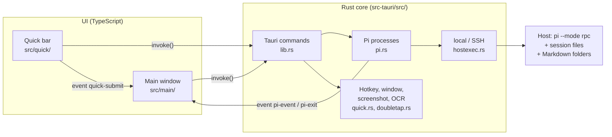

# Codemap

Map of the code: where things live, how the parts work together and where to start for a change.
Written for humans and AI assistants alike.

All code references have the form `` [`Symbol`](path/file) ``, e.g. [`PiManager::open`](../src-tauri/src/pi.rs), and are
checked in CI by [`check-codemap.mjs`](../scripts/check-codemap.mjs) (file exists, symbol is defined, every source file
is mentioned). `npm run check:codemap -- --print` lists all references with line numbers.

## Overview

PiBar is a [Tauri 2](https://v2.tauri.app) app: a **Rust core** (processes, SSH, files, hotkeys, screenshots) and a
**web UI** in TypeScript without a framework. Pi itself runs unchanged in RPC mode (`pi --mode rpc`, JSON lines over
stdin/stdout), locally or over SSH on a server.

## Directories

| Path | Contents |
| --- | --- |
| `index.html`, `quick.html` | The two windows: main window and quick bar |
| `src/main/` | Main window: sessions left, chat middle, files right, settings, reminders |
| `src/quick/` | Quick bar (hotkey window) |
| `src/shared/` | Shared: Rust interface, DOM helpers, translations, pure formatters (with tests) |
| `src-tauri/src/` | Rust core, one module per responsibility |
| `src-tauri/capabilities/` | Tauri permissions of the windows |
| `dev/` | Development helpers, e.g. a fake Pi without an API key |
| `scripts/` | Check scripts for CI |
| `docs/` | This codemap and architecture decisions ([`adr/`](adr/)) |

## Modules

### Rust core (`src-tauri/src/`)

| File | Responsibility | Key symbols |
| --- | --- | --- |
| [`main.rs`](../src-tauri/src/main.rs) | Program start | [`main`](../src-tauri/src/main.rs) |
| [`lib.rs`](../src-tauri/src/lib.rs) | All Tauri commands, tray, window events, startup | [`run`](../src-tauri/src/lib.rs), [`setup_tray`](../src-tauri/src/lib.rs), [`tray_menu`](../src-tauri/src/lib.rs), [`set_language`](../src-tauri/src/lib.rs), [`pi_close_all`](../src-tauri/src/lib.rs) |
| [`i18n.rs`](../src-tauri/src/i18n.rs) | Language of messages from Rust (errors, tray menu) | [`tr`](../src-tauri/src/i18n.rs), [`i18n::set`](../src-tauri/src/i18n.rs) |
| [`config.rs`](../src-tauri/src/config.rs) | Settings as JSON in the app config folder | [`AppConfig`](../src-tauri/src/config.rs), [`HostCfg`](../src-tauri/src/config.rs), [`UiPrefs`](../src-tauri/src/config.rs), [`Reminder`](../src-tauri/src/config.rs), [`load`](../src-tauri/src/config.rs), [`find_host`](../src-tauri/src/config.rs) |
| [`hostexec.rs`](../src-tauri/src/hostexec.rs) | Shell commands locally or over SSH; quoting | [`run_shell`](../src-tauri/src/hostexec.rs), [`spawn_pi`](../src-tauri/src/hostexec.rs), [`shell_command`](../src-tauri/src/hostexec.rs), [`sq`](../src-tauri/src/hostexec.rs), [`shell_path`](../src-tauri/src/hostexec.rs) |
| [`pi.rs`](../src-tauri/src/pi.rs) | One Pi process per open session, match RPC responses, forward events | [`PiManager`](../src-tauri/src/pi.rs), [`PiManager::open`](../src-tauri/src/pi.rs), [`PiManager::send`](../src-tauri/src/pi.rs), [`PiManager::close`](../src-tauri/src/pi.rs) |
| [`sessions.rs`](../src-tauri/src/sessions.rs) | Read the session list from `~/.pi/agent/sessions` | [`list`](../src-tauri/src/sessions.rs), [`SessionInfo`](../src-tauri/src/sessions.rs), [`first_text`](../src-tauri/src/sessions.rs) |
| [`models.rs`](../src-tauri/src/models.rs) | Model list via `pi --list-models` (no session needed) | [`models::list`](../src-tauri/src/models.rs), [`models::parse`](../src-tauri/src/models.rs) |
| [`files.rs`](../src-tauri/src/files.rs) | List, read, write and create Markdown files | [`files::list`](../src-tauri/src/files.rs), [`files::write`](../src-tauri/src/files.rs), [`FolderListing`](../src-tauri/src/files.rs) |
| [`quick.rs`](../src-tauri/src/quick.rs) | Quick bar: show/hide window, size, position, hotkey, screenshot, OCR | [`toggle_quick`](../src-tauri/src/quick.rs), [`hide_quick`](../src-tauri/src/quick.rs), [`resize_quick`](../src-tauri/src/quick.rs), [`register_hotkey`](../src-tauri/src/quick.rs), [`capture`](../src-tauri/src/quick.rs), [`ocr`](../src-tauri/src/quick.rs), [`mac_ocr_helper`](../src-tauri/src/quick.rs) |
| [`doubletap.rs`](../src-tauri/src/doubletap.rs) | Double tap on a modifier key (macOS, CGEventTap) | [`Detector`](../src-tauri/src/doubletap.rs), [`Detector::on_flags`](../src-tauri/src/doubletap.rs), [`TapKey`](../src-tauri/src/doubletap.rs), [`start`](../src-tauri/src/doubletap.rs) |

### Main window (`src/main/`)

| File | Responsibility | Key symbols |
| --- | --- | --- |
| [`index.ts`](../src/main/index.ts) | Entry: load settings and language, wire modules, dispatch Rust events | [`init`](../src/main/index.ts) |
| [`state.ts`](../src/main/state.ts) | Shared state (settings, sessions, active session) | [`state`](../src/main/state.ts), [`saveConfig`](../src/main/state.ts) |
| [`sessions.ts`](../src/main/sessions.ts) | Left column; open, activate and close sessions; "New session" | [`renderHosts`](../src/main/sessions.ts), [`openSession`](../src/main/sessions.ts), [`activate`](../src/main/sessions.ts), [`closeSession`](../src/main/sessions.ts), [`loadSessions`](../src/main/sessions.ts), [`newSessionDialog`](../src/main/sessions.ts) |
| [`reminders.ts`](../src/main/reminders.ts) | Reminders on sessions: dialog, list at the top left, notifications | [`reminderDialog`](../src/main/reminders.ts), [`presetTimes`](../src/main/reminders.ts), [`renderReminders`](../src/main/reminders.ts), [`openReminder`](../src/main/reminders.ts), [`startReminderClock`](../src/main/reminders.ts) |
| [`sessionTab.ts`](../src/main/sessionTab.ts) | One session: send Pi commands, render Pi events as chat | [`SessionTab`](../src/main/sessionTab.ts), [`SessionTab.start`](../src/main/sessionTab.ts), [`SessionTab.send`](../src/main/sessionTab.ts), [`SessionTab.onEvent`](../src/main/sessionTab.ts), [`SessionTab.loadHistory`](../src/main/sessionTab.ts), [`SessionTab.close`](../src/main/sessionTab.ts) |
| [`chatView.ts`](../src/main/chatView.ts) | Header, chat area, input, panels, shortcuts | [`renderToolbar`](../src/main/chatView.ts), [`wireChatView`](../src/main/chatView.ts), [`applyUiPrefs`](../src/main/chatView.ts), [`showEmpty`](../src/main/chatView.ts) |
| [`files.ts`](../src/main/files.ts) | Right column: session folders, Markdown editor | [`renderFiles`](../src/main/files.ts), [`saveEditor`](../src/main/files.ts), [`wireFiles`](../src/main/files.ts) |
| [`settings.ts`](../src/main/settings.ts) | Settings dialog: language, hotkeys, bar position, hosts | [`settingsDialog`](../src/main/settings.ts) |
| [`quickBridge.ts`](../src/main/quickBridge.ts) | Accept messages from the quick bar | [`handleQuick`](../src/main/quickBridge.ts), [`broadcastActive`](../src/main/quickBridge.ts) |
| [`styles.css`](../src/main/styles.css) | Main window look, light/dark via CSS variables | – |

### Quick bar (`src/quick/`) and shared code (`src/shared/`)

| File | Responsibility | Key symbols |
| --- | --- | --- |
| [`quick/index.ts`](../src/quick/index.ts) | Input, target, model/thinking, screenshot/OCR, send | [`submit`](../src/quick/index.ts), [`takeShot`](../src/quick/index.ts), [`runOcr`](../src/quick/index.ts), [`renderTargets`](../src/quick/index.ts), [`renderModels`](../src/quick/index.ts), [`fit`](../src/quick/index.ts) |
| [`shared/api.ts`](../src/shared/api.ts) | Types and `invoke` calls into the Rust core | [`api`](../src/shared/api.ts), [`QuickSubmit`](../src/shared/api.ts), [`AppConfig`](../src/shared/api.ts), [`Reminder`](../src/shared/api.ts) |
| [`shared/i18n.ts`](../src/shared/i18n.ts) | Translations: English text is the key, German dictionary; tested in `i18n.test.ts` | [`t`](../src/shared/i18n.ts), [`setLang`](../src/shared/i18n.ts), [`resolveLang`](../src/shared/i18n.ts), [`translateDom`](../src/shared/i18n.ts), [`LANGUAGES`](../src/shared/i18n.ts) |
| [`shared/dom.ts`](../src/shared/dom.ts) | Element builder, Markdown (marked + DOMPurify), toasts, modals | [`h`](../src/shared/dom.ts), [`renderMarkdown`](../src/shared/dom.ts), [`openModal`](../src/shared/dom.ts) |
| [`shared/format.ts`](../src/shared/format.ts) | Pure formatters, tested in `format.test.ts` | [`shortModel`](../src/shared/format.ts), [`cleanTitle`](../src/shared/format.ts), [`withScreenText`](../src/shared/format.ts), [`relTime`](../src/shared/format.ts) |

### Tools

| File | Purpose |
| --- | --- |
| [`dev/fake-pi.mjs`](../dev/fake-pi.mjs) | Fake Pi: simulates streaming, thinking, a tool call, `--list-models` |
| [`scripts/check-codemap.mjs`](../scripts/check-codemap.mjs) | Checks all code references in the docs |

## Flows

### Open a session and send a message

1. Click in the left column → [`openSession`](../src/main/sessions.ts) creates a [`SessionTab`](../src/main/sessionTab.ts).
2. [`SessionTab.start`](../src/main/sessionTab.ts) calls `pi_open` → [`PiManager::open`](../src-tauri/src/pi.rs) →
   [`spawn_pi`](../src-tauri/src/hostexec.rs) starts `pi --mode rpc [--session <file>]` locally or over `ssh`.
3. A reader thread in [`PiManager::open`](../src-tauri/src/pi.rs) matches `response` lines to the waiting call
   ([`PiManager::send`](../src-tauri/src/pi.rs)) and sends everything else as event `pi-event` to the main window.
4. [`init`](../src/main/index.ts) routes `pi-event` by process handle to [`SessionTab.onEvent`](../src/main/sessionTab.ts),
   which renders text, thinking and tool calls live.
5. On `agent_settled`, [`loadSessions`](../src/main/sessions.ts) reloads the list; new sessions get their file path as
   key.

### Close a session

× on a running session or ⌘W → [`closeSession`](../src/main/sessions.ts) → [`SessionTab.close`](../src/main/sessionTab.ts)
→ `pi_close` → [`PiManager::close`](../src-tauri/src/pi.rs). The session file stays and can be reopened. On reload the
main window calls [`pi_close_all`](../src-tauri/src/lib.rs) so no orphaned processes remain.

### Reminders

[`reminderDialog`](../src/main/reminders.ts) stores a [`Reminder`](../src/shared/api.ts) in `AppConfig.reminders`
(Rust side: [`Reminder`](../src-tauri/src/config.rs)). [`startReminderClock`](../src/main/reminders.ts) checks every
30 seconds, marks due ones, shows a system notification and re-renders the list
([`renderReminders`](../src/main/reminders.ts)). A click runs [`openReminder`](../src/main/reminders.ts): remove and
open the session.

### Quick bar

1. Hotkey: [`register_hotkey`](../src-tauri/src/quick.rs) (key combination) or [`Detector::on_flags`](../src-tauri/src/doubletap.rs)
   (double tap) → [`toggle_quick`](../src-tauri/src/quick.rs) positions and shows the window.
2. The bar loads targets ([`renderTargets`](../src/quick/index.ts)) and the target host's models
   ([`models::list`](../src-tauri/src/models.rs)).
3. While typing, [`fit`](../src/quick/index.ts) grows the text field and asks [`resize_quick`](../src-tauri/src/quick.rs)
   for a new window height only when it really changes (resizing on every keystroke made typing stutter on macOS).
4. Screenshot: [`takeShot`](../src/quick/index.ts) → [`capture`](../src-tauri/src/quick.rs) (`screencapture` on macOS);
   OCR: [`runOcr`](../src/quick/index.ts) → [`ocr`](../src-tauri/src/quick.rs) (Apple Vision via
   [`mac_ocr_helper`](../src-tauri/src/quick.rs), otherwise `tesseract`).
5. [`submit`](../src/quick/index.ts) emits `quick-submit`; [`handleQuick`](../src/main/quickBridge.ts) opens the target
   session, sets model/thinking and sends the message with image and OCR text ([`withScreenText`](../src/shared/format.ts)).

### Files on the right

[`renderFiles`](../src/main/files.ts) asks [`files::list`](../src-tauri/src/files.rs) for the working folder and the
session's extra folders (stored in `AppConfig.sessionFolders`). Reading and writing use `cat` through
[`run_shell`](../src-tauri/src/hostexec.rs), locally and over SSH; [`files::write`](../src-tauri/src/files.rs) writes to a
temp file first and then renames.

### Language

[`init`](../src/main/index.ts) calls [`setLang`](../src/shared/i18n.ts) with `ui.language` ("auto", "en", "de"),
[`translateDom`](../src/shared/i18n.ts) fills static HTML via `data-i18n*` attributes, and
[`set_language`](../src-tauri/src/lib.rs) tells Rust so errors and the tray menu ([`tray_menu`](../src-tauri/src/lib.rs))
match. Changing the language in the settings reloads both windows (event `language-changed`).

## UI ↔ Rust interface

Tauri commands are registered in [`run`](../src-tauri/src/lib.rs) and typed in [`api`](../src/shared/api.ts).
A new command needs both.

| Command | Purpose |
| --- | --- |
| `get_config`, `save_config` | Settings (the quick bar position is managed by Rust only) |
| `set_language` | Language for messages from Rust and the tray menu |
| `test_host`, `list_sessions`, `list_models` | Check a host, list sessions and models |
| `pi_open`, `pi_send`, `pi_close`, `pi_close_all` | Pi process per session |
| `list_files`, `read_file`, `write_file`, `create_file` | Markdown files |
| `quick_hide`, `quick_resize`, `quick_reset_pos`, `show_main` | Windows |
| `set_hotkey`, `set_double_tap`, `double_tap_status` | Hotkeys |
| `capture_screen`, `ocr_image` | Screenshot and text recognition |

| Event | From → to | Contents |
| --- | --- | --- |
| `pi-event` | Rust → main window | `{ handle, event }`, one Pi event (see [Pi docs](https://pi.dev/docs/latest/json)) |
| `pi-exit` | Rust → main window | `{ handle, stderr }` when a Pi process ends |
| `quick-show` | Rust → quick bar | The bar was opened |
| `quick-submit` | quick bar → main window | [`QuickSubmit`](../src/shared/api.ts) |
| `main-active`, `quick-request-active` | both directions | current session for the "Current" target |
| `language-changed` | main window → both | reload with the new language |

## Where do I change what?

| Goal | Starting point |
| --- | --- |
| Render a new Pi event | [`SessionTab.onEvent`](../src/main/sessionTab.ts) |
| New Pi RPC command in the UI | method in [`SessionTab`](../src/main/sessionTab.ts) via [`api`](../src/shared/api.ts) (`api.pi`) |
| New Rust command | function in [`lib.rs`](../src-tauri/src/lib.rs) + register in [`run`](../src-tauri/src/lib.rs) + [`api`](../src/shared/api.ts) |
| New setting | [`UiPrefs`](../src-tauri/src/config.rs) (with `serde(default)`) + [`AppConfig`](../src/shared/api.ts) + [`settingsDialog`](../src/main/settings.ts) |
| New or changed UI text | [`t`](../src/shared/i18n.ts) + German entry in the dictionary in the same file; Rust: [`tr`](../src-tauri/src/i18n.rs) |
| Another language | add a dictionary and an entry in [`LANGUAGES`](../src/shared/i18n.ts); Rust: [`i18n::set`](../src-tauri/src/i18n.rs) |
| Reminder presets | [`presetTimes`](../src/main/reminders.ts) |
| Another way to reach a host | [`shell_command`](../src-tauri/src/hostexec.rs) |
| Quick bar look | [`quick.html`](../quick.html), [`quick.css`](../src/quick/quick.css) |
| Main window look | [`index.html`](../index.html), [`styles.css`](../src/main/styles.css) |
| Linux/Windows support for screenshot/OCR/double tap | [`capture`](../src-tauri/src/quick.rs), [`ocr`](../src-tauri/src/quick.rs), [`start`](../src-tauri/src/doubletap.rs) |

## Known gaps

- No Content Security Policy header (`security.csp` is `null`); Markdown is sanitized with DOMPurify.
- Double tap, area screenshot and OCR with Apple Vision are macOS only.
- Reminders are only checked while PiBar is running (missed ones show as due on the next start).
